# AI Email Intelligence System

> **Status:** Phase 12 of 15 (PRD phase numbering). Phase 12 is this
> project's first departure from the pure modular monolith: an
> event-driven multi-agent layer (Kafka + an Orchestrator + 6 independent
> ML agents) now runs ALONGSIDE the still-fully-functional monolith, not
> instead of it — every pre-Phase-12 endpoint is unchanged. See
> `docs/architecture_multi_agent.md` for the full before/after and why
> this reverses (in a bounded, disclosed way) Phase 1's original
> "no Kafka yet" decision (`docs/architecture.md`).
> Phase 11 was this project's first frontend (`frontend/`, React +
> TypeScript) — every phase before that was backend-only.
> Full PRD: [`project document/PRD_AI_Email_Intelligence_System.md`](project%20document/PRD_AI_Email_Intelligence_System.md).

## Progress

| Phase | Module | Status |
|---|---|---|
| 1 | Problem Discovery & PRD | ✅ Done |
| 2 | Dataset Collection & EDA | ✅ Done |
| 3 | Spam Detection | ✅ Done — TF-IDF + calibrated SVM, 99.44% recall / 91.33% precision on held-out test. **Phase 8 found a real precision gap outside this evaluation domain** — see the Phase 8 row below. |
| 4 | Priority Classification | 🟡 Pipeline complete, **trained on synthetic data — not PRD-compliant**. See `docs/data_audit_priority.md`. |
| 5 | Email Categorization | 🟡 Pipeline complete (multi-label), **trained on synthetic data — not PRD-compliant**. See `docs/data_audit_categorization.md`. |
| 6 | Email Summarization | 🟡 Extractive (default) + abstractive (opt-in) both working, **evaluated on real but off-domain (news) data — not PRD-compliant**. See `docs/data_audit_summarization.md`. |
| 7A | Sentiment Analysis | 🟡 Zero-shot VADER lexicon scorer served, **no human-labelled email sentiment data exists at all — unvalidated on email domain**. See `docs/data_audit_sentiment.md`. |
| 7B | Intent Detection | 🟡 Pipeline complete (multi-label), **trained on synthetic data — not PRD-compliant**, and one class (Escalation) demonstrably unreliable, not just unvalidated. See `docs/data_audit_intent.md` / `docs/error_analysis_intent.md`. |
| 8 | Email Routing Engine | 🟡 Deterministic rule engine composing Spam/Category/Intent/Sentiment/Priority, served and audit-logged. **Not PRD-compliant** — no routing-outcome ground truth exists, and **inherits every upstream module's data-quality caveat**. Also **discovered a new, higher-priority finding**: Spam's recall-tuned threshold over-fires on ordinary business email outside its evaluation domain, quarantining most of Phase 8's own qualitative test sample before department routing runs at all. See `docs/model_cards/routing.md` / `docs/error_analysis_routing.md`. |
| 9 | Similar Email Retrieval / RAG Foundation | 🟡 Vector similarity search (ChromaDB, local) over PII-scrubbed embeddings, metadata-filterable by category/department/resolution-status, served and audit-logged. **New infrastructure**: this project's first canonical cross-module email entity, and its first wired-in PII anonymization. **Not PRD-compliant** — no retrieval-outcome ground truth exists. Two real bugs found and fixed during this phase's own testing: a TF-IDF vocabulary-pollution bug (all-zero similarity scores) and a Windows-specific import-order crash that segfaulted the *entire* test suite. **Default embedder changed to MiniLM in Phase 10** (see that row) — this row's TF-IDF-as-default framing is historical. See `docs/model_cards/embedding_retrieval.md` / `docs/error_analysis_retrieval.md`. |
| 10 | Auto-Reply Generation | 🟡 RAG + LLM draft-reply generation (Groq/`llama-3.3-70b-versatile`, a project-owner decision — not the PRD's own OpenAI/Anthropic suggestion), draft-only, human approve/edit/reject required (FR-49/FR-51 enforced architecturally — no send capability exists anywhere in the pipeline). **Not PRD-compliant** — no Human Acceptance Rate data exists (requires real agents/real traffic). A real, disclosed hallucination example (fabricated support hours on an ungrounded query) and a real performance bug (embedder/vector-store reconstructed on every call, found and fixed via this phase's own real-Postgres-and-real-Groq end-to-end testing) were both found this phase. See `docs/model_cards/auto_reply.md` / `docs/error_analysis_auto_reply.md`. |
| 11 | Manager Dashboard & Analytics | 🟡 React+TypeScript frontend (this project's first) over a new analytics query layer (`app/services/dashboard_service.py`) and a unified `feedback_events` table replacing write-only JSONL as the queryable home for corrections/confirmations across all 9 modules. Real-time updates (WebSocket + 30s polling fallback), SLA tracking, a ranked low-confidence Human Review Queue, CSV/PDF export, and honest evidence-status labeling on every model-derived number (never presents synthetic/off-domain metrics as production accuracy). **Not PRD-compliant** in several disclosed ways — email volume is a proxy (Phase 9's indexing still isn't auto-wired), WebSocket fan-out is single-process only, PDF/CSV export is on-demand not scheduled, and FR-61's retraining trigger is audit-only by explicit design (no retraining executes). Four real bugs (two timezone-handling bugs, a duplicate-feedback race, an unbounded query) were found and fixed during this phase's own adversarial review. See `docs/architecture_dashboard.md` / `docs/error_analysis_dashboard.md` / `PHASE_11_FINAL_REPORT.md`. |
| 12 | Multi-Agent Architecture | 🟡 New `POST /api/v1/email/process` → `GET /api/v1/workflows/{job_id}` pipeline: an Orchestrator Agent (`app/agents/orchestrator.py`) coordinates 6 independent Kafka-based Specialist Agents (Spam/Priority/Category/Sentiment/Intent/Summarization — one Kafka consumer group each), each wrapping its existing, unmodified `*Service` with FR-66 retry+exponential-backoff and a dead-letter topic. Idempotent under Kafka's at-least-once delivery (verified: a real duplicate-message replay against a live broker produces exactly one result, not two). Routing and Retrieval indexing stay in-process, reusing their pre-existing composition logic with the agents' already-computed results (no re-inference) — `RoutingService.route()` gained additive `precomputed_*` kwargs for this, verified not to change behavior for any existing caller (all 60 pre-Phase-12 routing tests pass unchanged). Auto-Reply is deliberately NOT auto-triggered (a real, billed external API call — see `docs/architecture_multi_agent.md` "Scope Boundary"). **Not PRD-compliant** in disclosed ways — no per-workflow timeout for a silently-missing agent (a workflow can stay `RUNNING` forever if an agent process never reports back at all), Orchestrator in-flight state is process-local (lost on restart), and Kafka-down/Postgres-down failure-injection tests aren't automated (the failure PATHS are implemented and documented, just not exercised by a test that kills a container mid-run). Verified end-to-end against a real disposable Postgres 16 container AND a real disposable `apache/kafka` (KRaft) container — not mocked: both the full 6-agent non-spam path and the 2-agent spam-gated path complete correctly with real trained model artifacts. See `docs/architecture_multi_agent.md` / `docs/kafka_architecture.md` / `PHASE_12_AUDIT_REPORT.md`. |
| 13–15 | CI/CD, Cloud, MLOps | ⬜ Not started |

**Read this before trusting any priority-classification, categorization,
summarization, sentiment, intent, or routing metric**: Phases 4, 5, and 7B's
models are trained on heuristically-labelled synthetic data (real Enron
email text, fabricated labels) — no human ever annotated them. Phase 6 is
different in kind: its reference summaries (BBC News Summary) are
genuinely human-written, not fabricated, but for *news articles*, not
email — a domain/format mismatch, not a ground-truth-fabrication problem.
Phase 7A is different again, and arguably weaker than either: the served
sentiment model (VADER) is a zero-shot lexicon scorer that was never
trained or fit to any dataset at all — there is no ground truth to even
measure it against, on any domain. Phase 8 is a composition layer, not a
trained model at all — it inherits every one of the above caveats from
its inputs, and additionally surfaced a **new** one: Spam's own real,
validated metrics (below) turn out to hold only within its original
evaluation domain, not on ordinary business email, which matters a great
deal once Spam gates a downstream decision rather than standing alone. All
failure modes are disclosed everywhere they matter —
`docs/data_audit_priority.md` / `docs/data_audit_categorization.md` /
`docs/data_audit_summarization.md` / `docs/data_audit_sentiment.md` /
`docs/data_audit_intent.md`, the respective model cards,
`docs/categorization_label_quality_report.md`,
`docs/error_analysis_sentiment.md` / `docs/error_analysis_intent.md` /
`docs/error_analysis_routing.md` / `docs/error_analysis_retrieval.md` /
`docs/error_analysis_auto_reply.md`,
`docs/ml_data_maturity_roadmap.md`, each dataset's own `run_metadata.json`
— because presenting any of these as real-world evidence would be
actively misleading. Spam's metrics are real and PRD-relevant *on their
own evaluation domain*; priority's, categorization's, summarization's,
sentiment's, intent's, routing's, retrieval's, and auto-reply's are
pipeline/model-validation only, not PRD-compliance evidence. Retrieval
(Phase 9) has no label-fabrication problem of its own (embedding fitting
is unsupervised) but has no relevance-outcome ground truth either — a
different, but equally real, evidentiary gap. Auto-Reply (Phase 10) is
the first module calling a third-party LLM this project does not train
or validate at all — its evidentiary gap is a different kind again: no
Human Acceptance Rate data exists (requires real agents/real traffic),
and one real, disclosed hallucination example (a confidently fabricated,
ungrounded detail) was directly observed during this phase's own
qualitative testing against the real Groq API — see
`docs/error_analysis_auto_reply.md`. The Manager Dashboard (Phase 11)
does not train or classify anything itself — it composes and displays
every module above, and its own evidentiary discipline is to never let
that composition imply more certainty than the underlying module has:
every dashboard number derived from a classifier carries the same
evidence badge (REAL_VALIDATED/SYNTHETIC/OFF_DOMAIN/UNVALIDATED/
PROVISIONAL) this table already establishes — see
`docs/model_evidence_policy.md`.

## Architecture (Completed Work)

Request flow, shared ML infrastructure, and data pipeline for everything
built so far (Phases 1–8). Color coding matters here as much as the boxes
do: **green is real, PRD-relevant evidence (Spam); amber is a working
pipeline trained on fabricated synthetic labels, not yet PRD-compliant
(Priority, Categorization, Intent); blue is evaluated against real but
off-domain data (Summarization — human-written summaries, wrong domain);
purple is a zero-shot model never trained or validated against any ground
truth at all (Sentiment); red is a composition layer that inherits every
color above at once, not a color of its own evidence (Routing)** — see the
"Progress" disclosure above before reading non-green metrics as anything
more than that.

```mermaid
flowchart TB
    Client(["Client"])

    subgraph API["FastAPI /api/v1 — modular monolith"]
        HealthEP["/health, /health/ready"]
        SpamEP["/spam/predict<br/>/spam/feedback"]
        PriorityEP["/priority/predict<br/>/priority/feedback"]
        CategoryEP["/categorization/predict<br/>/categorization/feedback"]
        SummaryEP["/summarization/predict<br/>/summarization/feedback"]
        SentimentEP["/sentiment/predict<br/>/sentiment/feedback"]
        IntentEP["/intent/predict<br/>/intent/feedback"]
        RoutingEP["/routing/predict<br/>/routing/feedback"]
    end

    subgraph Services["Service layer"]
        SpamSvc["SpamService"]
        PrioritySvc["PriorityService"]
        CategorySvc["CategoryService"]
        SummarySvc["SummarizationService"]
        SentimentSvc["SentimentService"]
        IntentSvc["IntentService"]
        RoutingSvc["RoutingService<br/>(rule engine, no artifact --<br/>composes the other five)"]
    end

    subgraph Inference["Inference — Protocol-backed backends"]
        SpamPred["SpamPredictor"]
        PriorityPred["PriorityPredictor"]
        CategoryPred["CategoryPredictor"]
        SentimentPred["VaderSentimentPredictor<br/>(zero-shot, no artifact)"]
        IntentPred["IntentPredictor"]
    end

    subgraph NLP["app/nlp/ — generation, not classification"]
        Extractive["ExtractiveSummarizer<br/>(TextRank, default)"]
        Abstractive["AbstractiveSummarizer<br/>(distilbart-cnn-6-6, opt-in,<br/>lazy-loaded)"]
        Grounding["summary_grounding<br/>(FR-26 entity preservation)"]
    end

    subgraph Artifacts["Trained artifacts — artifacts/"]
        SpamModel["spam_baseline.joblib<br/>TF-IDF + calibrated SVM"]
        PriorityModel["priority_baseline.joblib<br/>TF-IDF + features + LogReg"]
        CategoryModel["category_baseline.joblib<br/>TF-IDF + features + OvR SVM"]
        IntentModel["intent_baseline.joblib<br/>TF-IDF-only + OvR LogReg"]
    end

    subgraph Shared["Shared ML infrastructure"]
        Preprocess["EmailPreprocessor<br/>(task-specific configs)"]
        Features["Content / Metadata<br/>feature extractors"]
        Pipelines["MLPipeline / PriorityMLPipeline<br/>/ CategoryMLPipeline"]
        Training["Trainer + ArtifactManager"]
    end

    subgraph Data["Data pipeline — DVC-versioned"]
        Raw["Raw corpora:<br/>SpamAssassin, Enron,<br/>SMS Spam, Amazon Reviews"]
        Synthetic["Synthetic bootstrap:<br/>priority_synthetic_v1<br/>category_synthetic_v1<br/>intent_synthetic_v1"]
        RealOffDomain["Real, off-domain:<br/>summarization_bbc_v1<br/>(human summaries, news not email)"]
    end

    subgraph DB["PostgreSQL — audit logging"]
        SpamLog[("spam_prediction_logs")]
        PriorityLog[("priority_prediction_logs")]
        CategoryLog[("category_prediction_logs")]
        SummaryLog[("summary_logs<br/>(no source body stored)")]
        SentimentLog[("sentiment_prediction_logs")]
        IntentLog[("intent_prediction_logs<br/>(+ extracted entities)")]
        RoutingLog[("routing_decision_logs<br/>(rules fired + all signals)")]
    end

    Feedback[["*_feedback.jsonl<br/>(human corrections)"]]

    Client --> API
    SpamEP --> SpamSvc --> SpamPred --> SpamModel
    PriorityEP --> PrioritySvc --> PriorityPred --> PriorityModel
    CategoryEP --> CategorySvc --> CategoryPred --> CategoryModel
    SummaryEP --> SummarySvc --> Extractive
    SummarySvc -.-> Abstractive
    SummarySvc --> Grounding
    SentimentEP --> SentimentSvc --> SentimentPred
    IntentEP --> IntentSvc --> IntentPred --> IntentModel
    RoutingEP --> RoutingSvc
    RoutingSvc -.-> SpamSvc
    RoutingSvc -.-> CategorySvc
    RoutingSvc -.-> IntentSvc
    RoutingSvc -.-> SentimentSvc
    RoutingSvc -.-> PrioritySvc

    SpamSvc -.-> Preprocess
    PrioritySvc -.-> Preprocess
    CategorySvc -.-> Preprocess
    SummarySvc -.-> Preprocess
    SentimentSvc -.-> Preprocess
    IntentSvc -.-> Preprocess

    Training --> Pipelines --> Features
    Pipelines -.-> Preprocess
    Training --> Artifacts

    Raw --> Training
    Raw -. heuristic labels .-> Synthetic --> Training
    RealOffDomain -. ROUGE eval .-> Extractive
    RealOffDomain -. ROUGE eval .-> Abstractive

    SpamEP --> SpamLog
    PriorityEP --> PriorityLog
    CategoryEP --> CategoryLog
    SummaryEP --> SummaryLog
    SentimentEP --> SentimentLog
    IntentEP --> IntentLog
    RoutingEP --> RoutingLog
    SpamEP -.-> Feedback
    PriorityEP -.-> Feedback
    CategoryEP -.-> Feedback
    SummaryEP -.-> Feedback
    SentimentEP -.-> Feedback
    IntentEP -.-> Feedback
    RoutingEP -.-> Feedback

    classDef real fill:#1b4332,stroke:#40916c,color:#fff,stroke-width:2px
    classDef synthetic fill:#7f5539,stroke:#b08968,color:#fff,stroke-width:2px
    classDef offdomain fill:#1d3d5c,stroke:#4a90c2,color:#fff,stroke-width:2px
    classDef unvalidated fill:#3c1361,stroke:#8a4fd1,color:#fff,stroke-width:2px
    classDef composition fill:#7a1f1f,stroke:#c0392b,color:#fff,stroke-width:2px
    classDef infra fill:#1d3557,stroke:#457b9d,color:#fff

    class SpamEP,SpamSvc,SpamPred,SpamModel,SpamLog real
    class PriorityEP,PrioritySvc,PriorityPred,PriorityModel,PriorityLog,CategoryEP,CategorySvc,CategoryPred,CategoryModel,CategoryLog,IntentEP,IntentSvc,IntentPred,IntentModel,IntentLog,Synthetic synthetic
    class SummaryEP,SummarySvc,Extractive,Abstractive,Grounding,SummaryLog,RealOffDomain offdomain
    class SentimentEP,SentimentSvc,SentimentPred,SentimentLog unvalidated
    class RoutingEP,RoutingSvc,RoutingLog composition
    class Preprocess,Features,Pipelines,Training,Raw infra
```



Everything in this diagram is deployed as one FastAPI process (no
Kafka/microservices — see `docs/architecture.md` for why). Sentiment has no
`Artifacts`/`Training` connection at all (unlike every other module) — it's
a zero-shot lexicon scorer, not a trained model, which is why
`VaderSentimentPredictor` connects directly to its service with nothing
underneath it. Intent trains through the same `Pipelines`/`Training`
machinery as Priority/Category but deliberately does NOT connect through
`Features` (`ContentFeatures`/`MetadataFeatures`) — it's TF-IDF-only, see
`docs/architecture_intent.md`. Routing has no `Artifacts`/`Training`
connection either, for a different reason than Sentiment: it isn't a
model of any kind, trained or zero-shot — `RoutingSvc` connects (dashed,
composition, not inheritance) to all five other services' boxes instead,
the first and only such fan-out in this diagram, and its own DB row stores
which rules fired and every composed signal's value, not a prediction of
its own. Modules 9 and 10 (RAG foundation, Auto-Reply) are now built but
deliberately left off this diagram rather than redrawn as a rough
approximation this phase — see `docs/architecture_rag.md` /
`docs/architecture_auto_reply.md` for their own request-flow diagrams
instead. Modules 11–15 (Dashboard, CI/CD, Cloud, MLOps) genuinely aren't
built yet.

## What's Here

**Backend**: FastAPI (async), layered architecture (`api` / `services` /
`models` / `schemas`), async PostgreSQL via SQLAlchemy 2.0 + asyncpg,
Alembic migrations, structured JSON logging, request logging + global error
handling middleware, liveness/readiness health checks, eager ML-model
warm-up at startup, Dockerized local dev stack.

**ML modules**, each following the same pattern (data audit → feature
engineering → baseline model comparison → calibration → served API →
DB-backed audit logging → human-feedback endpoint):

| | Spam Detection | Priority Classification | Email Categorization | Email Summarization | Sentiment Analysis | Intent Detection | Email Routing |
|---|---|---|---|---|---|---|---|
| Model | TF-IDF + calibrated Linear SVM | TF-IDF + engineered features + Logistic Regression | TF-IDF + engineered features + One-vs-Rest calibrated SVM (multi-label) | TextRank (extractive, default) + off-the-shelf distilbart-cnn-6-6 (abstractive, opt-in) | VADER lexicon scorer (zero-shot, no training) | TF-IDF-only + One-vs-Rest Logistic Regression (multi-label) | Deterministic rule engine (no trained model — composes the other five) |
| Endpoint | `POST /api/v1/spam/predict` | `POST /api/v1/priority/predict` | `POST /api/v1/categorization/predict` | `POST /api/v1/summarization/predict` | `POST /api/v1/sentiment/predict` | `POST /api/v1/intent/predict` | `POST /api/v1/routing/predict` |
| Feedback | `POST /api/v1/spam/feedback` | `POST /api/v1/priority/feedback` | `POST /api/v1/categorization/feedback` | `POST /api/v1/summarization/feedback` | `POST /api/v1/sentiment/feedback` | `POST /api/v1/intent/feedback` | `POST /api/v1/routing/feedback` |
| Model card | [`docs/model_cards/spam_detection.md`](docs/model_cards/spam_detection.md) | [`docs/model_cards/priority_classification.md`](docs/model_cards/priority_classification.md) | [`docs/model_cards/email_categorization.md`](docs/model_cards/email_categorization.md) | [`docs/model_cards/email_summarization.md`](docs/model_cards/email_summarization.md) | [`docs/model_cards/sentiment.md`](docs/model_cards/sentiment.md) | [`docs/model_cards/intent.md`](docs/model_cards/intent.md) | [`docs/model_cards/routing.md`](docs/model_cards/routing.md) |
| Architecture | [`docs/architecture_spam_detection.md`](docs/architecture_spam_detection.md) | [`docs/architecture_priority_classification.md`](docs/architecture_priority_classification.md) | [`docs/architecture_email_categorization.md`](docs/architecture_email_categorization.md) | [`docs/architecture_email_summarization.md`](docs/architecture_email_summarization.md) | [`docs/architecture_sentiment.md`](docs/architecture_sentiment.md) | [`docs/architecture_intent.md`](docs/architecture_intent.md) | [`docs/architecture_routing.md`](docs/architecture_routing.md) |

The first three are swappable behind a `typing.Protocol` boundary
(`SpamClassifierBackend` / `PriorityClassifierBackend` /
`CategoryClassifierBackend`) — a future transformer model replaces the
concrete predictor class without an API change. Categorization is
multi-label (FR-22) — an email can carry more than one category, e.g. a
combined Legal + Billing tag for "please review the legal terms of the
invoice before payment" — see `docs/data_audit_categorization.md` §7 for
why this is a PRD requirement, not a design preference. Summarization is
a generation task, not classification (`app/nlp/`, no Protocol/trained
artifact) — extractive is the default because it measurably clears the
PRD's own latency SLA by ~3 orders of magnitude while abstractive does
not; see the model card for the measured numbers. Sentiment is the first
module with **no trained artifact whatsoever** — `VaderSentimentPredictor`
wraps a fixed lexicon (`vaderSentiment` package), not a fitted classifier;
a comparison classifier was built and evaluated (`train_sentiment_model.py`)
but deliberately not served — see the model card's "Model Selection" for
why training on VADER's own pseudo-labels can only ever imitate VADER, not
improve on it. Intent is multi-label (FR-34, confirmed directly by the
PRD's own "Complaint + Refund" example) and, unlike Priority/Category,
deliberately does **not** use the shared `ContentFeatures`/`MetadataFeatures`
extractors — TF-IDF only, avoiding a third module coupling into the
feature-schema fragility Phase 5 already caused once. Also extracts FR-35's
entities (order IDs, dates, amounts, names) via reused/extended NLP
utilities, independent of the classifier. One of its 9 classes
(Escalation) was found, via qualitative testing, to be specifically
unreliable — not just "unvalidated" — see the model card. Routing is the
first module that is **not** an independent intelligence capability — it's
a decision layer composing Spam/Category/Intent/Sentiment/Priority's
existing outputs through a versioned, code-defined rule engine
(`app/routing/rules.py`), deliberately not a sixth trained model (see the
model card's "Why Not a New ML Model"). It reuses Category's own 8-label
taxonomy as its department taxonomy (confirmed decision — see
`docs/routing_taxonomy.md`) and treats Intent's two demonstrated-unreliable
classes (Escalation, Refund) as evidence that can trigger human review but
can never independently select a department (`docs/routing_conflict_
resolution.md`). Its own qualitative evaluation surfaced a new,
higher-priority finding beyond the four inherited synthetic-data
caveats — Spam's recall-tuned threshold, validated on spam/ham corpora,
over-fires on ordinary business email and quarantined most of a 20-example
test set before department routing ran at all (`docs/error_analysis_
routing.md`). Similar Email Retrieval (Phase 9, `POST /api/v1/retrieval/*`)
composes a vector embedder (MiniLM as of Phase 10 — TF-IDF's demonstrated
paraphrase-blindness made it unsuitable once Auto-Reply started depending
on retrieval quality; see `docs/architecture_auto_reply.md` "Embedder
Decision") and ChromaDB, PII-scrubbed before embedding, filterable by
category/department/resolution-status. Auto-Reply Generation (Phase 10,
`POST /api/v1/reply/*`) is this project's first module calling a paid
external LLM (Groq/`llama-3.3-70b-versatile`, a confirmed project-owner
decision, not the PRD's own OpenAI/Anthropic suggestion) — it composes
Retrieval's top-3 similar *resolved* emails as RAG context, re-anonymizes
everything (current email AND retrieved context) before it reaches the
LLM, and produces a draft-only reply agents must explicitly approve, edit,
or reject (FR-49/FR-51 enforced architecturally — no send capability
exists anywhere in this codebase). A real, disclosed hallucination example
and a real, fixed performance bug (found via this phase's own testing
against a real Postgres container and the real Groq API, not just mocks)
are both documented in `docs/error_analysis_auto_reply.md`. **Manager
Dashboard & Analytics** (Phase 11, `frontend/` + `GET/POST
/api/v1/dashboard/*`) is this project's first frontend and the first
module that composes every other module's outputs into one place rather
than adding a new capability of its own — a new `feedback_events` table
unifies what was previously nine write-only, unqueryable JSONL feedback
logs, a ranked Human Review Queue surfaces low-confidence predictions
(the "confirm correct" action it introduces is what makes FR-62's
correction-rate formula computable at all, not just theoretically
correct), and every model-derived number on every page carries the same
evidence-status badge this README's own disclosures already establish
per module. Four real bugs (two datetime timezone-handling bugs, a
duplicate-feedback race condition, and an unbounded database query) were
found and fixed during this phase's own adversarial review — see
`docs/error_analysis_dashboard.md`.

**Data pipeline**: DVC-versioned datasets, a dataset registry that records
domain-match/trust-level per source (so a low-quality dataset can't
silently feed a model without a documented reason), checksum-verified
ingestion, task-aware preprocessing (`EmailPreprocessor` with per-task
configs), reusable content/metadata feature extractors
(`app/feature_engineering/`).

**Testing**: 487 backend tests (461 pre-Phase-12 + 26 new), 0 failed, 1
skipped (verified via a real full-suite run, 90s), + 1 opt-in slow
integration test (`RUN_SLOW_TESTS=1`) + 1 opt-in real-infrastructure
integration test (`RUN_KAFKA_INTEGRATION_TESTS=1`) across data
validation, model behavior, API contracts, security, and DB persistence —
`pytest`, `pytest-asyncio`, `aiosqlite` for DB tests without a live
Postgres. No paid API key is required for this suite — Auto-Reply's LLM
calls are always faked (`FakeLLMProvider`) or exercised against a
monkeypatched `groq.Groq` client using real exception types, never a real
network call; the only real-Groq-API code path is the manual, opt-in
`scripts/qualitative_eval_auto_reply.py`. Migrations are additionally
verified against a real, disposable PostgreSQL 16 container (not just
SQLite) whenever the schema changes — see
`docs/phase10_requirements_traceability.md`, `docs/analytics_data_model.md`,
and `docs/workflow_state.md` for the three most recent examples
(upgrade → downgrade → upgrade round-trips, plus real end-to-end
requests through the actual FastAPI app against that same container).
**Phase 12's real-infrastructure test**
(`backend/tests/test_phase12_kafka_integration.py::test_multi_agent_pipeline_end_to_end`,
**verified passing**, 34.47s) additionally provisions a real, disposable
`apache/kafka` (KRaft) container and runs the actual Orchestrator + all 6
specialist agent consumers against it — not mocked, not an in-process
fake queue. Writing it caught a real bug a shallower manual verification
script had missed entirely — see `docs/testing_strategy_phase12.md`.
**Frontend has no automated test suite yet** (no Jest/Vitest/Testing
Library) — Phase 11's frontend verification is limited to a clean
`npm run build` (strict TypeScript, zero errors) and manual `curl`-based
integration checks against a real running backend; disclosed as a real
gap, not silently skipped — see `PHASE_11_FINAL_REPORT.md` §8.

## Quickstart

```bash
# Local (no Docker)
cd backend
python -m venv .venv && .venv/bin/pip install -r requirements.txt -r requirements-dev.txt
cp .env.example .env
make run            # from project root
make test           # from project root

# Docker (API + Postgres + Kafka + Agents, Module 13)
cp backend/.env.example backend/.env
make docker-up
curl http://localhost:8000/api/v1/health
curl http://localhost:8000/api/v1/health/ready

# Try the new multi-agent pipeline (Module 13):
curl -X POST http://localhost:8000/api/v1/email/process \
  -H "Content-Type: application/json" \
  -d '{"subject": "Order issue", "body": "My order has not arrived.", "sender_email": "customer@example.com"}'
# -> {"job_id": "...", "status": "PENDING"} -- then poll:
curl http://localhost:8000/api/v1/workflows/<job_id>
# docker compose logs -f agents   # watch the Orchestrator + 6 agents process it (FR-67 structured logs)
```

API docs (auto-generated): `http://localhost:8000/docs`

To exercise the trained models, artifacts are already committed under
`artifacts/`. To retrain from scratch:

```bash
cd backend
PYTHONPATH=. python scripts/train_spam_model.py
PYTHONPATH=. python scripts/generate_synthetic_priority_dataset.py
PYTHONPATH=. python scripts/train_priority_model.py
PYTHONPATH=. python scripts/generate_synthetic_category_dataset.py
PYTHONPATH=. python scripts/train_category_model.py
PYTHONPATH=. python scripts/prepare_summarization_dataset.py
PYTHONPATH=. python scripts/evaluate_summarization_models.py
PYTHONPATH=. python scripts/generate_synthetic_sentiment_dataset.py
PYTHONPATH=. python scripts/train_sentiment_model.py
PYTHONPATH=. python scripts/generate_synthetic_intent_dataset.py
PYTHONPATH=. python scripts/train_intent_model.py
```

Summarization has no trained artifact to produce (extractive is pure
computation; abstractive downloads pre-trained, off-the-shelf weights on
first use) — `evaluate_summarization_models.py` runs the baseline-vs-
advanced comparison used in the model card, it doesn't train anything.
Sentiment likewise has no *served* trained artifact — `train_sentiment_model.py`
produces a comparison-only artifact (`artifacts/sentiment_comparison.joblib`)
that `SentimentService` never loads; the actually-served
`VaderSentimentPredictor` needs no training step at all, just
`pip install -r requirements.txt`. Routing has no trained artifact at all,
served or otherwise — it's a rule engine, not a model — but it does depend
transitively on Spam/Priority/Category/Intent's four artifacts above being
present; run `PYTHONPATH=. python scripts/qualitative_eval_routing.py` for
this phase's own 20-example qualitative check
(`docs/error_analysis_routing.md`).

**Troubleshooting**: if you already have Postgres installed natively on this
machine, it's probably also listening on port 5432 — see the comment above
`ports:` in `docker-compose.yml` for what that looks like and how to work
around it (map to a different host port, e.g. `5433:5432`, and set
`POSTGRES_PORT` in `backend/.env` to match).

## Project Structure

```
backend/
├── app/
│   ├── agents/                    # Module 13 — orchestrator.py, {spam,priority,category,sentiment,intent,summarization}_agent.py, base.py, runner.py (docker-compose's `agents` service entrypoint)
│   ├── messaging/                 # Module 13 — topics.py, schemas.py (AgentEvent/DeadLetterEnvelope), producer.py, consumer.py, retry.py
│   ├── workflows/                 # Module 13 — package marker only; workflow ORCHESTRATION lives in app/agents/orchestrator.py, workflow STATE models live in app/models/
│   ├── api/v1/endpoints/       # spam.py, priority.py, category.py, summarization.py, sentiment.py, intent.py, routing.py, retrieval.py, reply.py, dashboard.py (Module 11), workflows.py (Module 13 — POST /email/process, GET /workflows/{job_id}), health.py
│   ├── core/                    # config, logging — cross-cutting
│   ├── data_ingestion/          # corpus loaders + dataset_registry.py
│   ├── database/                # async session, repositories/ (incl. reply_draft_repository.py, workflow_execution_repository.py + agent_execution_repository.py (Module 13))
│   ├── evaluation/              # model_evaluator (classification) + summarization_evaluator (ROUGE)
│   ├── feature_engineering/     # content/metadata feature extractors, keyword lexicons, feature_schema
│   ├── inference/                # SpamPredictor/PriorityPredictor/CategoryPredictor/VaderSentimentPredictor/IntentPredictor/TfidfEmbedder/MiniLmEmbedder + Protocol backends; llm_provider.py (Protocol) + groq_provider.py + fake_llm_provider.py (Module 10)
│   ├── middleware/               # request logging, global error handling
│   ├── models/                   # SQLAlchemy ORM (*_prediction_log.py, summary_log.py, routing_decision_log.py, email_record.py, reply_draft.py, feedback_event.py + retraining_trigger.py (Module 11), workflow_execution.py + agent_execution.py (Module 13))
│   ├── nlp/                       # extractive/abstractive summarizers, grounding, thread, chunking, intent_entities, reply_prompt.py (Module 10) — generation/extraction, not classification
│   ├── pipeline/                  # PipelineConfig/Factory, MLPipeline, PriorityMLPipeline, CategoryMLPipeline, IntentMLPipeline
│   ├── preprocessing/             # EmailPreprocessor + task-specific configs
│   ├── retrieval/                 # Module 9 pure logic: identity.py, embedding_input.py, vector_store.py (+ InMemory fake), chroma_vector_store.py, resolution_status.py, tenant.py — no service dependency, independently testable
│   ├── routing/                   # Module 8 pure logic: rules.py, keyword_matcher.py, department_taxonomy.py, sender_domain.py, signal_reliability.py — no service dependency, independently testable
│   ├── schemas/                   # Pydantic request/response contracts (incl. auto_reply.py)
│   ├── security/                  # pii_anonymizer.py (Presidio-backed, lazy-loaded — wired in by Module 9, dormant since early in this project before that; reused by Module 10 for a new obligation — see docs/architecture_auto_reply.md "PII")
│   ├── services/                  # spam/priority/category/summarization/sentiment/intent/routing/retrieval_service, auto_reply_service.py (Module 10), feedback_service, dashboard_service.py + dashboard_broadcaster.py + dashboard_report_export.py + feedback_event_service.py (Module 11)
│   ├── training/                  # Trainer, ArtifactManager
│   └── main.py                    # app factory + startup warm-up (also: a documented sklearn/pandas import-order workaround — see docs/error_analysis_retrieval.md "Incident 2")
├── alembic/                        # DB migrations
├── scripts/                        # training + dataset generation scripts + DB-hang investigation scripts + qualitative_eval_sentiment.py / qualitative_eval_intent.py / qualitative_eval_routing.py / qualitative_eval_retrieval.py / qualitative_eval_auto_reply.py / benchmark_embedding_models.py
├── tests/
├── requirements.txt
└── requirements-dev.txt
artifacts/                          # trained model artifacts + versioned copies
data/                                # DVC-tracked datasets (raw/processed)
docker/Dockerfile
docker-compose.yml
frontend/                            # Module 11 — this project's first frontend (React + TypeScript + Vite)
├── src/
│   ├── api/                         # typed fetch wrappers per dashboard endpoint
│   ├── charts/                      # recharts wrappers (SimpleBarChart, SimpleLineChart)
│   ├── components/                  # EvidenceBadge, KpiCard, DateRangePicker, Layout, QueryState
│   ├── hooks/                       # useDashboardData (React Query), useDashboardFilters, useDashboardWebSocket
│   ├── pages/                       # Overview, EmailVolume, Categories, Sentiment, Priority, SLA, Agents, ModelQuality, ReviewQueue, Reports
│   ├── types/                       # TS interfaces mirroring backend/app/schemas/dashboard.py
│   └── websocket/                   # DashboardSocket (reconnect + 30s-poll-fallback client)
├── package.json
└── vite.config.ts
docs/
├── architecture.md                     # Phase 1 decisions + module doc index
├── architecture_spam_detection.md
├── architecture_priority_classification.md
├── architecture_email_categorization.md
├── architecture_email_summarization.md
├── architecture_sentiment.md
├── architecture_intent.md
├── architecture_routing.md
├── architecture_rag.md
├── architecture_auto_reply.md
├── data_audit_priority.md              # data strategy decision — read before priority's model card
├── data_audit_categorization.md        # data strategy decision — read before categorization's model card
├── data_audit_summarization.md         # data strategy decision — read before summarization's model card
├── data_audit_sentiment.md             # data strategy decision — read before sentiment's model card
├── data_audit_intent.md                # data strategy decision — read before intent's model card
├── annotation_guidelines_categorization.md
├── annotation_guidelines_sentiment.md
├── intent_taxonomy.md
├── intent_labeling_strategy.md
├── categorization_label_quality_report.md
├── error_analysis_sentiment.md
├── error_analysis_intent.md
├── error_analysis_routing.md
├── error_analysis_retrieval.md
├── error_analysis_auto_reply.md
├── security_auto_reply.md
├── rag_evaluation_auto_reply.md
├── routing_taxonomy.md
├── routing_signal_reliability.md
├── routing_conflict_resolution.md
├── routing_rules.md
├── email_identity_and_deduplication.md
├── resolution_status_design.md
├── vector_tenant_isolation.md
├── phase9_pii_embedding_strategy.md
├── embedding_input_strategy.md
├── embedding_model_decision.md
├── vector_store_decision.md
├── embedding_versioning.md
├── vector_index_consistency.md
├── ml_data_maturity_roadmap.md         # Track B — data-quality roadmap for all 5 ML-backed modules Routing composes
├── phase6_requirements_traceability.md
├── phase7a_requirements_traceability.md
├── phase7b_intent_requirements_traceability.md
├── phase8_requirements_traceability.md
├── phase9_requirements_traceability.md
├── phase10_requirements_traceability.md
├── requirements_traceability_phase11.md
├── architecture_dashboard.md
├── analytics_data_model.md
├── feedback_loop.md
├── active_learning.md
├── dashboard_security.md
├── dashboard_performance.md
├── error_analysis_dashboard.md
├── model_evidence_policy.md
├── architecture_multi_agent.md         # Module 13 — before/after, scope boundary, reuse ledger, disclosed limitations
├── kafka_architecture.md               # Module 13 — client/broker decisions, topics, partitioning, delivery semantics
├── agent_contracts.md                  # Module 13 — message contract, agent lifecycle, per-agent I/O
├── workflow_state.md                   # Module 13 — workflow_executions/agent_executions schema and semantics
├── retry_strategy.md                   # Module 13 — FR-66 retry/backoff/error-classification design
├── failure_handling.md                 # Module 13 — full failure-scenario matrix (Kafka down, DB down, etc.)
├── requirements_traceability_phase12.md
├── testing_strategy_phase12.md
├── technical_debt/
│   └── database_write_hang.md          # investigated, mitigated, NOT root-caused — read before assuming DB writes can't hang
├── model_cards/
└── git_workflow.md
project document/
└── PRD_AI_Email_Intelligence_System.md
```

## Docs

- [`docs/architecture.md`](docs/architecture.md) — Phase 1 decisions, what's deliberately deferred, module doc index.
- [`docs/data_audit_priority.md`](docs/data_audit_priority.md) — the Phase 4 data blocker, label taxonomy, and the synthetic-data strategy decision. Read this before trusting any priority metric.
- [`docs/data_audit_categorization.md`](docs/data_audit_categorization.md) — the Phase 5 data blocker (the PRD's named TREC dataset doesn't exist and wouldn't answer this taxonomy anyway; Enron's `X-Folder` header checked directly and rejected), label taxonomy, and the synthetic-data strategy decision. Read this before trusting any categorization metric.
- [`docs/annotation_guidelines_categorization.md`](docs/annotation_guidelines_categorization.md) — the full human-annotation process specification for the real (not-yet-started) categorization dataset.
- [`docs/architecture_spam_detection.md`](docs/architecture_spam_detection.md) / [`docs/model_cards/spam_detection.md`](docs/model_cards/spam_detection.md)
- [`docs/architecture_priority_classification.md`](docs/architecture_priority_classification.md) / [`docs/model_cards/priority_classification.md`](docs/model_cards/priority_classification.md)
- [`docs/architecture_email_categorization.md`](docs/architecture_email_categorization.md) / [`docs/model_cards/email_categorization.md`](docs/model_cards/email_categorization.md)
- [`docs/data_audit_summarization.md`](docs/data_audit_summarization.md) — the Phase 6 data situation: real, human-written reference summaries (BBC News Summary), but news, not email, and a summary-length format that doesn't match FR-25. Read this before trusting any summarization metric.
- [`docs/phase6_requirements_traceability.md`](docs/phase6_requirements_traceability.md) — FR-25 to FR-28 extracted directly from the PRD, mapped to design/implementation/test/evidence.
- [`docs/architecture_email_summarization.md`](docs/architecture_email_summarization.md) / [`docs/model_cards/email_summarization.md`](docs/model_cards/email_summarization.md)
- [`docs/data_audit_sentiment.md`](docs/data_audit_sentiment.md) — the Phase 7A data situation: **no human-labelled email sentiment data exists at all**; the served model (VADER) is a zero-shot lexicon scorer, never trained or fit to anything. Read this before trusting any sentiment metric.
- [`docs/annotation_guidelines_sentiment.md`](docs/annotation_guidelines_sentiment.md) — the full human-annotation process specification for the real (not-yet-started) sentiment dataset.
- [`docs/error_analysis_sentiment.md`](docs/error_analysis_sentiment.md) — qualitative failure-pattern analysis (36% match on 14 hand-written examples, not a real accuracy number) — politeness-masked negativity, indirect complaints, and sarcasm are the dominant, well-characterized failure modes.
- [`docs/phase7a_requirements_traceability.md`](docs/phase7a_requirements_traceability.md) — FR-29 to FR-32 extracted directly from the PRD, mapped to design/implementation/test/evidence, including which sub-requirements were explicitly deferred and why.
- [`docs/architecture_sentiment.md`](docs/architecture_sentiment.md) / [`docs/model_cards/sentiment.md`](docs/model_cards/sentiment.md)
- [`docs/data_audit_intent.md`](docs/data_audit_intent.md) — the Phase 7B data situation: **no human-labelled email intent data exists at all**, confirmed independently (matching the PRD's own "custom annotation required" statement). Read this before trusting any intent metric.
- [`docs/intent_taxonomy.md`](docs/intent_taxonomy.md) — the 9-class multi-label taxonomy (FR-33), with 2 naming collisions flagged against existing concepts (Priority's "escalation," this system's own feedback mechanism).
- [`docs/intent_labeling_strategy.md`](docs/intent_labeling_strategy.md) — the multi-label decision record (FR-34, determined directly from the PRD) plus the full (not-yet-started) annotation plan.
- [`docs/error_analysis_intent.md`](docs/error_analysis_intent.md) — qualitative failure-pattern analysis (21% match on 14 hand-written examples) — found and root-caused a specific reliability failure in the Escalation class (fires on unrelated text AND misses its own target case), stronger evidence than a generic synthetic-data disclaimer.
- [`docs/phase7b_intent_requirements_traceability.md`](docs/phase7b_intent_requirements_traceability.md) — FR-33 to FR-36 extracted directly from the PRD, mapped to design/implementation/test/evidence.
- [`docs/architecture_intent.md`](docs/architecture_intent.md) / [`docs/model_cards/intent.md`](docs/model_cards/intent.md)
- [`docs/routing_signal_reliability.md`](docs/routing_signal_reliability.md) — per-signal evidence table for everything Routing composes (Spam/Category/Priority/Sentiment/Intent/Keywords/Sender-domain). Read this before trusting any routing decision.
- [`docs/routing_taxonomy.md`](docs/routing_taxonomy.md) — the confirmed decision to reuse Category's 8-label taxonomy as departments, and the disclosed consequence (PRD §3.2's "Operations"/"Management" have no supporting signal).
- [`docs/routing_conflict_resolution.md`](docs/routing_conflict_resolution.md) — precedence hierarchy, tie-breaking, and the unreliable-Intent (Escalation/Refund) policy in full.
- [`docs/routing_rules.md`](docs/routing_rules.md) — the complete rule catalogue (`routing_rules_v1`) and keyword engine, plus why routing rules are versioned code, not a DB-backed CRUD API.
- [`docs/error_analysis_routing.md`](docs/error_analysis_routing.md) — qualitative evaluation (20 hand-written examples) that surfaced a real, higher-priority finding: Spam's recall-tuned threshold over-fires on ordinary business email outside its evaluation domain, quarantining 13/20 examples before department routing ran.
- [`docs/phase8_requirements_traceability.md`](docs/phase8_requirements_traceability.md) — FR-37 to FR-42 extracted directly from the PRD, mapped to design/implementation/test/evidence.
- [`docs/architecture_routing.md`](docs/architecture_routing.md) / [`docs/model_cards/routing.md`](docs/model_cards/routing.md)
- [`docs/ml_data_maturity_roadmap.md`](docs/ml_data_maturity_roadmap.md) — Track B: the data-quality replacement roadmap for Priority/Categorization/Intent/Sentiment **and** the newly-discovered Spam domain-transfer gap, kept explicitly separate from Phase 8's own (complete) Track A engineering implementation.
- [`docs/email_identity_and_deduplication.md`](docs/email_identity_and_deduplication.md) — why content-hash (not Message-ID, which doesn't exist anywhere in this system) is the canonical email identity, and exactly what idempotent re-indexing does and doesn't handle (forwarded emails are NOT deduplicated).
- [`docs/resolution_status_design.md`](docs/resolution_status_design.md) — the invented, minimal 4-state resolution taxonomy (the PRD names the filter but never defines its values), and why it's never auto-transitioned.
- [`docs/vector_tenant_isolation.md`](docs/vector_tenant_isolation.md) — the confirmed decision (Option C): structural tenant-metadata isolation now, real authentication still deferred since Phase 1.
- [`docs/phase9_pii_embedding_strategy.md`](docs/phase9_pii_embedding_strategy.md) — why only the text going INTO the vector store is PII-anonymized (Presidio), while Postgres storage stays raw like every other module — and why that split, not "anonymize everything," is the right line.
- [`docs/embedding_input_strategy.md`](docs/embedding_input_strategy.md) — what exactly gets embedded (subject + body, cleaned, nothing else) and why no field-weighting scheme was built.
- [`docs/embedding_model_decision.md`](docs/embedding_model_decision.md) — the measured TF-IDF vs. all-MiniLM-L6-v2 comparison (MiniLM correctly separated 6/6 paraphrase pairs, TF-IDF only 3/6, with literal zero-overlap scores on the misses) — written when TF-IDF still shipped as Phase 9's own default; **Phase 10 switched the default to MiniLM** once Auto-Reply started depending on retrieval quality — see `docs/architecture_auto_reply.md` "Embedder Decision" for why, and why the timing was safe (no real data to migrate yet).
- [`docs/vector_store_decision.md`](docs/vector_store_decision.md) — ChromaDB vs. Pinecone/FAISS/Qdrant, the `VectorStore` Protocol abstraction, and why cosine similarity was explicitly configured rather than left at Chroma's default.
- [`docs/embedding_versioning.md`](docs/embedding_versioning.md) / [`docs/vector_index_consistency.md`](docs/vector_index_consistency.md) — how embedding-model upgrades and Postgres/vector-store consistency (including soft-delete) are handled without Kafka or an outbox pattern.
- [`docs/error_analysis_retrieval.md`](docs/error_analysis_retrieval.md) — two real engineering incidents found and fixed during this phase's own testing (a TF-IDF vocabulary-pollution bug producing all-zero similarity scores, and a Windows-specific import-order crash that segfaulted the entire test suite), plus the qualitative retrieval gold-set results.
- [`docs/phase9_requirements_traceability.md`](docs/phase9_requirements_traceability.md) — FR-43 to FR-47 extracted directly from the PRD, mapped to design/implementation/test/evidence.
- [`docs/architecture_rag.md`](docs/architecture_rag.md) / [`docs/model_cards/embedding_retrieval.md`](docs/model_cards/embedding_retrieval.md)
- [`docs/security_auto_reply.md`](docs/security_auto_reply.md) — PII re-anonymization before every LLM call (a new obligation beyond Phase 9's own scrubbing), prompt-injection defenses (delimited data sections + a heuristic pre-filter), API-key handling, and a static, AST-based verification that no email-sending capability exists anywhere in the pipeline.
- [`docs/rag_evaluation_auto_reply.md`](docs/rag_evaluation_auto_reply.md) — separates retrieval-quality evidence (inherited from Phase 9) from generation-quality evidence (new this phase, a small manually-read sample against the real Groq API), and states plainly what is NOT YET MEASURED (Human Acceptance Rate).
- [`docs/error_analysis_auto_reply.md`](docs/error_analysis_auto_reply.md) — a real performance bug found and fixed via this phase's own real-Postgres-and-real-Groq end-to-end testing (the default embedder/vector store were being reconstructed on every call), plus a real, disclosed hallucination example from the qualitative script's real API output.
- [`docs/phase10_requirements_traceability.md`](docs/phase10_requirements_traceability.md) — FR-48 to FR-52 extracted directly from the PRD, mapped to design/implementation/test/evidence, including real measured latency numbers.
- [`docs/architecture_auto_reply.md`](docs/architecture_auto_reply.md) / [`docs/model_cards/auto_reply.md`](docs/model_cards/auto_reply.md)
- [`PHASE_11_AUDIT_REPORT.md`](PHASE_11_AUDIT_REPORT.md) — the Stage 1 repository audit: what data actually exists, the JSONL-only-feedback gap (no user ID anywhere), and why `email_id` was deliberately NOT added to six prediction tables.
- [`docs/requirements_traceability_phase11.md`](docs/requirements_traceability_phase11.md) — FR-53 to FR-62 mapped to design/implementation/test/evidence, verified post-implementation.
- [`docs/architecture_dashboard.md`](docs/architecture_dashboard.md) — the full Stage 3–5 design: data model, review-queue ranking, correction-rate formula, WebSocket architecture, SLA definition.
- [`docs/analytics_data_model.md`](docs/analytics_data_model.md) — the short reference version of the new/changed tables and why no `dashboard_metrics`-style duplicate tables were built.
- [`docs/feedback_loop.md`](docs/feedback_loop.md) — the unified `feedback_events` mechanism, the new `CONFIRM` action, and why it's what makes FR-62's correction-rate formula computable at all.
- [`docs/active_learning.md`](docs/active_learning.md) — the Review Queue's ranking heuristic, and what this phase explicitly is NOT (no automated retraining, no feedback-to-training-data pipeline).
- [`docs/dashboard_security.md`](docs/dashboard_security.md) — current (unauthenticated) vs. future identity model, CORS, and the deliberate subject-only (never body) PII exposure in the Review Queue.
- [`docs/dashboard_performance.md`](docs/dashboard_performance.md) — real measured latency plus every disclosed scaling limit (Python-side aggregation, single-process WebSocket, no scheduled reports).
- [`docs/error_analysis_dashboard.md`](docs/error_analysis_dashboard.md) — four real bugs found and fixed during this phase's own adversarial review: two datetime timezone bugs, a duplicate-feedback race condition, and an unbounded database query.
- [`docs/model_evidence_policy.md`](docs/model_evidence_policy.md) — the five evidence badges, where they're enforced, and why correction rate is never presented as an accuracy proxy on its own.
- [`PHASE_11_FINAL_REPORT.md`](PHASE_11_FINAL_REPORT.md) — the Stage 19 phase-gate report: what's FULL/PARTIAL, test counts, and honestly-stated production-readiness level.
- [`docs/technical_debt/database_write_hang.md`](docs/technical_debt/database_write_hang.md) — a real, reproduced DB-write hang under the live Windows request path; seven isolation experiments ruled out asyncpg, bare asyncio, SQLAlchemy alone, and `BaseHTTPMiddleware` as the sole cause; root cause still not found. Mitigated (bounded, not eliminated), not solved — read before assuming a DB timeout in this codebase can't still hang.
- [`docs/git_workflow.md`](docs/git_workflow.md) — branching, commit conventions.
- [`PHASE_12_AUDIT_REPORT.md`](PHASE_12_AUDIT_REPORT.md) — the pre-implementation audit: the headline finding that no "process this email" entrypoint existed anywhere before Phase 12, the confirmed scope decisions (client library, broker, which modules become agents), and the full design for FR-63–67.
- [`docs/architecture_multi_agent.md`](docs/architecture_multi_agent.md) — the as-built architecture: before/after diagrams, component responsibilities, the reuse ledger (what changed vs. what didn't in existing code), and disclosed limitations.
- [`docs/kafka_architecture.md`](docs/kafka_architecture.md) — client/broker decisions and why, the full topic list, partitioning/consumer-group/delivery-semantics design, and why Routing/Retrieval/Auto-Reply are deliberately NOT Kafka agents.
- [`docs/agent_contracts.md`](docs/agent_contracts.md) — the `AgentEvent` message contract, the common agent lifecycle every specialist agent shares, and the per-agent input/output table.
- [`docs/workflow_state.md`](docs/workflow_state.md) — why Postgres (not Kafka) is the durable system of record, the `workflow_executions`/`agent_executions` schema, and status semantics.
- [`docs/retry_strategy.md`](docs/retry_strategy.md) — FR-66's in-process retry design, exponential backoff, and transient-vs-permanent error classification.
- [`docs/failure_handling.md`](docs/failure_handling.md) — the full failure-scenario matrix (Kafka down, Postgres down, agent crash, malformed event, consumer restart, etc.) and the disclosed no-per-workflow-timeout limitation.
- [`docs/requirements_traceability_phase12.md`](docs/requirements_traceability_phase12.md) — FR-63 to FR-67 mapped to design/implementation/test/evidence, plus the full Definition-of-Done checklist.
- [`docs/testing_strategy_phase12.md`](docs/testing_strategy_phase12.md) — unit vs. real-infrastructure integration tests, and a real finding (the Spam model's known over-firing issue, first documented in Phase 8, resurfacing through the new pipeline) discovered while writing these tests.
- [`PHASE_12_COMPLETION_REPORT.md`](PHASE_12_COMPLETION_REPORT.md) — the phase-gate report: what's real vs. disclosed-limited, real bugs found and fixed (including a real `logging` stdlib collision found via the live integration test), and production-readiness level.

## Known Gaps (tracked, not hidden)

- **Priority classification and email categorization both need real annotated data** to be PRD-compliant — the single biggest open item, blocking further ML modules from compounding the same problem. Priority: 10,000+ emails, 3 annotators, Cohen's Kappa ≥ 0.70 (PRD §8.2). Categorization: no PRD-specified minimum: see `docs/annotation_guidelines_categorization.md` §4 for the engineering-recommended target (8,000+ emails, per-category Kappa ≥ 0.70) and full process spec. See `docs/data_audit_priority.md` §4 / `docs/data_audit_categorization.md` §4.
- **Email summarization has no real email-domain evaluation data anywhere in reach of this project** — unlike priority/categorization, this isn't "annotation hasn't started," it's "no such dataset appears to publicly exist" for enterprise email specifically (see `docs/data_audit_summarization.md` §7).
- **A DB-write hang under the live request path on Windows is reproduced and investigated, but NOT root-caused** — seven isolated experiments each individually passed; only the full real app reproduces the hang. Two timeout layers mitigate (bound the failure), neither is proven to eliminate it. See `docs/technical_debt/database_write_hang.md` for the full investigation and recommended next steps.
- **Extending shared feature-engineering infrastructure (`ContentFeatures`/`MetadataFeatures`) is backward-compatible for code but not for an already-trained model's fitted scaler** — Phase 5 adding 7 fields to `ContentFeatures` broke priority's committed artifact until it was retrained. Phase 6 added a `FeatureSchema` fingerprint mechanism (`app/feature_engineering/feature_schema.py`) so the *next* such change fails loudly and explicitly at prediction time instead of crashing cryptically or (worse) silently producing wrong output — see `docs/architecture_email_categorization.md` "Incident" and `tests/test_feature_schema.py`.
- FR-18 (Critical → notification) and FR-17's sender-history signal have no supporting infrastructure yet — both require modules that don't exist (notification service, persistent sender history) rather than being an oversight in this module.
- FR-23 (per-organization configurable category taxonomy) is unimplemented — no multi-tenant org concept exists anywhere in this codebase yet, same class of gap as Phase 1's deferred real auth.
- Categorization's per-category probability calibration is unverified (unlike spam/priority, which both have a measured calibration check) — see `docs/model_cards/email_categorization.md` "Calibration."
- Summarization's abstractive path measurably exceeds the PRD's own latency SLA on this CPU-only environment (~4.5s avg vs. a 2s P50 target) — usable only where a caller explicitly opts in; extractive is the service default specifically because it clears the SLA by orders of magnitude. See `docs/model_cards/email_summarization.md` "Performance."
- `requirements.txt` was, and remains, incomplete relative to several phases' actual runtime dependencies (scikit-learn, pandas, spacy, presidio, and others were never declared) — Phase 6 added its own new dependencies (`torch`, `transformers`, `networkx`, `rouge-score`) correctly but did not retroactively fix the pre-existing gap; see that file's own header comment.
- **No human-labelled email sentiment data exists anywhere, and the served sentiment model was never trained or fit to any dataset at all** — weaker evidentiary footing than priority/categorization (real email text, fabricated labels) or summarization (real labels, wrong domain). See `docs/data_audit_sentiment.md`.
- **Sentiment cannot detect sarcasm, indirect negativity, or politeness-masked complaints** — a structural limitation of lexicon-based scoring, directly evidenced in `docs/error_analysis_sentiment.md` (5/14 on a qualitative, non-statistical set), not merely theorized.
- FR-30 (emotion detection), FR-31 (sentiment feeding into priority score), and FR-32 (sender-level sentiment trend tracking) are explicitly deferred, not implemented — see `docs/data_audit_sentiment.md` §1 for why each was scoped out rather than attempted.
- `app/models/__init__.py` was found, during Phase 7A's DB-metadata audit, to be missing `CategoryPredictionLog` and `SummaryLog` (added in Phases 5/6, never registered for Alembic's `Base.metadata` discovery) — fixed alongside adding `SentimentPredictionLog`, verified against a real disposable Postgres 16 container, regression-tested (`tests/test_model_metadata_registration.py`). Had not caused a visible failure yet because every migration in this repo is hand-written, not autogenerated.
- **Intent Detection's "Escalation" class is empirically unreliable, not just unvalidated** — fires on unrelated text (a contract request, an order-status question, a scheduling email) AND fails to fire on the one example written specifically to trigger it. Root-caused to Escalation's extreme rarity (4.41% of the synthetic training set) combined with `class_weight="balanced"` amplifying a thin, noisy signal. See `docs/error_analysis_intent.md` and `docs/model_cards/intent.md`.
- **Intent's "Refund" class was never correctly predicted on the test set at all (F1 = 0.0)** — the weakest single-class result of any classifier shipped in this project so far. See `docs/model_cards/intent.md`.
- Intent detection is trained on `intent_synthetic_v1` (Enron + keyword-heuristic multi-label bootstrap, same pattern as priority/category) — **not PRD-compliant**, and several of FR-33's classes (Order/Refund/Cancel) are consumer-transactional concepts largely absent from Enron's internal B2B correspondence, a domain mismatch disclosed as worse than priority/category's. See `docs/data_audit_intent.md`.
- FR-36 (intent feeding routing) is now implemented, with restrictions — Escalation/Refund can trigger human review when corroborated but never independently select a department; auto-reply consumption still doesn't exist (a later phase). See `docs/routing_conflict_resolution.md`.
- **Routing (Phase 8) inherits every one of the above caveats** — it cannot be more trustworthy than its least trustworthy input signal. See `docs/routing_signal_reliability.md`.
- **Newly discovered during Phase 8: Spam's recall-tuned 0.06 threshold, validated on spam/ham corpora (SpamAssassin/SMS Spam/Amazon), over-fires on ordinary business email** — a sales inquiry, a billing request, an HR complaint, and an IT access request all scored above threshold in a 20-example qualitative check, quarantining 13/20 examples before department routing ran at all. Not fixed this phase (recalibrating Phase 3's threshold needs its own out-of-domain validation data, which doesn't exist yet). See `docs/error_analysis_routing.md` and `docs/ml_data_maturity_roadmap.md`.
- FR-39's literal `/routing/rules` CRUD API and FR-42's agent-level round-robin/skills-based routing are both unimplemented — the former because building unauthenticated write access to live routing logic would be worse than not having it (no auth/multi-tenancy exists yet), the latter because no `users`/`agents` table exists anywhere in this codebase. See `docs/routing_taxonomy.md` and `docs/routing_rules.md`.
- FR-41's "adjust rule weights" from feedback is deliberately not implemented — feedback is captured but never auto-applied, the same stance every other module's feedback path takes. See `docs/routing_conflict_resolution.md`.
- No routing-outcome ground truth exists — "Routing Accuracy > 92%" (PRD §14.1) is not measured and cannot be, honestly, until a real annotated routing-outcome dataset exists. See `docs/model_cards/routing.md` "Evaluation."
- **No retrieval-outcome ground truth exists** — same class of gap as routing, but retrieval's embedding *fitting* itself is unsupervised (no labels used at all), a genuinely different, better evidentiary position than Priority/Category/Intent's fabricated-label problem. See `docs/model_cards/embedding_retrieval.md`.
- **Two real bugs were found and fixed during Phase 9's own testing**: a TF-IDF vocabulary-pollution bug (the fitted embedder's vocabulary was dominated by HTML fragments and mailing-list noise; every similarity score came back exactly 0.0 before the fix), and a Windows-specific import-order crash between `transformers`/`scikit-learn`/`pandas`/`pyarrow` that segfaulted the *entire* test suite, not just Phase 9's own tests. Both fixed and verified; see `docs/error_analysis_retrieval.md`.
- **TF-IDF was Phase 9's own default embedder despite a demonstrated quality gap** — a measured comparison found it structurally blind to paraphrase (3/6 vs. MiniLM's 6/6 on hand-written pairs, with literal zero-overlap scores on the misses). **Phase 10 switched the structural default to MiniLM** once Auto-Reply started depending on retrieval quality — see `docs/architecture_auto_reply.md` "Embedder Decision" and `docs/embedding_model_decision.md`.
- Retrieval indexing is not auto-triggered after Spam/Category/Routing predictions — FR-43's "every processed email" is a capability this phase built, not an automatic behavior wired into the existing pipeline yet. See `docs/architecture_rag.md` "Not Auto-Wired to Upstream Endpoints." **This now also affects Phase 10**: Auto-Reply's RAG context can only ever be as populated as whatever has been manually indexed.
- No real tenant authentication exists for retrieval (same gap as everywhere else in this codebase since Phase 1) — cross-tenant isolation is structural (the code cannot search across organizations even by omission) but not access-controlled. See `docs/vector_tenant_isolation.md`.
- Resolution status (FR-46) is an invented, minimal 4-state taxonomy — the PRD names the filter requirement but never defines its possible values anywhere. See `docs/resolution_status_design.md`. **This now also directly limits Phase 10**: nothing in this codebase auto-transitions status, so real `RESOLVED` context for Auto-Reply is likely rare in practice today — see `docs/architecture_auto_reply.md` "Resolved-Email Data Reality."
- **No Human Acceptance Rate data exists for Auto-Reply** (PRD's own primary metric, >60% target) — requires real agents using the approve/edit/reject endpoints against real traffic, which does not exist yet. See `docs/model_cards/auto_reply.md`.
- **A real, disclosed hallucination example was found during Phase 10's own qualitative testing against the real Groq API**: given a query with zero grounding, the model produced a confident, specific-sounding but entirely fabricated detail (invented support hours). FR-49's human-review requirement is structural specifically because of this class of risk — no generation-policy gate in this phase catches "the model invented a plausible-sounding but ungrounded fact." See `docs/error_analysis_auto_reply.md`.
- **A real performance bug was found and fixed during Phase 10's own end-to-end testing**: `RetrievalService`'s default embedder/vector store were being reconstructed on every call (invisible to any unit test, since those always inject an explicit embedder) — a ~1.4s/request cost once MiniLM became the default, found only by running the real app against a real Postgres container and the real Groq API. Fixed by memoizing both; re-verified directly (before: ~1.4-5.8s/request; after: ~17-19ms warm). See `docs/error_analysis_auto_reply.md`.
- **Update**: Ollama's local-fallback (named in the PRD's own ADR-002) is now implemented — `OllamaProvider` + `FallbackLLMProvider`, triggered specifically on a Groq 429/503. Verified against a real, locally-running Ollama server; one disclosed finding from that verification: a cold Ollama model load took ~11s, which by itself can exceed FR-50's 10s budget if the fallback fires against an unloaded model — no Ollama pre-warming was built. See `docs/architecture_auto_reply.md` "Ollama Fallback."
- **Update**: a hallucination-mitigation confidence gate, Human Acceptance Rate tracking (`edit_distance` column + structured review-action logs), and an auto-mark-resolved-on-approve mechanism (closing Phase 9's resolution-status gap gradually) were all added after the initial Phase 10 report — see `docs/architecture_auto_reply.md` for all three.
- No real tenant authentication exists for Auto-Reply either (same standing gap since Phase 1) — `reviewer_id`/`organization_id` on approve/edit/reject are caller-supplied, not verified.
- **Feedback was JSONL-only, write-only, and had no user-ID field anywhere before Phase 11** — every `*/feedback` endpoint recorded original/corrected values and a timestamp but never who submitted it. See `PHASE_11_AUDIT_REPORT.md` finding F2. **Update (Phase 11)**: a new `feedback_events` Postgres table now dual-writes alongside every existing JSONL write, adding `reviewer_id` (still caller-supplied and unauthenticated) and making aggregate correction-rate queries possible for the first time — see `docs/feedback_loop.md`.
- **Six of eight prediction/log tables had no `organization_id` before Phase 11**, unlike `emails`/`reply_drafts` — inconsistent tenant scoping across the codebase. **Update (Phase 11)**: backfilled via migration on all 7 tables that lacked it (model-level default, zero changes to existing `*/predict` endpoints) — see `docs/analytics_data_model.md`.
- **Phase 11's Manager Dashboard inherits every evidentiary caveat above by composition, same as Routing did in Phase 8** — it trains and validates nothing itself; its own discipline is never presenting a synthetic/off-domain/unvalidated number as if it were validated accuracy. See `docs/model_evidence_policy.md`.
- **Email volume on the dashboard is a proxy** (sourced from `spam_prediction_logs`, not `emails`) precisely because Phase 9's indexing still isn't auto-wired to the six prediction endpoints — the same gap flagged above, now also limiting Phase 11's own "total email volume" KPI. See `docs/architecture_dashboard.md` §"Email volume."
- **No Human Acceptance Rate or correction-rate data exists for real usage yet** — Phase 11's Model Quality page and Overview KPIs correctly display "No real observations yet" rather than fabricating a 0% rate, but the underlying gap (no real agents, no real traffic) is unchanged from Phase 10. See `docs/feedback_loop.md`.
- **Phase 11's frontend has no automated test coverage** (no Jest/Vitest/Testing Library) and was never visually verified in an actual browser this phase (no browser tooling was available in the environment it was built in) — disclosed explicitly, not silently claimed as done. See `PHASE_11_FINAL_REPORT.md` §7–8.
- **Four real bugs were found and fixed during Phase 11's own adversarial review**: two datetime timezone-handling bugs (SLA calculation crashing on SQLite's naive-datetime round-trip; custom date-range filters silently depending on the Postgres server's session timezone rather than being explicitly normalized), a duplicate-feedback race condition (double-clicking "Confirm" on the Review Queue could insert two rows for one review), and an unbounded database query (the Review Queue scanned entire tables with no row cap). All four fixed and verified with dedicated tests. See `docs/error_analysis_dashboard.md`.
- **Phase 12 has no per-workflow timeout for a silently-missing agent** — if an expected agent's consumer process never reports back at all (as opposed to reporting a failure, which finalizes normally), the workflow stays `RUNNING` indefinitely. A real fix needs a scheduled sweep job this codebase has no scheduler for yet — same class of gap as Phase 11's "no scheduled report generation." See `docs/architecture_multi_agent.md` "Known, Disclosed Limitations."
- **The Orchestrator's in-flight workflow tracking is process-local, lost on restart** — same disclosed single-process limitation Phase 11's WebSocket broadcaster already carries; `workflow_executions`/`agent_executions` in Postgres are unaffected, only workflows mid-flight at the moment of restart are. See `docs/architecture_multi_agent.md`.
- **A real bug (two call sites) was found via Phase 12's own live-Kafka integration test, not a code review**: `Orchestrator`'s structured logging passed `module` as a Python `logging` `extra` key — a reserved stdlib `LogRecord` attribute — which raised `KeyError: "Attempt to overwrite 'module' in LogRecord"` on every single agent dispatch once real logging was active. A separate, earlier manual verification script never caught this at all, because it never called `setup_logging()`, so its log calls were filtered out below the default WARNING level before the collision was ever reached — real evidence that a shallow smoke-test can look completely clean while missing a defect a properly-configured test catches immediately. Fixed (renamed to `agent_name`) and re-verified against a live broker. See `docs/testing_strategy_phase12.md`.
- **Kafka-down/Postgres-down failure-injection tests are not automated for Phase 12** — the failure paths are implemented and documented (`docs/failure_handling.md`), but no test actually kills a container mid-run to exercise them, consistent with Phase 6's own finding that even a carefully engineered failure-injection test can fail to reproduce the real failure mode it targets (`docs/technical_debt/database_write_hang.md`).
- **Auto-Reply generation is deliberately NOT auto-triggered by the new pipeline** — it makes a real, billed Groq API call; wiring it into every processed email without being asked would silently increase real spend and external-service dependency well beyond what FR-63–67 requires. It remains reachable only through its existing, explicit `/reply/generate` endpoint. See `docs/architecture_multi_agent.md` "Scope Boundary."
- **A second real bug was found via a dedicated post-delivery code review, not the integration test**: `Orchestrator._start_workflow` had no idempotency guard, unlike every specialist agent. A redelivered `email.processing.requested` (FR-65's normal at-least-once behavior) could silently reset an already-`COMPLETED` workflow back to `RUNNING` with no way to ever re-finalize it. Fixed by checking the workflow's DB status before dispatching, mirroring the pattern every specialist agent already used; 2 new regression tests reproduce the exact failure sequence, and the fix was re-verified against a live broker afterward. See `docs/failure_handling.md` "Duplicate Event."

## Next (Phase 13)

Per the PRD's own module numbering, **Modules 14–15** are next: FR-68–72
— Docker (already done since Phase 1), Kubernetes horizontal scaling, a
CI/CD pipeline (lint/unit/integration/model-sanity gates before deploy),
MLflow model version tracking, and alerting (accuracy drift, latency
spikes, queue depth, error rate). These are the natural next step now
that Phase 12 has given this project its first genuinely async,
multi-process architecture (API + Kafka + a separate `agents` container)
worth building CI/CD and alerting around — a monolith with no moving
parts had comparatively little for a pipeline to gate. Given every phase
including this one has run its own tests and migrations by hand, CI/CD
(FR-70) is likely the single highest-value item in that group. This is
an explicit scoping decision for the next phase's own prompt to make, not
one this README should quietly resolve.

Still blocked, same as every phase since 4, on the annotation effort
tracked in `docs/ml_data_maturity_roadmap.md` before more ML modules
compound the same data problem; Routing's Spam domain-transfer gap
(`docs/error_analysis_routing.md`) remains the smaller, more tractable,
still-unfixed near-term item. Phase 11's own remaining work (manual
browser verification of the dashboard, frontend test coverage, real
authentication) is tracked in `PHASE_11_FINAL_REPORT.md` §15, not
repeated here. See each module's architecture doc for its own "Known
Gaps" section for smaller, unblocked follow-ups.
