# AI Email Intelligence System

> **Status:** Phase 6 of 15 (PRD phase numbering). Modular monolith, no
> Kafka/K8s/microservices yet — deliberately, see `docs/architecture.md`.
> Full PRD: [`project document/PRD_AI_Email_Intelligence_System.md`](project%20document/PRD_AI_Email_Intelligence_System.md).

## Progress

| Phase | Module | Status |
|---|---|---|
| 1 | Problem Discovery & PRD | ✅ Done |
| 2 | Dataset Collection & EDA | ✅ Done |
| 3 | Spam Detection | ✅ Done — TF-IDF + calibrated SVM, 99.44% recall / 91.33% precision on held-out test |
| 4 | Priority Classification | 🟡 Pipeline complete, **trained on synthetic data — not PRD-compliant**. See `docs/data_audit_priority.md`. |
| 5 | Email Categorization | 🟡 Pipeline complete (multi-label), **trained on synthetic data — not PRD-compliant**. See `docs/data_audit_categorization.md`. |
| 6 | Email Summarization | 🟡 Extractive (default) + abstractive (opt-in) both working, **evaluated on real but off-domain (news) data — not PRD-compliant**. See `docs/data_audit_summarization.md`. |
| 7–15 | Sentiment/Intent, Routing, RAG, Auto-Reply, Dashboard, CI/CD, Cloud, MLOps | ⬜ Not started |

**Read this before trusting any priority-classification, categorization, or
summarization metric**: Phases 4 and 5's models are trained on
heuristically-labelled synthetic data (real Enron email text, fabricated
labels) — no human ever annotated them. Phase 6 is different in kind: its
reference summaries (BBC News Summary) are genuinely human-written, not
fabricated, but for *news articles*, not email — a domain/format mismatch,
not a ground-truth-fabrication problem. Both failure modes are disclosed
everywhere they matter — `docs/data_audit_priority.md` /
`docs/data_audit_categorization.md` / `docs/data_audit_summarization.md`,
the respective model cards, `docs/categorization_label_quality_report.md`,
each dataset's own `run_metadata.json` — because presenting either kind of
metric as real-world evidence would be actively misleading. Spam's metrics
are real and PRD-relevant; priority's, categorization's, and
summarization's are pipeline/model-validation only, not PRD-compliance
evidence.

## Architecture (Completed Work)

Request flow, shared ML infrastructure, and data pipeline for everything
built so far (Phases 1–6). Color coding matters here as much as the boxes
do: **green is real, PRD-relevant evidence (Spam); amber is a working
pipeline trained on fabricated synthetic labels, not yet PRD-compliant
(Priority, Categorization); blue is evaluated against real but
off-domain data (Summarization — human-written summaries, wrong domain)**
— see the "Progress" disclosure above before reading non-green metrics as
anything more than that.

```mermaid
flowchart TB
    Client(["Client"])

    subgraph API["FastAPI /api/v1 — modular monolith"]
        HealthEP["/health, /health/ready"]
        SpamEP["/spam/predict<br/>/spam/feedback"]
        PriorityEP["/priority/predict<br/>/priority/feedback"]
        CategoryEP["/categorization/predict<br/>/categorization/feedback"]
        SummaryEP["/summarization/predict<br/>/summarization/feedback"]
    end

    subgraph Services["Service layer"]
        SpamSvc["SpamService"]
        PrioritySvc["PriorityService"]
        CategorySvc["CategoryService"]
        SummarySvc["SummarizationService"]
    end

    subgraph Inference["Inference — Protocol-backed backends"]
        SpamPred["SpamPredictor"]
        PriorityPred["PriorityPredictor"]
        CategoryPred["CategoryPredictor"]
    end

    subgraph NLP["app/nlp/ — generation, not classification"]
        Extractive["ExtractiveSummarizer<br/>(TextRank, default)"]
        Abstractive["AbstractiveSummarizer<br/>(distilbart-cnn-6-6, opt-in,<br/>lazy-loaded)"]
        Grounding["summary_grounding<br/>(FR-26 entity preservation)"]
    end

    subgraph Artifacts["Trained artifacts — artifacts/"]
        SpamModel["spam_baseline.joblib<br/>TF-IDF + calibrated SVM"]
        PriorityModel["priority_baseline.joblib<br/>TF-IDF + features + LogReg"]
        CategoryModel["category_baseline.joblib<br/>TF-IDF + features + OvR SVM"]
    end

    subgraph Shared["Shared ML infrastructure"]
        Preprocess["EmailPreprocessor<br/>(task-specific configs)"]
        Features["Content / Metadata<br/>feature extractors"]
        Pipelines["MLPipeline / PriorityMLPipeline<br/>/ CategoryMLPipeline"]
        Training["Trainer + ArtifactManager"]
    end

    subgraph Data["Data pipeline — DVC-versioned"]
        Raw["Raw corpora:<br/>SpamAssassin, Enron,<br/>SMS Spam, Amazon Reviews"]
        Synthetic["Synthetic bootstrap:<br/>priority_synthetic_v1<br/>category_synthetic_v1"]
        RealOffDomain["Real, off-domain:<br/>summarization_bbc_v1<br/>(human summaries, news not email)"]
    end

    subgraph DB["PostgreSQL — audit logging"]
        SpamLog[("spam_prediction_logs")]
        PriorityLog[("priority_prediction_logs")]
        CategoryLog[("category_prediction_logs")]
        SummaryLog[("summary_logs<br/>(no source body stored)")]
    end

    Feedback[["*_feedback.jsonl<br/>(human corrections)"]]

    Client --> API
    SpamEP --> SpamSvc --> SpamPred --> SpamModel
    PriorityEP --> PrioritySvc --> PriorityPred --> PriorityModel
    CategoryEP --> CategorySvc --> CategoryPred --> CategoryModel
    SummaryEP --> SummarySvc --> Extractive
    SummarySvc -.-> Abstractive
    SummarySvc --> Grounding

    SpamSvc -.-> Preprocess
    PrioritySvc -.-> Preprocess
    CategorySvc -.-> Preprocess
    SummarySvc -.-> Preprocess

    Training --> Pipelines --> Features
    Pipelines -.-> Preprocess
    Training --> Artifacts

    Raw --> Training
    Raw -. heuristic labels .-> Synthetic --> Training
    RealOffDomain -. ROUGE eval .-> Extractive
    RealOffDomain -. ROUGE eval .-> Abstractive

    SpamEP --> SpamLog
    PriorityEP --> PriorityLog
    CategoryEP --> CategoryLog
    SummaryEP --> SummaryLog
    SpamEP -.-> Feedback
    PriorityEP -.-> Feedback
    CategoryEP -.-> Feedback
    SummaryEP -.-> Feedback

    classDef real fill:#1b4332,stroke:#40916c,color:#fff,stroke-width:2px
    classDef synthetic fill:#7f5539,stroke:#b08968,color:#fff,stroke-width:2px
    classDef offdomain fill:#1d3d5c,stroke:#4a90c2,color:#fff,stroke-width:2px
    classDef infra fill:#1d3557,stroke:#457b9d,color:#fff

    class SpamEP,SpamSvc,SpamPred,SpamModel,SpamLog real
    class PriorityEP,PrioritySvc,PriorityPred,PriorityModel,PriorityLog,CategoryEP,CategorySvc,CategoryPred,CategoryModel,CategoryLog,Synthetic synthetic
    class SummaryEP,SummarySvc,Extractive,Abstractive,Grounding,SummaryLog,RealOffDomain offdomain
    class Preprocess,Features,Pipelines,Training,Raw infra
```



Everything in this diagram is deployed as one FastAPI process (no
Kafka/microservices — see `docs/architecture.md` for why). Modules 7–15
(Sentiment, Intent, Routing, RAG, Auto-Reply, Dashboard, ...) aren't built
yet and are deliberately left off this diagram rather than sketched as a
guess.

## What's Here

**Backend**: FastAPI (async), layered architecture (`api` / `services` /
`models` / `schemas`), async PostgreSQL via SQLAlchemy 2.0 + asyncpg,
Alembic migrations, structured JSON logging, request logging + global error
handling middleware, liveness/readiness health checks, eager ML-model
warm-up at startup, Dockerized local dev stack.

**ML modules**, each following the same pattern (data audit → feature
engineering → baseline model comparison → calibration → served API →
DB-backed audit logging → human-feedback endpoint):

| | Spam Detection | Priority Classification | Email Categorization | Email Summarization |
|---|---|---|---|---|
| Model | TF-IDF + calibrated Linear SVM | TF-IDF + engineered features + Logistic Regression | TF-IDF + engineered features + One-vs-Rest calibrated SVM (multi-label) | TextRank (extractive, default) + off-the-shelf distilbart-cnn-6-6 (abstractive, opt-in) |
| Endpoint | `POST /api/v1/spam/predict` | `POST /api/v1/priority/predict` | `POST /api/v1/categorization/predict` | `POST /api/v1/summarization/predict` |
| Feedback | `POST /api/v1/spam/feedback` | `POST /api/v1/priority/feedback` | `POST /api/v1/categorization/feedback` | `POST /api/v1/summarization/feedback` |
| Model card | [`docs/model_cards/spam_detection.md`](docs/model_cards/spam_detection.md) | [`docs/model_cards/priority_classification.md`](docs/model_cards/priority_classification.md) | [`docs/model_cards/email_categorization.md`](docs/model_cards/email_categorization.md) | [`docs/model_cards/email_summarization.md`](docs/model_cards/email_summarization.md) |
| Architecture | [`docs/architecture_spam_detection.md`](docs/architecture_spam_detection.md) | [`docs/architecture_priority_classification.md`](docs/architecture_priority_classification.md) | [`docs/architecture_email_categorization.md`](docs/architecture_email_categorization.md) | [`docs/architecture_email_summarization.md`](docs/architecture_email_summarization.md) |

The first three are swappable behind a `typing.Protocol` boundary
(`SpamClassifierBackend` / `PriorityClassifierBackend` /
`CategoryClassifierBackend`) — a future transformer model replaces the
concrete predictor class without an API change. Categorization is
multi-label (FR-22) — an email can carry more than one category, e.g. a
combined Legal + Billing tag for "please review the legal terms of the
invoice before payment" — see `docs/data_audit_categorization.md` §7 for
why this is a PRD requirement, not a design preference. Summarization is
a generation task, not classification (`app/nlp/`, no Protocol/trained
artifact) — extractive is the default because it measurably clears the
PRD's own latency SLA by ~3 orders of magnitude while abstractive does
not; see the model card for the measured numbers.

**Data pipeline**: DVC-versioned datasets, a dataset registry that records
domain-match/trust-level per source (so a low-quality dataset can't
silently feed a model without a documented reason), checksum-verified
ingestion, task-aware preprocessing (`EmailPreprocessor` with per-task
configs), reusable content/metadata feature extractors
(`app/feature_engineering/`).

**Testing**: 151 tests (+1 opt-in slow integration test, `RUN_SLOW_TESTS=1`)
across data validation, model behavior, API contracts, security, and DB
persistence — `pytest`, `pytest-asyncio`, `aiosqlite` for DB tests without
a live Postgres.

## Quickstart

```bash
# Local (no Docker)
cd backend
python -m venv .venv && .venv/bin/pip install -r requirements.txt -r requirements-dev.txt
cp .env.example .env
make run            # from project root
make test           # from project root

# Docker (API + Postgres)
cp backend/.env.example backend/.env
make docker-up
curl http://localhost:8000/api/v1/health
curl http://localhost:8000/api/v1/health/ready
```

API docs (auto-generated): `http://localhost:8000/docs`

To exercise the trained models, artifacts are already committed under
`artifacts/`. To retrain from scratch:

```bash
cd backend
PYTHONPATH=. python scripts/train_spam_model.py
PYTHONPATH=. python scripts/generate_synthetic_priority_dataset.py
PYTHONPATH=. python scripts/train_priority_model.py
PYTHONPATH=. python scripts/generate_synthetic_category_dataset.py
PYTHONPATH=. python scripts/train_category_model.py
PYTHONPATH=. python scripts/prepare_summarization_dataset.py
PYTHONPATH=. python scripts/evaluate_summarization_models.py
```

Summarization has no trained artifact to produce (extractive is pure
computation; abstractive downloads pre-trained, off-the-shelf weights on
first use) — `evaluate_summarization_models.py` runs the baseline-vs-
advanced comparison used in the model card, it doesn't train anything.

**Troubleshooting**: if you already have Postgres installed natively on this
machine, it's probably also listening on port 5432 — see the comment above
`ports:` in `docker-compose.yml` for what that looks like and how to work
around it (map to a different host port, e.g. `5433:5432`, and set
`POSTGRES_PORT` in `backend/.env` to match).

## Project Structure

```
backend/
├── app/
│   ├── api/v1/endpoints/       # spam.py, priority.py, category.py, summarization.py, health.py
│   ├── core/                    # config, logging — cross-cutting
│   ├── data_ingestion/          # corpus loaders + dataset_registry.py
│   ├── database/                # async session, repositories/
│   ├── evaluation/              # model_evaluator (classification) + summarization_evaluator (ROUGE)
│   ├── feature_engineering/     # content/metadata feature extractors, keyword lexicons, feature_schema
│   ├── inference/                # SpamPredictor/PriorityPredictor/CategoryPredictor + Protocol backends
│   ├── middleware/               # request logging, global error handling
│   ├── models/                   # SQLAlchemy ORM (*_prediction_log.py, summary_log.py)
│   ├── nlp/                       # extractive/abstractive summarizers, grounding, thread, chunking — generation, not classification
│   ├── pipeline/                  # PipelineConfig/Factory, MLPipeline, PriorityMLPipeline, CategoryMLPipeline
│   ├── preprocessing/             # EmailPreprocessor + task-specific configs
│   ├── schemas/                   # Pydantic request/response contracts
│   ├── services/                  # spam/priority/category/summarization_service, feedback_service
│   ├── training/                  # Trainer, ArtifactManager
│   └── main.py                    # app factory + startup warm-up
├── alembic/                        # DB migrations
├── scripts/                        # training + dataset generation scripts + DB-hang investigation scripts
├── tests/
├── requirements.txt
└── requirements-dev.txt
artifacts/                          # trained model artifacts + versioned copies
data/                                # DVC-tracked datasets (raw/processed)
docker/Dockerfile
docker-compose.yml
docs/
├── architecture.md                     # Phase 1 decisions + module doc index
├── architecture_spam_detection.md
├── architecture_priority_classification.md
├── architecture_email_categorization.md
├── architecture_email_summarization.md
├── data_audit_priority.md              # data strategy decision — read before priority's model card
├── data_audit_categorization.md        # data strategy decision — read before categorization's model card
├── data_audit_summarization.md         # data strategy decision — read before summarization's model card
├── annotation_guidelines_categorization.md
├── categorization_label_quality_report.md
├── phase6_requirements_traceability.md
├── technical_debt/
│   └── database_write_hang.md          # investigated, mitigated, NOT root-caused — read before assuming DB writes can't hang
├── model_cards/
└── git_workflow.md
project document/
└── PRD_AI_Email_Intelligence_System.md
```

## Docs

- [`docs/architecture.md`](docs/architecture.md) — Phase 1 decisions, what's deliberately deferred, module doc index.
- [`docs/data_audit_priority.md`](docs/data_audit_priority.md) — the Phase 4 data blocker, label taxonomy, and the synthetic-data strategy decision. Read this before trusting any priority metric.
- [`docs/data_audit_categorization.md`](docs/data_audit_categorization.md) — the Phase 5 data blocker (the PRD's named TREC dataset doesn't exist and wouldn't answer this taxonomy anyway; Enron's `X-Folder` header checked directly and rejected), label taxonomy, and the synthetic-data strategy decision. Read this before trusting any categorization metric.
- [`docs/annotation_guidelines_categorization.md`](docs/annotation_guidelines_categorization.md) — the full human-annotation process specification for the real (not-yet-started) categorization dataset.
- [`docs/architecture_spam_detection.md`](docs/architecture_spam_detection.md) / [`docs/model_cards/spam_detection.md`](docs/model_cards/spam_detection.md)
- [`docs/architecture_priority_classification.md`](docs/architecture_priority_classification.md) / [`docs/model_cards/priority_classification.md`](docs/model_cards/priority_classification.md)
- [`docs/architecture_email_categorization.md`](docs/architecture_email_categorization.md) / [`docs/model_cards/email_categorization.md`](docs/model_cards/email_categorization.md)
- [`docs/data_audit_summarization.md`](docs/data_audit_summarization.md) — the Phase 6 data situation: real, human-written reference summaries (BBC News Summary), but news, not email, and a summary-length format that doesn't match FR-25. Read this before trusting any summarization metric.
- [`docs/phase6_requirements_traceability.md`](docs/phase6_requirements_traceability.md) — FR-25 to FR-28 extracted directly from the PRD, mapped to design/implementation/test/evidence.
- [`docs/architecture_email_summarization.md`](docs/architecture_email_summarization.md) / [`docs/model_cards/email_summarization.md`](docs/model_cards/email_summarization.md)
- [`docs/technical_debt/database_write_hang.md`](docs/technical_debt/database_write_hang.md) — a real, reproduced DB-write hang under the live Windows request path; seven isolation experiments ruled out asyncpg, bare asyncio, SQLAlchemy alone, and `BaseHTTPMiddleware` as the sole cause; root cause still not found. Mitigated (bounded, not eliminated), not solved — read before assuming a DB timeout in this codebase can't still hang.
- [`docs/git_workflow.md`](docs/git_workflow.md) — branching, commit conventions.

## Known Gaps (tracked, not hidden)

- **Priority classification and email categorization both need real annotated data** to be PRD-compliant — the single biggest open item, blocking further ML modules from compounding the same problem. Priority: 10,000+ emails, 3 annotators, Cohen's Kappa ≥ 0.70 (PRD §8.2). Categorization: no PRD-specified minimum: see `docs/annotation_guidelines_categorization.md` §4 for the engineering-recommended target (8,000+ emails, per-category Kappa ≥ 0.70) and full process spec. See `docs/data_audit_priority.md` §4 / `docs/data_audit_categorization.md` §4.
- **Email summarization has no real email-domain evaluation data anywhere in reach of this project** — unlike priority/categorization, this isn't "annotation hasn't started," it's "no such dataset appears to publicly exist" for enterprise email specifically (see `docs/data_audit_summarization.md` §7).
- **A DB-write hang under the live request path on Windows is reproduced and investigated, but NOT root-caused** — seven isolated experiments each individually passed; only the full real app reproduces the hang. Two timeout layers mitigate (bound the failure), neither is proven to eliminate it. See `docs/technical_debt/database_write_hang.md` for the full investigation and recommended next steps.
- **Extending shared feature-engineering infrastructure (`ContentFeatures`/`MetadataFeatures`) is backward-compatible for code but not for an already-trained model's fitted scaler** — Phase 5 adding 7 fields to `ContentFeatures` broke priority's committed artifact until it was retrained. Phase 6 added a `FeatureSchema` fingerprint mechanism (`app/feature_engineering/feature_schema.py`) so the *next* such change fails loudly and explicitly at prediction time instead of crashing cryptically or (worse) silently producing wrong output — see `docs/architecture_email_categorization.md` "Incident" and `tests/test_feature_schema.py`.
- FR-18 (Critical → notification) and FR-17's sender-history signal have no supporting infrastructure yet — both require modules that don't exist (notification service, persistent sender history) rather than being an oversight in this module.
- FR-23 (per-organization configurable category taxonomy) is unimplemented — no multi-tenant org concept exists anywhere in this codebase yet, same class of gap as Phase 1's deferred real auth.
- Categorization's per-category probability calibration is unverified (unlike spam/priority, which both have a measured calibration check) — see `docs/model_cards/email_categorization.md` "Calibration."
- Summarization's abstractive path measurably exceeds the PRD's own latency SLA on this CPU-only environment (~4.5s avg vs. a 2s P50 target) — usable only where a caller explicitly opts in; extractive is the service default specifically because it clears the SLA by orders of magnitude. See `docs/model_cards/email_summarization.md` "Performance."
- `requirements.txt` was, and remains, incomplete relative to several phases' actual runtime dependencies (scikit-learn, pandas, spacy, presidio, and others were never declared) — Phase 6 added its own new dependencies (`torch`, `transformers`, `networkx`, `rouge-score`) correctly but did not retroactively fix the pre-existing gap; see that file's own header comment.

## Next (Phase 7)

Blocked on the annotation effort above before more ML modules compound the
same data problem. See each module's architecture doc for its own "Known
Gaps" section for smaller, unblocked follow-ups.
