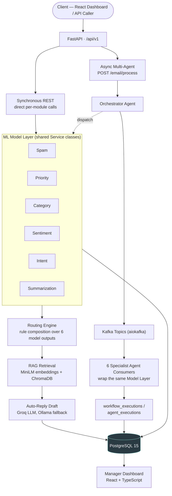

<div align="center">

# AI Email Intelligence System

**Multi-Agent Email Triage, Classification & Response Platform**

[](https://python.org)
[](https://fastapi.tiangolo.com)
[](https://postgresql.org)
[](https://kafka.apache.org)
[](https://react.dev)
[](https://docker.com)

*One inbox in → six ML models, a rule-based router, a RAG-grounded reply draft, and a live analytics dashboard out — coordinated by an event-driven multi-agent pipeline.*

</div>

---

## What It Does

Imagine an email lands in a company's support inbox. Before any human even
opens it, this system has already worked out several things about it: is it
spam or a real message, how urgent is it, which department should deal with
it, what is the sender actually asking for, how do they seem to feel about
it, and — based on how similar emails were handled in the past — it has
already written a first draft of a reply. All of that happens automatically,
in a few seconds, and every single decision is written down somewhere a
manager can review it later on a live dashboard.

Under the hood, each of those judgments (spam or not, how urgent, which
department, and so on) is made by its own small, separately trained model.
None of these models talks directly to any other — instead, a simple
rule-based "router" waits for all of them to finish, looks at everything
they decided, and picks a department. There are two different ways to send
an email into the system: you can call the API directly and get a full
answer back immediately (handy for testing one email at a time), or you can
send it through a background pipeline built on a message queue called
Apache Kafka, which is better suited to handling a lot of emails at once
because the work happens in the background while you check on progress
separately.

### A few terms you'll see a lot below

- **Model** — a small program that has learned to make a prediction (like
  "is this spam?") by studying lots of examples, instead of following
  rules a person wrote by hand.
- **TF-IDF** — a simple, fast way of turning text into numbers a model can
  actually work with. It weighs each word by how important that word is to
  one particular email compared to every other email.
- **Classifier** — a model whose only job is to sort something into one of
  a few categories, like "spam" vs. "not spam."
- **Embedding** — a way of turning the *meaning* of a piece of text into a
  list of numbers, so a computer can measure how similar two emails are
  even if they don't use the exact same words.
- **RAG (Retrieval-Augmented Generation)** — instead of asking an AI to
  write a reply purely from what it already knows in general, you first
  dig up real, similar past emails and hand those to the AI as examples to
  base its answer on. That keeps the reply grounded in this business's own
  history, rather than sounding generic.
- **LLM (Large Language Model)** — a general-purpose AI model, similar to
  the ones behind ChatGPT, that can read and write natural language. This
  project only ever uses one to draft replies — never to decide spam,
  priority, category, or anything else.
- **Kafka** — a message queue. It lets different parts of the system send
  each other messages without being directly wired together, so one part
  running slowly, or briefly going down, doesn't immediately break
  everything else.
- **PII (Personally Identifiable Information)** — things like real names,
  phone numbers, and card numbers that could identify an actual person.
  This system strips that out of an email before ever sending its text to
  an outside AI service.

---

## Architecture

Here's the plain-English walkthrough before you look at the diagram:

1. Something calls the API — either the React dashboard running in a
   browser, or any program/script calling the API directly.
2. FastAPI (the Python web framework this backend is built on) receives
   the request and decides which of two paths to send it down.
3. **The direct path**: for a single email, the API calls each of the six
   ML models one by one and hands back a complete, final answer right
   away, in the same response.
4. **The background path** (`POST /email/process`): the API just records
   that a new job has started and drops a message onto a Kafka topic. An
   "Orchestrator" program is listening, picks the message up, and fans it
   out to six separate small programs (called agents) — one per model.
   Each agent is a thin wrapper around the exact same model code the
   direct path uses, so the actual ML logic only exists once, not twice.
5. Either way, once all six models have made their predictions, a
   rule-based Routing Engine combines the results into one department
   decision, and a Retrieval step searches through past, already-resolved
   emails (stored as embeddings — see the glossary above — in a small
   local database called ChromaDB) to find similar cases.
6. Those similar cases become the grounding for an AI-drafted reply,
   generated by Groq's cloud-hosted LLM, with a locally-running model
   called Ollama standing by as a backup if Groq is ever slow or
   unreachable.
7. Every result along the way — the six model outputs, the routing
   decision, the drafted reply — gets saved into PostgreSQL, a relational
   database, so nothing is lost and the dashboard always has fresh numbers
   to show.



So there are really just two doorways into the same underlying model code:
a request-and-response API for talking to it directly, and a Kafka
pipeline for asynchronous, trackable processing that can survive a hiccup
and retry. Neither doorway duplicates the actual ML logic — the
background agents are thin wrappers around the exact same services the
direct API calls.

---

## Modules

This project is organized into 16 pieces, roughly matching the phases it
was built in. Each one is described below in plain language, along with
how it's built and how far along it actually is (this project is careful
about not overstating a module's status).

1. **Email Ingestion & Preprocessing.** Before any model can look at an
   email, the raw text needs cleaning up: HTML tags get stripped away,
   the text gets split into words (tokenization), and common filler words
   like "the" and "and" get removed (these are called stopwords), using
   two well-known text-processing toolkits, spaCy and NLTK. On top of
   that, this module can connect directly to a real Gmail or Outlook
   inbox using OAuth2 (the secure sign-in flow Google and Microsoft use
   for third-party apps) and check for new mail on a regular schedule
   (this is called polling). *Status:* the text-cleaning part is done and
   working. The live Gmail/Outlook connection has been built, and tested
   with fake data standing in for a real inbox, but hasn't yet been tried
   against an actual Gmail or Outlook account — that needs real developer
   credentials from Google/Microsoft first.

2. **Spam Detection.** A simple yes/no classifier: is this email spam, or
   "ham" (the term for ordinary, wanted email)? It's built from two
   classic, well-understood techniques — TF-IDF to turn the text into
   numbers, and a Support Vector Machine (SVM), a straightforward
   algorithm for drawing a boundary between two categories, with its
   confidence scores calibrated so a "90% sure" really does mean roughly
   90% sure. *Status:* done. On a held-out test set built from the public
   SpamAssassin spam dataset, it correctly catches 97.22% of real spam
   (this percentage is called "recall" — how much of the actual spam it
   successfully flags). It was also trained on real, ordinary business
   email (from the Enron email dataset) as examples of "not spam," so it
   only wrongly flags a legitimate business email as spam 0.78% of the
   time.

3. **Priority Classification.** Sorts each email into Critical, High,
   Medium, or Low urgency, using TF-IDF again, this time paired with
   logistic regression — another simple, well-understood classifier that
   outputs a probability for each category rather than just a single
   guess. *Status:* the whole pipeline (training, evaluating, and serving
   predictions through the API) is complete and tested, but it's
   currently trained on synthetic labels — meaning labels generated by a
   heuristic rule, not by a real person reading the email and deciding.
   Getting real humans to label real emails is the planned next step.

4. **Email Categorization.** Works out which department(s) an email is
   about — Support, Sales, Billing, and so on — using the same TF-IDF
   approach, but with "multi-label" logistic regression, which just means
   one email is allowed to belong to more than one category at once (for
   example, both "Billing" and "Complaint"). *Status:* pipeline complete,
   currently trained on synthetic labels, same caveat as Priority above.

5. **Email Summarization.** Turns a long email into a short two-to-three
   sentence summary. Two approaches are supported: "extractive" (the
   default, and much faster), which simply picks out the most important
   existing sentences from the email using TF-IDF ranking, and
   "abstractive" (opt-in), which uses a small AI model called DistilBART
   to actually write new summary sentences, more like how a person would
   paraphrase something in their own words. *Status:* both are working.
   The abstractive model's quality has only been measured against a
   dataset of news articles so far, not real emails, since that's the
   best public dataset available for this kind of check.

6. **Sentiment Analysis.** Figures out how the sender seems to feel, from
   Very Negative to Very Positive, using a tool called VADER. VADER works
   off a dictionary of words that are already pre-scored for emotional
   tone, so it needs no training data of its own — it already
   understands English sentiment words out of the box. *Status:* live
   and serving predictions, but it hasn't yet been specifically
   double-checked against real, human-labeled email data (it was
   designed for general text, and emails can have their own quirks that
   a general-purpose tool might miss).

7. **Intent Detection.** Works out what the sender is actually asking
   for — a Complaint, a Refund request, a general Inquiry, and so on —
   again with TF-IDF and multi-label logistic regression, since one email
   can carry more than one intent at once (for example, "Complaint" and
   "Refund" together). *Status:* pipeline complete, trained on synthetic
   labels for now.

8. **Department Routing.** This is the decision-maker that looks at
   everything every other module figured out (category, intent,
   sentiment, and so on) and decides which department the email should
   actually go to. It isn't a machine-learning model at all — it's a
   deterministic rule engine, meaning it follows clear, plainly-written
   if-this-then-that logic, which makes it easy to explain afterward
   exactly why a given email was routed the way it was. *Status:* live,
   and every single routing decision is logged so it can be audited
   later.

9. **Similar Email Retrieval (the "R" in RAG, explained above).** For
   every processed email, the system calculates an embedding (a numeric
   fingerprint of its meaning, see the glossary above) using a small,
   fast model called MiniLM, and stores it in a local vector database
   called ChromaDB. When a new email arrives, the system can search that
   database for the most similar past emails — useful both for the
   auto-reply feature below and for letting a human agent see how a
   similar case was handled before. Before anything gets stored, personal
   information is scrubbed out first using Microsoft Presidio (the PII
   tool mentioned in the glossary). *Status:* live and serving.

10. **Auto-Reply Generation.** Writes a first-draft reply by taking the
    similar past emails found in step 9 and handing them, together with
    the new email, to a Large Language Model — specifically Groq's
    cloud-hosted model, with a locally-running model called Ollama
    standing by as a backup if Groq is ever unreachable or overloaded.
    *Status:* by design, nothing here is ever sent automatically — a
    human always has to read, approve, edit, or reject the draft first.
    There is no code path anywhere in this project that lets a
    machine-written reply go out without a person clicking approve.

11. **Manager Dashboard & Analytics.** A website, built with React and
    TypeScript, that gives a manager a live view of what's happening —
    how many emails are coming in, how they break down by category, how
    sentiment is trending over time, whether any Service-Level-Agreement
    (SLA) deadlines are at risk of being missed, and a review queue of
    low-confidence predictions that need a human to double-check them.
    *Status:* done, including exporting reports as CSV or PDF files, and
    updates that arrive live over a WebSocket connection (a persistent,
    two-way connection), with a plain 30-second refresh as a fallback in
    case that live connection ever drops.

12. **Human Feedback Loop.** Whenever a person corrects one of the
    system's decisions (for example, "this actually wasn't spam"), that
    correction gets saved into one shared table used by every module.
    This is what powers the dashboard's review queue, and it will
    eventually be what triggers retraining a model once enough
    corrections have piled up for it. *Status:* done.

13. **Multi-Agent Architecture.** This is the engine room: an Orchestrator
    program and six separate specialist programs (one per ML model) that
    talk to each other through Kafka (the message queue from the
    glossary) instead of calling each other's code directly. If a
    specialist temporarily fails, it automatically retries a few times,
    waiting a little longer between each attempt (this is called
    "exponential backoff"), before giving up and logging the failure.
    *Status:* done, and specifically tested against a real, running Kafka
    and PostgreSQL setup — not just simulated — including checking that a
    message which accidentally gets delivered twice doesn't cause the
    same email to be processed twice.

14. **Continuous Integration / Continuous Deployment (CI/CD).** Every
    time code is pushed to this project on GitHub, an automated pipeline
    (GitHub Actions) runs to check the code's style, run the entire test
    suite, sanity-check the ML models, build the Docker images, and scan
    for any secrets (like passwords) that were accidentally committed —
    all before anything is considered safe to deploy. *Status:* live and
    enforced on every change to the codebase.

15. **Kubernetes / Horizontal Scaling.** Kubernetes is a system for
    running many copies of an application spread across several
    machines, and for automatically restarting anything that crashes.
    This project has Kubernetes configuration files ready to go, and
    they've been tested against a real (if local, single-machine)
    Kubernetes cluster called `kind` — including deliberately killing a
    running copy of the app to confirm it recovers on its own, and
    rolling out an update with no downtime. *Status:* done locally;
    actually running this in a real cloud environment is the next
    infrastructure step.

16. **MLflow Model Registry.** MLflow is a tool for keeping track of every
    version of every trained model: what data it was trained on, how well
    it performed, and whether it's the current "production" model or
    just a candidate still being evaluated. This makes it possible to
    roll back to an older model if a newer one turns out to perform
    worse. *Status:* verified against the real, running Docker setup for
    all four modules that currently have trainable models — spam,
    priority, category, and intent.

---

## Under the Hood

A closer look at some of the specific engineering choices behind the
modules above, and why they were made this way.

**Orchestration.** The background pipeline runs on Kafka (specifically
`apache/kafka` version 3.9, using a mode called KRaft that doesn't need a
separate Zookeeper service), talked to from Python using a library called
`aiokafka`. There's one Orchestrator agent plus six specialist agents,
and each one has its own Kafka "consumer group" — think of a consumer
group as a named subscription, so each agent only sees the messages meant
for it.

**Where the workflow's state actually lives.** Even though messages pass
through Kafka, the real source of truth for "what happened to this email"
is two PostgreSQL tables, `workflow_executions` and `agent_executions`.
Kafka messages are treated as *events*, not as the permanent record —
Postgres is.

**Making retries safe (idempotency).** There's a database rule (a unique
constraint) on the pairing of `(workflow_id, agent_name)`, so if the same
Kafka message accidentally gets delivered twice — which can genuinely
happen with this kind of messaging system — the second delivery finds a
row that's already marked finished and simply does nothing, instead of
processing the same email twice.

**What happens when something fails.** Failures are retried automatically,
in-process, with an increasing delay between attempts (exponential
backoff), up to 3 attempts total. The system tells apart failures that
are worth retrying (like a brief network hiccup) from ones that aren't
(like a genuinely broken input) — and once retries are exhausted, the
failure gets published to a shared "dead letter" topic where it can be
investigated later, instead of just vanishing.

**How Spam, Priority, Category, and Intent actually work.** All four use
scikit-learn, a well-known and widely trusted Python machine-learning
library, with either a linear SVM or logistic regression underneath, fed
by TF-IDF text features. Each trained model is saved to disk as a
versioned file (called a joblib artifact), and when the app starts up it
checks a fingerprint of that file to make sure the features it expects
still match what was actually trained.

**How Sentiment works.** Unlike the four modules above, Sentiment doesn't
use a trained model at all — it uses `vaderSentiment`, a rule-based
lexicon scorer. There's no training data and no model weights involved;
its behavior is fully deterministic because it's just looking words up in
a pre-built dictionary of emotional tone.

**How Summarization works.** Extractive summarization (the default) ranks
sentences using TF-IDF and just picks the best ones. Abstractive
summarization (opt-in per request, not the default) uses a small AI model
called `sshleifer/distilbart-cnn-6-6` to actually write new sentences.

**How the embeddings and retrieval (RAG) piece works.** Text gets turned
into embeddings using `sentence-transformers/all-MiniLM-L6-v2`, loaded
through a library called `transformers`, and those embeddings are stored
in a local ChromaDB database. Personal information is scrubbed out with
Presidio before anything is turned into an embedding, and searches can be
filtered by metadata like category or department.

**How the AI-drafted reply works.** The reply text itself comes from
Groq's API (using their `llama-3.3-70b-versatile` model), with a locally
running model called Ollama (`mistral:7b`) as an automatic fallback if
Groq responds with a rate-limit error (429) or a service-unavailable
error (503). As mentioned above, this is draft-only — nothing here is
ever sent without a human approving it — and this project's automated
test suite is set up to never make a real, costly call to either LLM by
default.

**How Routing works.** A deterministic rule engine, fully covered by unit
tests, that combines the outputs of the five upstream classifiers
(spam/priority/category/sentiment/intent) into one department-and-priority
decision.

**How the Feedback Loop works.** All feedback across every module lands
in one shared `feedback_events` table (this replaced an earlier approach
that only ever wrote feedback to a log file and never read it back). This
table is what feeds the dashboard's Human Review Queue.

**The Frontend.** Built with React 19 and TypeScript, using Vite as the
build tool, TanStack Query for fetching and caching data from the API,
and Recharts for the charts on the dashboard. It updates in real time
over a WebSocket connection, falling back to polling the API every 30
seconds if that connection isn't available.

**How PII (personal information) is handled.** Microsoft Presidio (both
its "analyzer," which detects personal information, and its
"anonymizer," which replaces it with placeholders) runs before any text
is turned into an embedding or sent to an outside LLM.

**Authentication.** Every real business endpoint now requires a signed-in
user. Logging in gets you a JWT (a signed token, using the HS256
algorithm) that has to be presented on every request afterward; passwords
themselves are hashed with bcrypt (via a library called `passlib`) rather
than stored as plain text. Which organization's data you can see is taken
from your login token, not from something you could simply type into a
request yourself — and the dashboard has its own login page that handles
all of this automatically.

**Observability (keeping an eye on the system while it runs).**
Prometheus (via the `prometheus_client` library) collects metrics from
both the API process and the background agents process — things like how
long requests take, how many predictions succeeded or failed, and how far
behind the Kafka consumers are. Grafana turns those metrics into
dashboards, and Alertmanager can fire an alert if latency, error rates, or
queue backlogs cross a defined threshold.

**Live mailbox ingestion.** Talks to the Gmail API and Microsoft Graph
API directly over HTTP (using a library called `httpx`), handling the
OAuth2 sign-in flow for each. A background poller running inside the
agents process checks connected mailboxes on a schedule. Refresh tokens
(the long-lived credentials that let the system keep checking a mailbox
without asking the user to sign in again and again) are encrypted before
being stored, using a library called `cryptography`. A separate "already
seen this message" ledger makes it safe to retry a poll that partly
failed, without accidentally processing the same email twice.

---

## Tech Stack

**Backend.** Written in Python 3.11, using FastAPI as the web framework
(it automatically generates interactive API documentation and validates
incoming requests), SQLAlchemy 2.x for talking to the database
asynchronously, and Alembic for managing database schema changes over
time (migrations).

**Database.** PostgreSQL 15, with more than a dozen tables — one set of
tables logging every prediction each ML module makes, plus tables for
feedback, and for tracking the state of every background workflow.

**Messaging.** Apache Kafka 3.9, running in KRaft mode (no separate
Zookeeper service needed), accessed from Python through the `aiokafka`
library.

**Classical machine learning.** scikit-learn provides the SVM and
logistic regression classifiers, with TF-IDF used throughout to turn
email text into numbers those classifiers can use.

**Text preprocessing.** spaCy and NLTK handle language-processing tasks
like breaking text into words and removing filler words; BeautifulSoup
handles stripping HTML out of email bodies.

**Transformer-based AI models.** The `transformers` library (from
HuggingFace) loads both the DistilBART summarizer and the MiniLM
embedding model used for retrieval.

**Vector store.** ChromaDB, running locally and embedded directly inside
the application — no separate server to manage for now.

**Large Language Model (for reply drafts only).** Groq's
`llama-3.3-70b-versatile` model in the cloud, with Ollama as a
locally-running fallback.

**Protecting personal information.** Microsoft Presidio.

**Frontend.** React 19 with TypeScript, built using Vite, with TanStack
Query for data fetching, React Router for page navigation, and Recharts
for charts.

**Tracking model versions.** MLflow, with its tracking data stored in
PostgreSQL.

**Tracking dataset versions.** DVC (Data Version Control), so it's
possible to know exactly which version of a dataset any given model was
trained on.

**Logging in securely.** PyJWT for issuing and checking login tokens, and
`passlib` (with bcrypt) for hashing passwords.

**Watching the system run.** `prometheus_client` for collecting metrics,
Grafana for dashboards, and Alertmanager for alerts.

**Automated testing.** pytest and pytest-asyncio, with 586 tests passing
as of the last full run.

**Infrastructure.** Docker and Docker Compose for local development, and
Kubernetes (tested against a local `kind` cluster) for running this at a
larger scale.

**CI/CD.** GitHub Actions, running linting, the full test suite,
ML-model sanity checks, a Docker build, and a scan for accidentally
committed secrets on every change.

---

## Model Evidence & Engineering Notes

This project reports each model's status with the actual evidence behind
it, rather than folding everything into one impressive-sounding accuracy
number — that's the standard held for every claim below.

- **Spam detection** is trained on the SpamAssassin dataset plus a sample
  of real Enron business email mixed in as examples of "not spam"
  (`scripts/train_spam_model.py`). This was necessary because a version
  trained only on SpamAssassin, when tested against real business email,
  flagged 59.3% of it as spam — and no amount of simply moving the
  decision threshold could fix that, because a model that has never seen
  real business email as an example of "ham" has no setting that both
  catches spam and lets legitimate mail through. After retraining with
  real business email included, and then recalibrating the decision
  threshold against a separate, never-trained-on batch of Enron email
  (`scripts/recalibrate_spam_threshold.py`), recall reached 97.22% on
  held-out SpamAssassin data, with a false-positive rate (legitimate
  email wrongly flagged as spam) of just 0.78% on 2,941 held-out Enron
  emails — down from 59.3% before the fix, and 7.0% at the first,
  not-yet-recalibrated threshold after retraining. The full evidence,
  including every threshold trade-off that was considered, is recorded in
  `artifacts/spam_baseline_metrics.json` under `threshold_recalibration`.
- **Priority, categorization, and intent detection** are trained on
  synthetic (rule-generated, not human-decided) labels for now. The
  pipelines themselves — training, evaluation, serving — are complete and
  tested; getting real, human-annotated training data for these three is
  the next milestone.
- **Sentiment analysis** uses a zero-shot lexicon scorer (meaning it
  needs no training data of its own); checking it specifically against
  real, labeled email data is still planned.
- **Summarization** has been evaluated on a real, but off-domain, dataset
  (news articles, not emails).
- **Auto-Reply** is draft-only by design — there is no way for a reply to
  be sent automatically anywhere in this codebase. A metric for how often
  human reviewers accept a draft as-is already exists in the database
  schema, and will start showing real numbers once real reviewer usage
  builds up.
- **Orchestrator resilience.** Tracking of "which workflows are currently
  in progress" is deliberately kept local to a single running copy of the
  agents process, given the scale this project runs at today — as a
  result, the Kubernetes configuration for the agents process is
  deliberately kept at one replica rather than scaled out, with a
  monitoring-based "stuck workflow" detector as the first line of defense
  in the meantime (see the Roadmap below).
- **The MLflow model registry** is deliberately not something the live
  API depends on to serve a single request — this was verified directly
  by stopping MLflow entirely and confirming both `/health/models` and
  `/spam/predict` kept working. Serving reads from a local snapshot of
  the model file; only the training and promotion scripts talk to MLflow
  directly.
- **Kubernetes** testing (`k8s/`) covers real scaling, a pod being
  killed, a dependency going down, and rolling updates, all against a
  local `kind` cluster; actually deploying to a real cloud is the next
  infrastructure milestone (see the Roadmap below).

---

## Roadmap

**Recently completed:**

- **Observability Stack** — Prometheus metrics across the API and the
  background agents, Grafana dashboards, and Alertmanager-based alerts
  for latency, error rate, and queue backlog, plus a "stuck workflow"
  detector that closes the Orchestrator resilience gap mentioned above.
- **Authentication** — signing in with a JWT token, passwords hashed with
  bcrypt, and every business endpoint (both the API and the dashboard)
  now figuring out which organization's data to show from the logged-in
  user, instead of trusting a value the caller could simply type in. The
  React dashboard has its own login page and attaches the login token to
  every request automatically.
- **Live Mailbox Ingestion** — an OAuth2 "connect" flow for both Gmail
  (via the Gmail API) and Outlook (via Microsoft Graph), with a
  background program that checks connected mailboxes on a schedule and
  feeds anything new into the exact same pipeline `POST /email/process`
  already uses. It checks on a schedule (polling) rather than waiting for
  a push notification, because push notifications need a public web
  address this local setup doesn't have. A duplicate-prevention ledger
  makes it safe if a check has to be retried. The backend has thorough
  automated tests and has been verified against the real, running Docker
  setup — the one thing still missing is trying it against an actual
  Gmail or Outlook account, which needs real developer credentials from
  Google or Microsoft first. There's also no dashboard page yet for
  connecting a mailbox — for now it's API-only.

**Planned:**

- Outbound notifications — a webhook or email alert whenever a critical
  or SLA-at-risk email comes in.
- Automatically generating scheduled reports, and automatically
  triggering model retraining once enough feedback has built up.
- Role-based **authorization** — every user already has a role
  (`admin` or `member`) stored on their account and included in their
  login token, but no endpoint actually checks it yet. Making that
  distinction real, alongside an admin screen for configuring
  per-organization category and routing rules, is the next step beyond
  just knowing who's logged in.
- Deploying to a real managed cloud Kubernetes cluster, with managed
  Postgres and Kafka, a proper Ingress, and TLS encryption.
- A formal security and GDPR (data-privacy law) compliance review.
- Replacing the synthetic training labels for priority, categorization,
  and intent detection with real, human-annotated ones.

---

## Quick Start

```bash
git clone https://github.com/sunilsaini01/ai-email-intelligence-system.git
cd ai-email-intelligence-system
cp backend/.env.example backend/.env   # fill in GROQ_API_KEY and DB credentials
```

**Start the full stack (Postgres + Kafka + API + agent consumers):**

```bash
docker compose up --build
```

**Run database migrations:**

```bash
docker compose exec api alembic upgrade head
```

**Or run the backend locally without Docker:**

```bash
cd backend
pip install -r requirements.txt -r requirements-dev.txt
uvicorn app.main:app --reload
```

**Run the frontend:**

```bash
cd frontend
npm install
npm run dev
```

**Run the test suite:**

```bash
cd backend
python -m pytest tests/ -q
```

API docs are served at `http://localhost:8000/docs`. The dashboard runs at
`http://localhost:5173` in dev mode.

### Environment variables you'll actually need to set

The database connection needs five values: `POSTGRES_USER`,
`POSTGRES_PASSWORD`, `POSTGRES_HOST`, `POSTGRES_PORT`, and `POSTGRES_DB`.
The background Kafka pipeline needs `KAFKA_BOOTSTRAP_SERVERS`, which is
just the address of the Kafka broker. For the Auto-Reply feature, you'll
need a `GROQ_API_KEY` — this is only required for that one feature, not
for the rest of the app. If you want the local Ollama fallback available
too, set `OLLAMA_BASE_URL` and `OLLAMA_MODEL` (both optional). Finally,
`SECRET_KEY` is the application's own secret, used to sign login tokens —
make sure to generate a real one before running this anywhere other than
your own machine.

The complete, up-to-date list — including the mailbox-ingestion settings
for Gmail/Outlook added in the latest update — lives in
`backend/.env.example`, with a comment above each one explaining exactly
what it's for.

---

## API Overview

All endpoints are versioned under `/api/v1`. The first group below are
the direct, synchronous calls — send one email's worth of data, get a
full answer back immediately:

```
POST /spam/predict            POST /priority/predict         POST /category/predict
POST /summarization/predict   POST /sentiment/predict        POST /intent/predict
POST /routing/predict         POST /retrieval/search          POST /reply/generate
GET  /dashboard/...           (analytics, SLA, review queue, reports)
```

The second pair is the asynchronous, background path — the same six
models, but dispatched over Kafka and tracked to completion in Postgres
instead of being returned straight away:

```
POST /email/process            -> 202, returns job_id
GET  /workflows/{job_id}       -> workflow + per-agent status
```

There's also a set of endpoints for signing in (`/auth/register`,
`/auth/login`, `/auth/me`) and for connecting a Gmail or Outlook mailbox
(`/mailbox/{provider}/connect`, `/mailbox/{provider}/callback`,
`/mailbox/connections`) — every endpoint except signing in and health
checks requires a valid login token.
