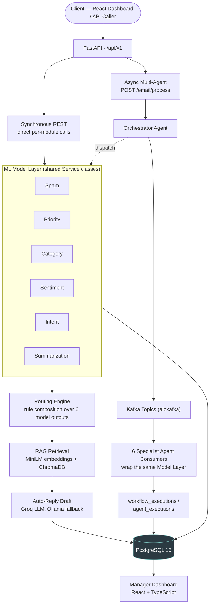

<div align="center">

# AI Email Intelligence System

**Multi-Agent Email Triage, Classification & Response Platform**

[](https://python.org)
[](https://fastapi.tiangolo.com)
[](https://postgresql.org)
[](https://kafka.apache.org)
[](https://react.dev)
[](https://docker.com)

*One inbox in → six ML models, a rule-based router, a RAG-grounded reply draft, and a live analytics dashboard out — coordinated by an event-driven multi-agent pipeline.*

</div>

---

## What It Does

An email arrives. The system decides whether it's spam, how urgent it is, which
department it belongs to, what the sender is asking for, how they feel about
it, and drafts a grounded reply pulling from similar past emails — then
routes it and logs every decision for a manager to review on a live
dashboard.

Each of those six judgments is a separate, independently trained model
behind its own service. A rule-based router composes their outputs into a
department assignment. Everything is orchestrated two ways: a synchronous
REST API for direct per-model calls, and an asynchronous Kafka pipeline
(`POST /email/process`) that fans a single email out to six independent
agent consumers and tracks the whole workflow in Postgres.

---

## Architecture



Two entry points into the same underlying model layer: a request/response
API for direct integration, and an at-least-once, retry-with-backoff Kafka
pipeline for asynchronous, traceable batch-style processing. Neither
duplicates the ML logic — agents are thin wrappers around the same
services the REST endpoints call.

---

<div align="center">

## Modules

| # | Module | Approach | Status |
|:---:|:---|:---|:---|
| 1 | Email Ingestion & Preprocessing | HTML stripping, tokenization, stopword removal (spaCy + NLTK) | Done |
| 2 | Spam Detection | TF-IDF + calibrated linear SVM | Done — 97.22% recall on held-out SpamAssassin data; trained on real Enron business email as ham, 0.78% false-positive rate on a held-out Enron sample |
| 3 | Priority Classification | TF-IDF + logistic regression | Pipeline complete — trained on synthetic labels, human annotation planned |
| 4 | Email Categorization | TF-IDF + multi-label logistic regression | Pipeline complete — trained on synthetic labels |
| 5 | Email Summarization | Extractive (default) + abstractive (DistilBART, opt-in) | Both serving — abstractive evaluated on an off-domain (news) dataset |
| 6 | Sentiment Analysis | VADER lexicon scorer (zero-shot, no training) | Serving — email-domain validation planned |
| 7 | Intent Detection | TF-IDF + multi-label logistic regression | Pipeline complete — trained on synthetic labels |
| 8 | Department Routing | Deterministic rule engine composing modules 2–7 | Serving, audit-logged |
| 9 | Similar Email Retrieval (RAG) | MiniLM embeddings + local ChromaDB vector store, PII-scrubbed | Serving |
| 10 | Auto-Reply Generation | RAG-grounded LLM draft (Groq `llama-3.3-70b-versatile`, Ollama local fallback) | Draft-only by design — human approve/edit/reject required |
| 11 | Manager Dashboard & Analytics | React + TypeScript SPA over a dedicated analytics query layer | Done — SLA tracking, review queue, CSV/PDF export, WebSocket + polling live updates |
| 12 | Human Feedback Loop | Unified `feedback_events` table across all modules | Done — feeds the dashboard's review queue and retraining-trigger audit log |
| 13 | Multi-Agent Architecture | Kafka orchestrator + 6 independent specialist agent consumers | Done — real Kafka + Postgres verified, idempotent under at-least-once delivery, retry with exponential backoff |
| 14 | CI/CD | GitHub Actions — lint, unit/integration tests, model sanity checks, Docker build, secret scan | Done — live on `origin/main`, all gates enforced |
| 15 | Kubernetes / Horizontal Scaling | `kind`-validated manifests — StatefulSets for Postgres/Kafka, scalable `api` Deployment | Done locally — real scaling, pod-kill, dependency-outage, and rolling-update tests passed against a live cluster |
| 16 | MLflow Model Registry | Postgres-backed MLflow tracking server + registry; `train_*.py` → candidate → `promote_model.py` → Production; `--rollback-to` | Live-verified for all 4 registrable modules — each trained, registered, and promoted against the live Docker stack |

</div>

---

## Under the Hood

| Category | Implementation | Detail |
|:---|:---|:---|
| **Orchestration** | Kafka (`apache/kafka` 3.9, KRaft, no Zookeeper) + `aiokafka` | One Orchestrator Agent + 6 specialist consumers, one Kafka consumer group each |
| **Workflow state** | PostgreSQL (`workflow_executions`, `agent_executions`) | Durable source of truth — Kafka messages are not treated as durable state on their own |
| **Idempotency** | `(workflow_id, agent_name)` unique constraint | A terminal-status row makes a redelivered Kafka message a no-op instead of a re-run |
| **Retry policy** | In-process, exponential backoff, max 3 attempts | Transient vs. permanent error classification; exhausted retries publish to a shared dead-letter topic |
| **Spam / Priority / Category / Intent** | scikit-learn (linear SVM / logistic regression), TF-IDF features | Served via versioned joblib artifacts, feature-schema fingerprint checked at load time |
| **Sentiment** | `vaderSentiment` — rule-based lexicon scorer | No training data, no model weights — deterministic by construction |
| **Summarization** | Extractive (TF-IDF sentence ranking) + `sshleifer/distilbart-cnn-6-6` (abstractive) | Abstractive is opt-in per request, not the default |
| **Embeddings / RAG** | `sentence-transformers/all-MiniLM-L6-v2` via `transformers`, local ChromaDB | PII-scrubbed (Presidio) before embedding; metadata-filterable by category/department |
| **LLM reply drafting** | Groq API (`llama-3.3-70b-versatile`), Ollama (`mistral:7b`) local fallback on 429/503 | Draft-only, never auto-sent; real API calls excluded from the default test suite |
| **Routing** | Deterministic rule engine, fully unit-tested | Composes the five upstream classifiers' outputs into a department + priority decision |
| **Feedback loop** | Unified `feedback_events` table | Replaces earlier write-only JSONL logging; feeds the dashboard's Human Review Queue |
| **Frontend** | React 19 + TypeScript, Vite, TanStack Query, Recharts | Real-time dashboard: WebSocket updates with a 30s polling fallback |
| **PII handling** | Microsoft Presidio (analyzer + anonymizer) | Applied before any embedding or third-party LLM call |

---

<div align="center">

## Tech Stack

| Layer | Technologies |
|:---:|:---|
| **Backend** | FastAPI, Python 3.11, SQLAlchemy 2.x (async), Alembic |
| **Database** | PostgreSQL 15 — 13+ tables (prediction logs per module, feedback events, workflow/agent execution state) |
| **Messaging** | Apache Kafka 3.9 (KRaft mode), `aiokafka` |
| **Classical ML** | scikit-learn (SVM, logistic regression), TF-IDF vectorization |
| **NLP / Preprocessing** | spaCy, NLTK, BeautifulSoup |
| **Transformer models** | `transformers` (DistilBART summarizer, MiniLM embedder) |
| **Vector store** | ChromaDB (local, embedded) |
| **LLM** | Groq (`llama-3.3-70b-versatile`), Ollama (local fallback) |
| **PII protection** | Microsoft Presidio |
| **Frontend** | React 19, TypeScript, Vite, TanStack Query, React Router, Recharts |
| **Model registry** | MLflow (Postgres-backed tracking + registry) |
| **Data versioning** | DVC |
| **Testing** | pytest, pytest-asyncio — 487 tests passing |
| **Infra** | Docker, Docker Compose, Kubernetes (`kind`-validated) |
| **CI/CD** | GitHub Actions — lint, test, model sanity, Docker build, secret scan |

</div>

---

## Model Evidence & Engineering Notes

Model status is reported per-module with an explicit evidence basis, rather
than blended into a single headline accuracy number — the standard this
project holds itself to for every claim below:

- **Spam detection** is trained on SpamAssassin plus a real Enron
  business-email sample mixed into the ham class (`scripts/train_spam_model.py`),
  after live testing showed a SpamAssassin-only model flagged 59.3% of
  ordinary business email as spam — a threshold change alone couldn't fix
  that (a model that's never seen business email as ham has no operating
  point that both catches spam and clears legitimate mail). Retraining with
  real business email as ham, then recalibrating the decision threshold
  against a disjoint, never-trained-on Enron holdout
  (`scripts/recalibrate_spam_threshold.py`), gets recall to 97.22% on
  held-out SpamAssassin data and a 0.78% false-positive rate on 2,941
  held-out Enron emails (down from 59.3% pre-fix, 7.0% at the naive
  post-retraining threshold before recalibration). See
  `artifacts/spam_baseline_metrics.json`'s `threshold_recalibration` field
  for the full evidence, including every threshold trade-off considered.
- **Priority, categorization, and intent detection** are trained on
  synthetic (heuristically-labelled) data — pipelines are complete and
  tested; human-annotated training data is the next milestone for these
  three modules.
- **Sentiment analysis** uses a zero-shot lexicon scorer; email-domain
  validation against real labelled data is planned.
- **Summarization** is evaluated on a real but off-domain (news) dataset.
- **Auto-Reply** is draft-only by architectural design — there is no send
  path anywhere in the pipeline. Human Acceptance Rate tracking exists in
  the schema and activates once real reviewer usage accumulates.
- **Orchestrator resilience**: in-flight workflow tracking is process-local
  by design at this scale — the `agents` Kubernetes Deployment is
  deliberately pinned to a single replica rather than horizontally scaled
  as a result, with a monitoring-based stuck-workflow detector as the
  first line of defense (see Roadmap).
- **MLflow model registry** has zero request-path dependency by design —
  verified live with MLflow fully stopped (`/health/models` and
  `/spam/predict` both unaffected). Serving reads a local artifact
  snapshot; only training/promotion scripts talk to MLflow directly.
- **Kubernetes** validation (`k8s/`) covers real scaling, pod-restart, and
  dependency-outage behavior against a local `kind` cluster; cloud
  deployment is the next infrastructure milestone (see Roadmap).

---

## Roadmap

**In progress:**

- **Observability Stack** — Prometheus metrics across the API and agent
  layers, Grafana dashboards, and Alertmanager-based alerting on latency,
  error rate, and queue depth, with a stuck-workflow detector closing the
  Orchestrator resilience gap noted above.
- **Authentication & Authorization** — JWT-based login, bcrypt password
  hashing, and organization-scoped access control replacing the current
  caller-supplied `organization_id` model.

**Planned:**

- Live mailbox ingestion via Gmail and Outlook (OAuth2), replacing manual
  API submission as the primary intake path.
- Outbound notifications (webhook/email alerts on critical or SLA-at-risk emails).
- Scheduled report generation and automated model-retraining triggers.
- Role-based permissions and an admin configuration UI for per-organization
  category/routing rules.
- Cloud deployment on a managed Kubernetes cluster with managed
  Postgres/Kafka, Ingress, and TLS.
- Formal security and GDPR compliance review.
- Human-annotated training data for priority, categorization, and intent
  detection, replacing the current synthetic-label baseline.

---

## Quick Start

```bash
git clone https://github.com/sunilsaini01/ai-email-intelligence-system.git
cd ai-email-intelligence-system
cp backend/.env.example backend/.env   # fill in GROQ_API_KEY and DB credentials
```

**Start the full stack (Postgres + Kafka + API + agent consumers):**

```bash
docker compose up --build
```

**Run database migrations:**

```bash
docker compose exec api alembic upgrade head
```

**Or run the backend locally without Docker:**

```bash
cd backend
pip install -r requirements.txt -r requirements-dev.txt
uvicorn app.main:app --reload
```

**Run the frontend:**

```bash
cd frontend
npm install
npm run dev
```

**Run the test suite:**

```bash
cd backend
python -m pytest tests/ -q
```

API docs are served at `http://localhost:8000/docs`. The dashboard runs at
`http://localhost:5173` in dev mode.

### Required environment variables

| Variable | Purpose |
|---|---|
| `POSTGRES_USER` / `POSTGRES_PASSWORD` / `POSTGRES_HOST` / `POSTGRES_PORT` / `POSTGRES_DB` | Database connection |
| `KAFKA_BOOTSTRAP_SERVERS` | Kafka broker address for the multi-agent pipeline |
| `GROQ_API_KEY` | Auto-Reply LLM provider (required for that endpoint only) |
| `OLLAMA_BASE_URL` / `OLLAMA_MODEL` | Local LLM fallback (optional) |
| `SECRET_KEY` | Application secret |

See `backend/.env.example` for the complete list.

---

## API Overview

All endpoints are versioned under `/api/v1`:

```
POST /spam/predict            POST /priority/predict         POST /category/predict
POST /summarization/predict   POST /sentiment/predict        POST /intent/predict
POST /routing/predict         POST /retrieval/search          POST /reply/generate
GET  /dashboard/...           (analytics, SLA, review queue, reports)

POST /email/process            -> 202, returns job_id
GET  /workflows/{job_id}       -> workflow + per-agent status
```

The second pair is the async multi-agent path — the same six models,
dispatched over Kafka and tracked to completion in Postgres instead of
returned synchronously.
