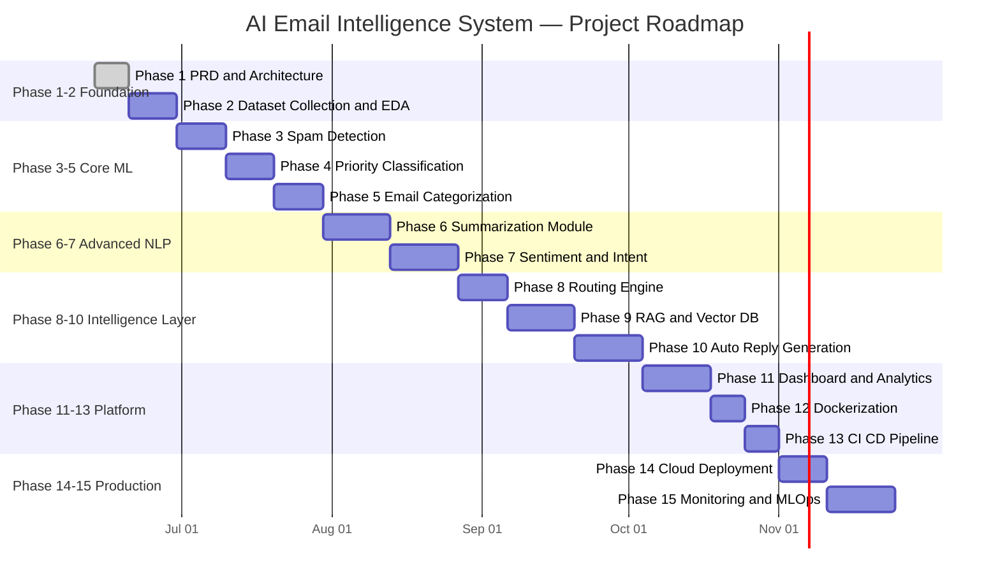
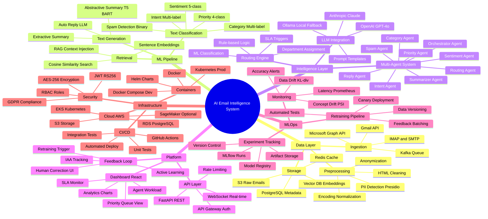

# AI Email Intelligence System
## Product Requirement Document (PRD) — v1.0.0

**Date:** June 2026
**Status:** Phase 1 — Foundation
**Author:** MSc AI & ML Student
**Reviewer:** AI Engineering Mentor
**Classification:** Internal / Portfolio

---

## Table of Contents

1. [Executive Summary](#1-executive-summary)
2. [Problem Statement](#2-problem-statement)
3. [Business Context & Value](#3-business-context--value)
4. [Stakeholders & User Personas](#4-stakeholders--user-personas)
5. [Functional Requirements](#5-functional-requirements)
6. [Non-Functional Requirements](#6-non-functional-requirements)
7. [User Stories](#7-user-stories)
8. [Data Requirements](#8-data-requirements)
9. [ML/NLP Requirements](#9-mlnlp-requirements)
10. [System Architecture](#10-system-architecture)
11. [Technology Stack](#11-technology-stack)
12. [Database Design](#12-database-design)
13. [API Design](#13-api-design)
14. [Evaluation Metrics](#14-evaluation-metrics)
15. [Risk Assessment](#15-risk-assessment)
16. [Project Phases & Roadmap](#16-project-phases--roadmap)
17. [Milestones & Deliverables](#17-milestones--deliverables)
18. [Success Criteria](#18-success-criteria)
19. [Mind Map](#19-mind-map)
20. [Appendix](#20-appendix)

---

## 1. Executive Summary

### What Are We Building?

An **end-to-end, production-grade AI Email Intelligence System** — a platform that applies NLP, machine learning, and large language models to automatically analyze, classify, route, summarize, and respond to enterprise emails. This replaces brittle keyword rules and manual triage with an intelligent, feedback-driven pipeline.

### Why This Matters

- Knowledge workers spend **28% of their workday** managing email (McKinsey Global Institute)
- Enterprise email volume grows **4.3% YoY** — human-only triage does not scale
- **23% of support SLA breaches** are caused by misrouted or missed emails
- Existing solutions (Gmail Smart Reply, Zendesk AI) are black-boxes not customizable to enterprise domain language

### Expected Outcomes

| Metric | Current Baseline | Target After System |
|--------|-----------------|---------------------|
| Manual triage time per agent/hour | 15–20 min | < 3 min |
| SLA breach rate | ~23% | < 5% |
| Spam miss rate | ~12% | < 1% |
| Department routing accuracy | 100% manual | > 92% automated |
| Avg. response time (High/Critical) | 4–8 hours | < 30 minutes |
| Auto-reply acceptance rate | N/A | > 60% |

---

## 2. Problem Statement

### 2.1 The Root Problem

Enterprise email is **unstructured, high-volume, and semantically rich** — the exact combination that makes rule-based systems fail and makes humans exhausted.

**What the current state looks like:**

- Spam filters built on 2003-era Naive Bayes and keyword blacklists
- Priority folders manually configured by individuals — no organizational intelligence
- No automatic routing to the right department or person
- Support agents answering identical questions 40–60 times per day
- Zero ML-driven similarity matching to leverage past resolutions
- Managers have no real-time visibility into email workload or SLA risk

**What breaks as a result:**

1. A critical customer complaint lands in spam because it contains the word "promotion" — customer churns
2. A compliance-critical legal notice sits unread for 3 days because it looked like a newsletter
3. A high-value sales lead goes cold — routed to IT support instead of the sales team
4. A support agent rewrites the same refund policy explanation 15 times per shift
5. Management discovers an SLA breach after it has happened, not before

### 2.2 Why This Problem Is Technically Hard

| Challenge | Why It's Hard |
|-----------|--------------|
| Ambiguity of priority | Same email text → different priority based on sender history and business context |
| Evolving spam | Adversarial senders adapt faster than static rules |
| Intent multiplicity | One email can contain complaint + refund request + escalation |
| Domain specificity | General NLP models don't understand enterprise-specific terms |
| PII exposure | Emails contain sensitive data — can't blindly send to cloud LLMs |
| Thread context | A one-word reply ("Agreed.") means nothing without its thread |
| Latency | Users expect near-instant triage, not 30-second batch processing |

### 2.3 What Exists Today and Why It Fails

| Existing Solution | Approach | Core Failure |
|------------------|----------|-------------|
| Gmail Spam Filter | Naive Bayes + rule lists | No intent/priority understanding |
| Microsoft Rules | Keyword matching | Brittle, requires constant manual updates |
| Zendesk AI | Ticket-centric, closed source | Not email-native, very expensive at scale |
| Gmail Smart Reply | Generic LSTM/T5 | No domain adaptation, low acceptance rate |
| Manual triage | 100% human | Does not scale, prone to fatigue errors |

---

## 3. Business Context & Value

### 3.1 Target Market

- **Primary:** Mid-to-large enterprises (500+ employees) with high email volume
- **Secondary:** Customer Support SaaS platforms
- **Tertiary:** E-commerce operations with high inbound support traffic

### 3.2 Department-Level Pain Points

| Department | Core Pain | Business Impact |
|------------|----------|-----------------|
| Customer Support | Can't distinguish urgent complaints from general enquiries | Churn, SLA penalties |
| Sales | Leads buried in bulk inbox, no urgency flag | Revenue loss |
| HR | Sensitive complaints (harassment, legal) mixed with normal comms | Legal liability |
| IT Helpdesk | Repetitive tickets (password reset, VPN) waste senior engineer time | Operational inefficiency |
| Operations | No email analytics → can't forecast volume or staff properly | Poor resource allocation |
| Management | Blind to email workload distribution and SLA risk | Reactive decision-making |

### 3.3 ROI Calculation (Per 100-Agent Organization)

```
Current State:
  100 agents × 28% email time × 8 hours/day × $35/hour = $7,840/day lost to triage

After System (75% triage automation):
  Savings = $7,840 × 0.75 = $5,880/day
  Annual savings ≈ $2.1M

Additional Value:
  - Avoided SLA penalties: ~$50K–$150K/year
  - Faster lead response → 15–20% conversion uplift
  - Reduced escalations → -40% escalated ticket volume
  - Agent retention improvement (less repetitive work)
```

### 3.4 Competitive Positioning

| Capability | Gmail AI | Zendesk AI | Microsoft Viva | Our System |
|-----------|----------|------------|----------------|------------|
| Spam Detection | ✅ | ✅ | ❌ | ✅ |
| Priority Classification | ❌ | Partial | ❌ | ✅ |
| Multi-label Categorization | ❌ | ✅ | ❌ | ✅ |
| Summarization | ❌ | ❌ | ❌ | ✅ |
| Intent Detection | ❌ | Partial | ❌ | ✅ |
| Semantic Similar Search | ❌ | ❌ | ❌ | ✅ |
| RAG Auto-Reply | Partial | Partial | ❌ | ✅ |
| Analytics Dashboard | ❌ | ✅ | ✅ | ✅ |
| Human Feedback Loop | ❌ | Partial | ❌ | ✅ |
| Self-hostable / Customizable | ❌ | ❌ | ❌ | ✅ |

---

## 4. Stakeholders & User Personas

### 4.1 Stakeholder Map

| Role | Primary Interest | Key Concern |
|------|-----------------|-------------|
| CTO / Engineering Head | System architecture, maintainability | Build cost, technical debt |
| CEO / Business Owner | ROI, competitive advantage | Time-to-value |
| Support Department Head | SLA compliance, agent efficiency | Classification accuracy |
| Support Agents | Faster triage, less cognitive load | False positives blocking real emails |
| IT / DevOps | System stability, security, ops | Scalability, integration complexity |
| Data / ML Team | Model performance, retraining loop | Data quality, annotation burden |
| Legal / Compliance | GDPR, data retention, audit logs | PII handling, external API data sharing |

### 4.2 User Personas

---

**Persona 1 — Sarah (Support Agent)**

> *"I spend the first two hours of my day just triaging emails before I can actually help anyone."*

- **Role:** Level-1 Customer Support Agent
- **Volume:** 200+ emails/day
- **Pain Points:** No priority signal, buried in spam, rewriting identical replies
- **Needs:** Clear priority view, 2-sentence summaries, suggested replies, similar past cases
- **Success Metric:** Can act on top 10 critical emails within 15 minutes of shift start

---

**Persona 2 — David (Support Manager)**

> *"I only find out we've breached an SLA when an angry customer CC's the CEO."*

- **Role:** Customer Support Team Manager (15 direct reports)
- **Volume:** Reviews aggregate email metrics, handles escalations
- **Pain Points:** Zero real-time visibility, reactive problem-solving, no trend data
- **Needs:** Real-time dashboard, SLA breach alerts, sentiment trend charts, agent workload distribution
- **Success Metric:** Zero SLA breach surprises; proactive intervention capability

---

**Persona 3 — Priya (IT Administrator)**

> *"The previous AI tool was a black box — nobody could tell me why it made a wrong decision."*

- **Role:** IT Systems Administrator
- **Volume:** Manages system health, model accuracy, routing rules
- **Pain Points:** Unexplainable ML decisions, no ability to configure without redeployment
- **Needs:** Explainable decisions, configurable routing rules via UI, system health monitoring
- **Success Metric:** Can update routing rules without a code deployment

---

**Persona 4 — James (Business Analyst)**

> *"I know email contains business intelligence — I just can't get it out."*

- **Role:** Business Intelligence Analyst
- **Volume:** Analyzes trends, builds reports for leadership
- **Pain Points:** Email data is unstructured and inaccessible for analysis
- **Needs:** Historical email analytics, category distribution, sentiment trends, exportable data
- **Success Metric:** Can generate a weekly email insights report in < 5 minutes

---

## 5. Functional Requirements

### Module 1 — Email Ingestion & Preprocessing

| ID | Requirement |
|----|-------------|
| FR-01 | System shall connect to email servers via IMAP, SMTP, and OAuth2 protocols |
| FR-02 | System shall integrate with Gmail API and Microsoft Graph API (Exchange/Outlook) |
| FR-03 | System shall ingest and queue a new email within 30 seconds of receipt |
| FR-04 | System shall extract: sender, all recipients, subject, body (text + HTML), timestamps, attachments metadata |
| FR-05 | System shall handle email threads — associate replies to their parent thread |
| FR-06 | System shall detect and decode character encodings (UTF-8, ISO-8859-1, etc.) |
| FR-07 | System shall strip HTML and extract clean plain-text body |
| FR-08 | System shall detect PII (names, phones, SSNs, credit card numbers) using Microsoft Presidio |
| FR-09 | System shall anonymize PII before passing email content to any external API (LLMs) |

### Module 2 — Spam Detection

| ID | Requirement |
|----|-------------|
| FR-10 | System shall classify every email as Spam or Ham (Not Spam) |
| FR-11 | System shall achieve Spam Recall > 99% on internal test set (missing spam worse than false positives) |
| FR-12 | System shall produce a spam confidence score from 0.0 (definitely ham) to 1.0 (definitely spam) |
| FR-13 | Emails above spam threshold shall be quarantined — never silently deleted |
| FR-14 | Users shall be able to report false positives and false negatives via UI |
| FR-15 | Reported mistakes shall be logged for retraining pipeline |

### Module 3 — Priority Classification

| ID | Requirement |
|----|-------------|
| FR-16 | System shall assign a priority label: Critical / High / Medium / Low |
| FR-17 | Priority shall incorporate: sender history, subject keywords, body sentiment, time of day |
| FR-18 | Critical emails shall trigger immediate notifications (in-app + configurable webhook) |
| FR-19 | System shall allow agents and managers to override priority labels |
| FR-20 | Priority overrides shall be logged as feedback for model improvement |

### Module 4 — Email Categorization

| ID | Requirement |
|----|-------------|
| FR-21 | System shall assign category labels: Support / Sales / Billing / Legal / HR / IT / Marketing / General |
| FR-22 | System shall support multi-label assignment (one email may belong to multiple categories) |
| FR-23 | Category taxonomy shall be configurable per organization via admin UI |
| FR-24 | System shall return a confidence score for each assigned category |

### Module 5 — Email Summarization

| ID | Requirement |
|----|-------------|
| FR-25 | System shall generate a 2–3 sentence summary for emails longer than 200 words |
| FR-26 | Summaries shall preserve: key names, dates, monetary amounts, and action items |
| FR-27 | System shall summarize an entire email thread as a cohesive narrative, not per-message |
| FR-28 | System shall support both extractive (key sentence selection) and abstractive (T5/BART generation) summarization |

### Module 6 — Sentiment Analysis

| ID | Requirement |
|----|-------------|
| FR-29 | System shall classify email sentiment: Very Negative / Negative / Neutral / Positive / Very Positive |
| FR-30 | System shall detect primary emotion: Anger / Frustration / Confusion / Satisfaction / Urgency |
| FR-31 | Negative or Very Negative sentiment on non-spam emails shall increase priority score |
| FR-32 | System shall track sentiment trends per sender over time (for proactive escalation) |

### Module 7 — Intent Detection

| ID | Requirement |
|----|-------------|
| FR-33 | System shall identify primary intent: Complaint / Inquiry / Request / Feedback / Escalation / Order / Cancel / Refund / Schedule |
| FR-34 | System shall support multi-intent detection per email |
| FR-35 | System shall extract key entities: order IDs, dates, amounts, product names, person names |
| FR-36 | Intent shall be used as a signal for both routing and auto-reply generation |

### Module 8 — Department Routing Engine

| ID | Requirement |
|----|-------------|
| FR-37 | System shall automatically route emails to the correct department and/or agent |
| FR-38 | Routing shall use combined signals: category, intent, sentiment, keywords, sender domain |
| FR-39 | System shall support configurable rule-based overrides with priority ordering |
| FR-40 | All routing decisions shall be logged with the reasoning (which rules/signals fired) |
| FR-41 | System shall detect routing errors via human feedback and adjust rule weights |
| FR-42 | Round-robin and skills-based routing between agents shall be supported |

### Module 9 — Similar Email Retrieval (RAG Foundation)

| ID | Requirement |
|----|-------------|
| FR-43 | System shall compute and store semantic embeddings for every processed email |
| FR-44 | System shall retrieve the top-5 semantically similar emails for every new email |
| FR-45 | Vector similarity search shall complete within 500ms |
| FR-46 | Similar email results shall be filterable by: category, department, resolution status |
| FR-47 | Vector index shall support incremental updates (no full rebuild required) |

### Module 10 — Auto Reply Generation

| ID | Requirement |
|----|-------------|
| FR-48 | System shall generate a draft reply using the email content + top-3 similar resolved emails as RAG context |
| FR-49 | Generated replies shall be draft-only by default — not auto-sent without human approval |
| FR-50 | System shall complete reply generation within 10 seconds |
| FR-51 | Agents shall be able to approve, edit, or reject generated drafts |
| FR-52 | Approval/rejection decisions shall feed back into reply quality improvement |

### Module 11 — Manager Dashboard & Analytics

| ID | Requirement |
|----|-------------|
| FR-53 | Dashboard shall display: email volume by hour/day, category distribution, sentiment trends, SLA status, agent workload |
| FR-54 | Dashboard data shall update in real-time via WebSocket (refresh interval: 30 seconds) |
| FR-55 | Dashboard shall support date range filtering: Today / This Week / This Month / Custom |
| FR-56 | System shall auto-generate weekly email analytics reports exportable as PDF and CSV |
| FR-57 | Dashboard shall show model accuracy trends over time and feedback correction rates |

### Module 12 — Human Feedback Loop

| ID | Requirement |
|----|-------------|
| FR-58 | Users shall be able to correct: spam label, priority, categories, sentiment, intent, routing |
| FR-59 | Every correction shall be logged with: user ID, timestamp, original value, corrected value |
| FR-60 | System shall surface low-confidence predictions for human review (active learning) |
| FR-61 | When feedback volume crosses a threshold, system shall trigger retraining pipeline |
| FR-62 | System shall track feedback correction rate as a model quality proxy metric |

### Module 13 — Multi-Agent Architecture

| ID | Requirement |
|----|-------------|
| FR-63 | System shall implement an Orchestrator Agent that coordinates all ML Specialist Agents |
| FR-64 | Each ML module (spam, priority, category, sentiment, intent, summarization) shall run as an independent agent |
| FR-65 | Agents shall communicate asynchronously via Kafka message topics |
| FR-66 | Failed agent tasks shall auto-retry up to 3 times with exponential backoff |
| FR-67 | All agent executions shall produce structured logs for observability |

### Modules 14–15 — Infrastructure, CI/CD, Monitoring

| ID | Requirement |
|----|-------------|
| FR-68 | All services shall be containerized with Docker |
| FR-69 | System shall support horizontal scaling via Kubernetes |
| FR-70 | CI/CD pipeline shall run: linting, unit tests, integration tests, model sanity checks before every deployment |
| FR-71 | Model versions shall be tracked, compared, and rolled back via MLflow |
| FR-72 | System shall alert on: model accuracy drift, inference latency spikes, queue depth > 500, error rate > 1% |

---

## 6. Non-Functional Requirements

### 6.1 Performance SLAs

| Operation | P50 Target | P95 Target | Hard Limit |
|-----------|-----------|-----------|------------|
| Spam Detection | < 50ms | < 100ms | 500ms |
| Priority + Category + Sentiment + Intent | < 200ms | < 400ms | 1s |
| Summarization | < 2s | < 4s | 8s |
| Similar Email Retrieval | < 300ms | < 500ms | 2s |
| Auto Reply Generation | < 8s | < 15s | 30s |
| Dashboard Initial Load | < 1.5s | < 3s | 5s |
| Full End-to-End Pipeline | < 4s | < 8s | 15s |

### 6.2 Scalability Targets

| Stage | Volume | Architecture |
|-------|--------|-------------|
| MVP / Portfolio Demo | 1,000 emails/day | Docker Compose, single-node |
| Growth Stage | 100,000 emails/day | Kubernetes, 3-node cluster |
| Enterprise Production | 1,000,000+ emails/day | K8s auto-scaling, managed cloud services |

### 6.3 Availability & Reliability

- **Uptime SLA:** 99.9% (< 8.7 hours downtime per year)
- **Data Durability:** Zero email loss — persistent Kafka + write-ahead logging
- **Graceful Degradation:** If any ML agent fails → email delivered, manual review flagged, alert fired
- **Recovery Time Objective (RTO):** < 15 minutes
- **Recovery Point Objective (RPO):** < 5 minutes (Kafka offset retention)

### 6.4 Security Requirements

| Requirement | Implementation |
|-------------|---------------|
| Data at rest encryption | AES-256 (PostgreSQL + S3) |
| Data in transit encryption | TLS 1.3 |
| Authentication | JWT (RS256 signed) |
| Authorization | Role-Based Access Control (RBAC): Agent / Manager / Admin |
| PII protection | Presidio anonymization before external API calls |
| Audit logging | All data access and model decisions logged with user ID + timestamp |
| GDPR compliance | Right-to-deletion endpoint, configurable data retention, data processing agreements |
| Secrets management | HashiCorp Vault / AWS Secrets Manager — no secrets in code |
| Container security | Non-root containers, read-only filesystems, Trivy scanning in CI |

### 6.5 Maintainability

- Modular microservices — each ML module independently deployable
- All classification decisions accompanied by SHAP/LIME explanations
- OpenAPI 3.0 specification for all endpoints
- Unit test coverage ≥ 80%
- Integration test coverage ≥ 60%
- All configuration externalized (environment variables, not hardcoded)

---

## 7. User Stories

### Epic 1: Email Triage (Agent)
- As a support agent, I want emails sorted by priority so I can respond to critical issues first
- As a support agent, I want to see a 2-sentence summary so I don't have to read 500-word emails
- As a support agent, I want spam automatically quarantined so my inbox shows only actionable emails
- As a support agent, I want to see 5 similar past emails so I can learn how this type of issue was resolved
- As a support agent, I want a suggested reply draft so I can respond 3x faster with minor edits

### Epic 2: Management Visibility
- As a manager, I want real-time email volume by hour so I can adjust staffing proactively
- As a manager, I want SLA breach alerts (not post-breach reports) so I can intervene early
- As a manager, I want a sentiment trend chart so I can detect customer satisfaction decline before it becomes churn

### Epic 3: System Control (Admin/IT)
- As an IT admin, I want to update routing rules via UI so I don't need a code deployment to reflect business changes
- As an IT admin, I want a system health dashboard so I know when models are degrading before users complain
- As an IT admin, I want to see which model version is in production and compare it to the candidate model

### Epic 4: Quality Improvement
- As an agent, I want to correct wrong classifications with one click so the system improves from my expertise
- As a manager, I want to see the feedback correction rate so I know which modules need retraining attention
- As a system admin, I want to trigger model retraining from the dashboard without touching the terminal

---

## 8. Data Requirements

### 8.1 Training Datasets

| Module | Dataset | Approx. Size | Source | License |
|--------|---------|-------------|--------|---------|
| Spam | SpamAssassin Public Corpus | 6,047 emails | spamassassin.apache.org | Apache 2.0 |
| Spam | Enron Email Dataset | 500,000 emails | CMU / Kaggle | Research |
| Spam | SMS Spam Collection | 5,574 messages | UCI ML Repository | CC BY 4.0 |
| Priority | **Custom annotation required** | 10,000+ | Internal labeling | Internal |
| Categorization | TREC 2006/2007 Email | 37,000 docs | TREC | Research |
| Sentiment | Amazon Reviews (Polarity) | 3.6M reviews | HuggingFace Datasets | Open |
| Sentiment | Twitter Sentiment Dataset | 1.6M tweets | Kaggle | Open |
| Intent | **Custom annotation required** | 5,000+ | Internal labeling | Internal |
| Summarization | CNN/DailyMail | 300,000 articles | HuggingFace Datasets | MIT |
| Summarization | XSum | 227,000 articles | HuggingFace Datasets | MIT |
| Embeddings | **All processed emails** | Ongoing | System-generated | Internal |

### 8.2 Annotation Requirements (Custom Datasets)

**For Priority Labels (Critical / High / Medium / Low):**
- Annotate 2,500 real or simulated emails per class = 10,000 total minimum
- Use Label Studio (open source) for annotation workflow
- Minimum 3 annotators per email
- Target inter-annotator agreement (Cohen's Kappa) ≥ 0.70
- Create detailed annotation guidelines document before starting

**For Intent Labels:**
- Minimum 500 examples per intent class × 9 classes = 4,500 samples
- Multi-label allowed (one email can have Complaint + Refund intent)
- Edge-case annotation guide: what does "Escalation" mean vs "Complaint"?

**Annotation Tooling:** Label Studio (self-hosted, free, supports text classification)

### 8.3 Data Pipeline

```
Raw Email (IMAP/API)
     ↓
Parse (extract headers, body, metadata)
     ↓
Clean (strip HTML, normalize encoding, remove quoted text)
     ↓
PII Detection (Microsoft Presidio: names, phones, SSNs, credit cards)
     ↓
Anonymize (replace PII with placeholders: [PERSON_1], [ORDER_ID_1])
     ↓
Feature Extraction (TF-IDF features, embeddings, metadata features)
     ↓
Store:
  ├── Raw email → PostgreSQL + S3 (original, never modified)
  ├── Processed text → PostgreSQL (cleaned, anonymized)
  └── Embedding → Vector DB (Pinecone/ChromaDB)
```

### 8.4 Data Storage & Retention Strategy

| Data Type | Primary Store | Backup | Retention Policy |
|-----------|-------------|--------|------------------|
| Raw emails (original) | PostgreSQL + S3 | Cross-region S3 | 2 years (GDPR) |
| Processed features | PostgreSQL | Daily snapshot | 2 years |
| API response cache | Redis | None | 24 hours (TTL) |
| Email embeddings | Vector DB | S3 export | 2 years |
| Model predictions | PostgreSQL | Daily snapshot | 2 years |
| Human feedback | PostgreSQL | Daily snapshot | Indefinite |
| Application logs | Elasticsearch | S3 cold storage | 90 days |
| Analytics aggregates | PostgreSQL/BigQuery | None | 5 years |

---

## 9. ML/NLP Requirements

### 9.1 Model Architecture Overview

| Module | Baseline Model | Production Model | Task Type |
|--------|---------------|-----------------|-----------|
| Spam Detection | TF-IDF + Logistic Regression | Fine-tuned BERT-base | Binary Classification |
| Priority | TF-IDF + SVM | Fine-tuned DistilBERT | 4-class Classification |
| Categorization | TF-IDF + One-vs-Rest LR | Fine-tuned BERT | Multi-label Classification |
| Summarization | TextRank (extractive) | Fine-tuned T5-small / BART | Seq2Seq Generation |
| Sentiment | VADER + TextBlob | Fine-tuned RoBERTa-base | 5-class Classification |
| Intent Detection | TF-IDF + Multi-label LR | Fine-tuned BERT | Multi-label Classification |
| Entity Extraction | spaCy (en_core_web_sm) | spaCy + custom NER | Sequence Labeling |
| Department Routing | Rule-based logic | Hybrid: Rules + ML | Classification + Rules |
| Email Embeddings | TF-IDF vectors | all-MiniLM-L6-v2 | Dense Embedding |
| Auto Reply | Template matching | LLM + RAG (GPT-4o / Claude) | Text Generation |

> **Mentor Note:** Always build the baseline first. TF-IDF + Logistic Regression achieves 97%+ on SpamAssassin. If BERT only gets you to 98.5%, the 1.5% gain must justify the 10× latency cost. Make this decision with data, not intuition.

### 9.2 Feature Engineering

**Text Features:**
- TF-IDF unigrams + bigrams (sparse, fast, interpretable — excellent baseline)
- Sentence-level embeddings via `sentence-transformers/all-MiniLM-L6-v2`
- BERT [CLS] token embeddings after fine-tuning (for transfer learning tasks)

**Metadata Features (often underrated):**
- Hour of day (0–23) — urgency peaks at certain hours
- Day of week — Friday afternoon emails need different handling
- Sender domain type (@gmail.com / @company.com / @gov.uk)
- Is sender in known contacts list (boolean)
- Subject line length and character count
- Body length (word count, paragraph count)
- Has attachments (boolean + count)
- Number of recipients (To + CC)
- Is this a reply (Re: prefix in subject)
- Thread depth (how many turns in conversation)
- Time since last email in thread

### 9.3 Model Training Requirements

| Requirement | Specification |
|-------------|-------------|
| GPU | NVIDIA T4 or A10G (Google Colab Pro / AWS `g4dn.xlarge`) |
| Training framework | PyTorch + HuggingFace Transformers |
| Experiment tracking | MLflow (local + hosted) |
| Hyperparameter tuning | Optuna (automated, Bayesian search) |
| Model explainability | SHAP for tree/linear models, LIME for neural models |
| Confidence calibration | Platt Scaling or Temperature Scaling on all classifiers |
| Evaluation | HuggingFace `evaluate` library + scikit-learn metrics |

### 9.4 ML Pipeline Design Principles

1. **Baseline before BERT:** Establish TF-IDF + LR baseline for every module before reaching for transformers
2. **Latency budget allocation:** Total pipeline < 5s; classify latency budget per module at design time
3. **Confidence calibration is mandatory:** Raw softmax probabilities are not calibrated — they lie
4. **Ensemble for high-stakes decisions:** Routing uses rule-based + ML ensemble (precision > recall for routing)
5. **Domain adaptation:** Fine-tune on email-specific data, not just general corpus fine-tuning
6. **Active learning from day 1:** Low-confidence predictions surfaced to humans — don't wait for bulk retraining

---

## 10. System Architecture

### 10.1 High-Level Architecture

```
┌──────────────────────────────────────────────────────────────────────────┐
│                              CLIENTS                                      │
│        Email Servers     Web Dashboard     Agent UI     Mobile App        │
│        (IMAP/SMTP/API)   (React)           (React)      (Future)          │
└────────────┬──────────────────┬──────────────┬──────────────┬────────────┘
             │                  │              │              │
             ▼                  ▼              ▼              ▼
┌──────────────────────────────────────────────────────────────────────────┐
│                         API GATEWAY                                       │
│            Rate Limiting │ JWT Auth │ Load Balancing │ SSL Termination    │
└──────────────────────────────┬───────────────────────────────────────────┘
                               │
              ┌────────────────┼─────────────────┐
              ▼                ▼                  ▼
   ┌──────────────────┐ ┌──────────────┐ ┌──────────────────┐
   │ Email Ingestion  │ │  REST API    │ │  WebSocket       │
   │ Service          │ │  (FastAPI)   │ │  Service         │
   │ (IMAP/Gmail/MS)  │ │              │ │  (Dashboard RT)  │
   └────────┬─────────┘ └──────┬───────┘ └──────────────────┘
            │                  │
            ▼                  ▼
┌──────────────────────────────────────────────────────────────────────────┐
│                      MESSAGE QUEUE — Apache Kafka                         │
│  Topics: [email.raw] [email.preprocessed] [email.classified] [feedback]  │
│          [reply.draft] [routing.decision] [alert.sla]                    │
└─────────────────────────────────┬────────────────────────────────────────┘
                                  │
                ┌─────────────────┼───────────────────┐
                ▼                 ▼                    ▼
   ┌────────────────────┐ ┌─────────────┐ ┌──────────────────────┐
   │  Preprocessing     │ │  Feedback   │ │  Alert Service       │
   │  Service           │ │  Service    │ │  (SLA, Drift)        │
   │  (PII + Clean)     │ │             │ │                      │
   └─────────┬──────────┘ └─────────────┘ └──────────────────────┘
             │
             ▼
┌──────────────────────────────────────────────────────────────────────────┐
│                   ML PIPELINE ORCHESTRATOR (Multi-Agent)                  │
│                                                                           │
│  ┌──────────────┐  ┌────────────────┐  ┌─────────────────────────────┐  │
│  │ Spam Agent   │  │ Priority Agent │  │  Categorization Agent       │  │
│  │ (BERT-base)  │  │ (DistilBERT)   │  │  (BERT multi-label)         │  │
│  └──────┬───────┘  └───────┬────────┘  └──────────────┬──────────────┘  │
│         │                  │                           │                  │
│  ┌──────┴───────┐  ┌───────┴────────┐  ┌─────────────┴──────────────┐  │
│  │ Sentiment    │  │ Intent Agent   │  │  Summarization Agent        │  │
│  │ Agent        │  │ (BERT)         │  │  (T5-small / BART)          │  │
│  │ (RoBERTa)   │  │                │  │                             │  │
│  └─────────────┘  └────────────────┘  └─────────────────────────────┘  │
│                                                                           │
│  ┌──────────────────────────────────────────────────────────────────┐    │
│  │  Routing Agent (Rules + ML hybrid)                                │    │
│  └──────────────────────────────────────────────────────────────────┘    │
│                                                                           │
│  ┌──────────────────────────────────────────────────────────────────┐    │
│  │  Auto Reply Agent (LLM + RAG: GPT-4o / Claude / Ollama fallback) │    │
│  └──────────────────────────────────────────────────────────────────┘    │
└────────────────────────────────┬────────────────────────────────────────┘
                                 │
          ┌──────────────────────┼──────────────────────┐
          ▼                      ▼                       ▼
┌─────────────────┐  ┌──────────────────────┐  ┌────────────────┐
│  PostgreSQL 15  │  │  Vector Database     │  │  Redis 7       │
│  (Metadata,     │  │  ChromaDB (Dev)      │  │  (Cache,       │
│   Results,      │  │  Pinecone (Prod)     │  │   Sessions)    │
│   Feedback)     │  │  384-dim embeddings  │  │                │
└─────────────────┘  └──────────────────────┘  └────────────────┘
          │
          ▼
┌──────────────────────────────────────────────────────────────────────────┐
│                        OBSERVABILITY STACK                                │
│   MLflow (Model Registry) │ Prometheus (Metrics) │ Grafana (Dashboards)  │
│   Elasticsearch + Kibana (Logs) │ Jaeger (Distributed Tracing)           │
└──────────────────────────────────────────────────────────────────────────┘
```

### 10.2 Email Processing Data Flow

```
Step 1:  Email arrives → Email Ingestion Service (IMAP poll / Webhook)
Step 2:  Parse email → Extract headers, body, attachments
Step 3:  Clean text → Strip HTML, normalize whitespace, decode charset
Step 4:  PII Detection → Presidio: detect names, phones, SSNs, card numbers
Step 5:  Anonymize → Replace PII with placeholders
Step 6:  Publish to Kafka → [email.preprocessed] topic
Step 7:  ML Orchestrator consumes → Dispatches to all specialist agents
Step 8:  Parallel execution (concurrent, not sequential):
         ├── Spam Agent           → spam_label, spam_score
         ├── Priority Agent       → priority_label, priority_confidence
         ├── Categorization Agent → categories[], category_scores[]
         ├── Sentiment Agent      → sentiment_label, emotions[]
         └── Intent Agent         → intents[], entities[]
Step 9:  Aggregation → Combine all agent outputs
Step 10: Summarization Agent → 2–3 sentence summary
Step 11: Routing Agent → Department + agent assignment
Step 12: Store → PostgreSQL (all results), Vector DB (embeddings)
Step 13: WebSocket Push → Dashboard real-time update
Step 14: Auto Reply Agent (async, non-blocking) → draft reply with RAG
Step 15: Agent notification → Email appears in prioritized queue
Step 16: Human Review → Agent acts on email, possibly corrects labels
Step 17: Feedback → Logged to Kafka [feedback] topic → retraining pipeline
```

### 10.3 Architectural Patterns Applied

| Pattern | Where Applied | Why |
|---------|-------------|-----|
| Event-Driven Architecture | Kafka between all services | Decouples ingestion from processing; handles burst load |
| Microservices | Each ML module is independent | Independent scaling, deployment, and failure isolation |
| CQRS | Separate read (dashboard) / write (processing) paths | Prevents analytics queries from blocking real-time pipeline |
| Circuit Breaker | Around each ML agent | If BERT service is down → use TF-IDF fallback, not system crash |
| Saga Pattern | Multi-step email processing | Handles partial failures with compensating transactions |
| Repository Pattern | All database operations | Abstract persistence for testability and portability |
| Async/Await | All I/O operations in FastAPI | Non-blocking; handles concurrent email processing efficiently |

---

## 11. Technology Stack

### 11.1 Core Stack Decisions

| Layer | Technology | Version | Rationale |
|-------|-----------|---------|-----------|
| **Language** | Python | 3.11+ | ML ecosystem, FastAPI, async support |
| **API Framework** | FastAPI | 0.110+ | Async, auto OpenAPI docs, Pydantic validation |
| **ML Framework** | PyTorch + HuggingFace Transformers | 2.x + 4.x | Industry standard, model hub access |
| **LLM (Cloud)** | OpenAI GPT-4o / Anthropic Claude | API | Best quality for auto-reply generation |
| **LLM (Local)** | Ollama + Mistral 7B | Latest | Self-hosted fallback, data privacy option |
| **LLM Orchestration** | LangChain | 0.2+ | Prompt templates, RAG chains, LLM abstraction |
| **Embeddings** | sentence-transformers | 2.x | `all-MiniLM-L6-v2`: fast, 384-dim, good quality |
| **Vector DB (Dev)** | ChromaDB | 0.5+ | Zero-setup, local, perfect for dev/testing |
| **Vector DB (Prod)** | Pinecone | Managed | Scalable, low-latency, managed service |
| **Relational DB** | PostgreSQL | 15 | ACID, JSONB support, reliable |
| **Cache** | Redis | 7 | Fast, supports complex data structures |
| **Message Queue** | Apache Kafka | 3.x | High-throughput, persistent, replay capability |
| **Task Queue** | Celery | 5.x | Async task execution with Redis broker |
| **Object Storage** | AWS S3 / MinIO | — | Raw email storage; MinIO for local dev |
| **Experiment Tracking** | MLflow | 2.x | Model versioning, metrics, artifact storage |
| **Monitoring** | Prometheus + Grafana | Latest | Industry standard, large community |
| **Logging** | Structured (JSON) + ELK | 8.x | Searchable, parseable, production-grade |
| **Tracing** | OpenTelemetry + Jaeger | — | Distributed tracing across microservices |
| **Container Runtime** | Docker | 25+ | Containerization |
| **Local Orchestration** | Docker Compose | v2 | Local multi-service setup |
| **Production Orchestration** | Kubernetes | 1.28+ | Auto-scaling, rolling deployments |
| **CI/CD** | GitHub Actions | — | Automated testing and deployment |
| **IaC** | Terraform | 1.6+ | Infrastructure as Code for cloud resources |
| **Frontend** | React 18 + TypeScript + TailwindCSS | Latest | Type-safe, rapid UI development |
| **API Gateway** | Kong / AWS API Gateway | — | Rate limiting, auth, routing |

### 11.2 ML-Specific Tooling

| Tool | Purpose |
|------|---------|
| scikit-learn | Baseline models, preprocessing, metrics |
| HuggingFace Transformers | BERT/RoBERTa/T5/BART fine-tuning |
| sentence-transformers | Semantic email embeddings |
| spaCy | NER, POS tagging, linguistic features |
| NLTK | Text preprocessing utilities |
| Microsoft Presidio | PII detection and anonymization |
| Optuna | Hyperparameter optimization (Bayesian) |
| SHAP | Model explainability (tree + deep learning) |
| LIME | Local model explanations |
| Label Studio | Data annotation platform |
| datasets (HuggingFace) | Dataset loading and processing |
| evaluate (HuggingFace) | Standard NLP evaluation metrics |

---

## 12. Database Design

### 12.1 PostgreSQL Schema

```sql
-- ============================================================
-- CORE TABLES
-- ============================================================

CREATE EXTENSION IF NOT EXISTS "pgcrypto";

-- Organizations (multi-tenancy support)
CREATE TABLE organizations (
    id              UUID PRIMARY KEY DEFAULT gen_random_uuid(),
    name            VARCHAR(255) NOT NULL,
    domain          VARCHAR(255) UNIQUE,
    plan            VARCHAR(50) DEFAULT 'starter',  -- starter/growth/enterprise
    settings        JSONB DEFAULT '{}',
    created_at      TIMESTAMPTZ DEFAULT NOW(),
    updated_at      TIMESTAMPTZ DEFAULT NOW()
);

-- Users and roles
CREATE TABLE users (
    id              UUID PRIMARY KEY DEFAULT gen_random_uuid(),
    organization_id UUID NOT NULL REFERENCES organizations(id) ON DELETE CASCADE,
    email           VARCHAR(255) UNIQUE NOT NULL,
    name            VARCHAR(255) NOT NULL,
    role            VARCHAR(50) NOT NULL            -- agent / manager / admin
                    CHECK (role IN ('agent', 'manager', 'admin')),
    department      VARCHAR(100),
    is_active       BOOLEAN DEFAULT TRUE,
    last_login_at   TIMESTAMPTZ,
    created_at      TIMESTAMPTZ DEFAULT NOW()
);

-- Raw email storage
CREATE TABLE emails (
    id              UUID PRIMARY KEY DEFAULT gen_random_uuid(),
    organization_id UUID NOT NULL REFERENCES organizations(id),
    message_id      VARCHAR(512) UNIQUE NOT NULL,   -- RFC 822 Message-ID header
    thread_id       VARCHAR(512),                   -- Groups conversation thread
    in_reply_to     VARCHAR(512),                   -- Parent message ID
    sender_email    VARCHAR(320) NOT NULL,
    sender_name     VARCHAR(255),
    recipients      JSONB NOT NULL,                 -- {to:[], cc:[], bcc:[]}
    subject         TEXT,
    body_text       TEXT,                           -- Cleaned plain text
    body_html       TEXT,                           -- Original HTML (stored, masked for APIs)
    body_anonymized TEXT,                           -- PII-masked version for ML
    attachments     JSONB DEFAULT '[]',             -- [{name, size_bytes, mime_type, s3_key}]
    raw_s3_key      VARCHAR(1000),                  -- S3 path to original .eml file
    received_at     TIMESTAMPTZ NOT NULL,
    processed_at    TIMESTAMPTZ,
    status          VARCHAR(30) DEFAULT 'pending'   -- pending/processing/done/failed
                    CHECK (status IN ('pending', 'processing', 'done', 'failed')),
    retry_count     INTEGER DEFAULT 0,
    created_at      TIMESTAMPTZ DEFAULT NOW(),
    updated_at      TIMESTAMPTZ DEFAULT NOW()
);

CREATE INDEX idx_emails_org_received ON emails(organization_id, received_at DESC);
CREATE INDEX idx_emails_thread ON emails(thread_id);
CREATE INDEX idx_emails_sender ON emails(sender_email);
CREATE INDEX idx_emails_status ON emails(status) WHERE status != 'done';

-- ML classification results (one row per email, updated incrementally)
CREATE TABLE email_classifications (
    id                      UUID PRIMARY KEY DEFAULT gen_random_uuid(),
    email_id                UUID NOT NULL UNIQUE REFERENCES emails(id) ON DELETE CASCADE,
    -- Spam
    is_spam                 BOOLEAN,
    spam_score              FLOAT CHECK (spam_score BETWEEN 0 AND 1),
    -- Priority
    priority                VARCHAR(20) CHECK (priority IN ('Critical', 'High', 'Medium', 'Low')),
    priority_score          FLOAT,
    priority_confidence     FLOAT,
    -- Categorization
    categories              JSONB DEFAULT '[]',     -- [{label, confidence}]
    -- Sentiment
    sentiment               VARCHAR(30),            -- Very Negative/Negative/Neutral/Positive/Very Positive
    sentiment_score         FLOAT,                  -- -1.0 to +1.0
    emotions                JSONB DEFAULT '[]',     -- [{emotion, confidence}]
    -- Intent
    intents                 JSONB DEFAULT '[]',     -- [{intent, confidence}]
    entities                JSONB DEFAULT '[]',     -- [{text, label, start, end}]
    -- Summary
    summary                 TEXT,
    -- Routing
    routed_department       VARCHAR(100),
    routed_agent_id         UUID REFERENCES users(id),
    routing_confidence      FLOAT,
    routing_reason          TEXT,
    -- Metadata
    model_versions          JSONB DEFAULT '{}',     -- {spam: "v1.2", priority: "v2.0", ...}
    total_processing_ms     INTEGER,
    created_at              TIMESTAMPTZ DEFAULT NOW(),
    updated_at              TIMESTAMPTZ DEFAULT NOW()
);

CREATE INDEX idx_classifications_priority ON email_classifications(priority);
CREATE INDEX idx_classifications_spam ON email_classifications(is_spam);

-- Human feedback and corrections
CREATE TABLE feedback (
    id              UUID PRIMARY KEY DEFAULT gen_random_uuid(),
    email_id        UUID NOT NULL REFERENCES emails(id),
    user_id         UUID NOT NULL REFERENCES users(id),
    module          VARCHAR(50) NOT NULL,           -- spam/priority/category/sentiment/intent/routing
    original_value  JSONB NOT NULL,
    corrected_value JSONB NOT NULL,
    comment         TEXT,
    is_used_for_training BOOLEAN DEFAULT FALSE,
    created_at      TIMESTAMPTZ DEFAULT NOW()
);

CREATE INDEX idx_feedback_module ON feedback(module);
CREATE INDEX idx_feedback_training ON feedback(is_used_for_training) WHERE NOT is_used_for_training;

-- Auto-reply drafts
CREATE TABLE reply_drafts (
    id              UUID PRIMARY KEY DEFAULT gen_random_uuid(),
    email_id        UUID NOT NULL REFERENCES emails(id),
    draft_text      TEXT NOT NULL,
    rag_source_ids  JSONB DEFAULT '[]',             -- Similar email IDs used as context
    llm_model       VARCHAR(100),                   -- gpt-4o / claude-3-5-sonnet / mistral-7b
    prompt_version  VARCHAR(50),
    status          VARCHAR(30) DEFAULT 'pending'   -- pending/approved/edited/rejected/sent
                    CHECK (status IN ('pending', 'approved', 'edited', 'rejected', 'sent')),
    final_text      TEXT,                           -- After agent edits
    reviewed_by     UUID REFERENCES users(id),
    reviewed_at     TIMESTAMPTZ,
    rejection_reason TEXT,
    created_at      TIMESTAMPTZ DEFAULT NOW()
);

-- Routing rules (configurable by admin)
CREATE TABLE routing_rules (
    id              UUID PRIMARY KEY DEFAULT gen_random_uuid(),
    organization_id UUID NOT NULL REFERENCES organizations(id),
    rule_name       VARCHAR(100) NOT NULL,
    priority_order  INTEGER NOT NULL,               -- Lower = evaluated first
    conditions      JSONB NOT NULL,                 -- [{field, operator, value}]
    actions         JSONB NOT NULL,                 -- {department, agent_id, priority_override, notify}
    is_active       BOOLEAN DEFAULT TRUE,
    created_by      UUID REFERENCES users(id),
    created_at      TIMESTAMPTZ DEFAULT NOW(),
    updated_at      TIMESTAMPTZ DEFAULT NOW(),
    UNIQUE(organization_id, rule_name)
);

-- Model registry (supplement to MLflow)
CREATE TABLE model_registry (
    id              UUID PRIMARY KEY DEFAULT gen_random_uuid(),
    module          VARCHAR(50) NOT NULL,           -- spam/priority/category/sentiment/intent/summary/routing
    version         VARCHAR(20) NOT NULL,
    model_type      VARCHAR(100),                   -- bert-base-uncased-finetuned-spam
    metrics         JSONB NOT NULL,                 -- {accuracy, f1, precision, recall, roc_auc}
    is_production   BOOLEAN DEFAULT FALSE,
    is_candidate    BOOLEAN DEFAULT FALSE,
    artifact_path   VARCHAR(1000),                  -- MLflow artifact URI
    training_data_version VARCHAR(50),
    deployed_at     TIMESTAMPTZ,
    created_at      TIMESTAMPTZ DEFAULT NOW(),
    UNIQUE(module, version)
);

-- Agent processing audit log
CREATE TABLE agent_execution_logs (
    id              UUID PRIMARY KEY DEFAULT gen_random_uuid(),
    email_id        UUID NOT NULL REFERENCES emails(id),
    agent_name      VARCHAR(100) NOT NULL,
    input_summary   JSONB,
    output_summary  JSONB,
    status          VARCHAR(30),                    -- running/completed/failed/retried
    retry_count     INTEGER DEFAULT 0,
    error_type      VARCHAR(100),
    error_message   TEXT,
    latency_ms      INTEGER,
    model_version   VARCHAR(50),
    created_at      TIMESTAMPTZ DEFAULT NOW()
);

CREATE INDEX idx_agent_logs_email ON agent_execution_logs(email_id);
CREATE INDEX idx_agent_logs_failed ON agent_execution_logs(status) WHERE status = 'failed';
```

### 12.2 Vector Database Schema (Pinecone / ChromaDB)

```python
# Index configuration
INDEX_CONFIG = {
    "name": "email-embeddings",
    "dimension": 384,           # all-MiniLM-L6-v2 output dimension
    "metric": "cosine",         # cosine similarity for semantic search
    "pods": 1,                  # Scale up for production
    "replicas": 1
}

# Each vector's metadata (used for filtering in retrieval)
VECTOR_METADATA_SCHEMA = {
    "email_id": "string",           # UUID → link back to PostgreSQL
    "organization_id": "string",    # Multi-tenant isolation
    "subject": "string",            # For display in results
    "category": "string",           # Filter by category
    "intent": "string",             # Filter by intent
    "department": "string",         # Filter by department
    "priority": "string",           # Filter by priority
    "sentiment": "string",          # Filter by sentiment
    "resolution_status": "string",  # resolved / unresolved / pending
    "received_at": "integer",       # Unix timestamp for date filtering
}

# Text used to generate the embedding:
# f"{email.subject} [SEP] {email.body_anonymized[:512]}"
# Combining subject + body captures full semantic meaning
```

---

## 13. API Design

### 13.1 API Conventions

- **Base URL:** `https://api.emailai.yourdomain.com/api/v1`
- **Authentication:** Bearer JWT (`Authorization: Bearer <token>`)
- **Content Type:** `application/json`
- **Versioning:** URL path-based (`/v1`, `/v2`)
- **Rate Limits:** 1,000 req/min per organization (configurable)
- **Error Format:** RFC 7807 Problem Details (`{type, title, status, detail, instance}`)
- **Pagination:** Cursor-based for large result sets

### 13.2 Core Endpoints

```
── EMAIL PROCESSING ──────────────────────────────────────────────────────
POST   /emails/ingest                  Ingest and queue email for analysis
GET    /emails/{id}                    Get email with all ML results
GET    /emails/{id}/status             Poll processing status (async flow)
GET    /emails/{id}/summary            Get email summary
GET    /emails/{id}/similar            Get top-K similar emails
POST   /emails/{id}/reply/generate     Trigger auto-reply generation
GET    /emails/{id}/reply              Get generated reply draft
POST   /emails/{id}/reply/{reply_id}/approve   Approve draft
POST   /emails/{id}/reply/{reply_id}/reject    Reject with reason

── EMAIL QUEUE / INBOX ───────────────────────────────────────────────────
GET    /emails                         List emails (filtered, sorted, paginated)
       Query params: priority, category, status, department, date_from, date_to, limit, cursor

── FEEDBACK ──────────────────────────────────────────────────────────────
POST   /emails/{id}/feedback           Submit label correction
GET    /feedback/stats                 Feedback summary (for retraining decisions)
GET    /feedback/pending-training      Feedback not yet used for retraining

── ROUTING RULES ─────────────────────────────────────────────────────────
GET    /routing/rules                  List all routing rules
POST   /routing/rules                  Create new routing rule
PUT    /routing/rules/{rule_id}        Update routing rule
DELETE /routing/rules/{rule_id}        Deactivate routing rule
POST   /routing/simulate               Test rule set against a sample email

── ANALYTICS ─────────────────────────────────────────────────────────────
GET    /analytics/overview             Dashboard KPI summary
GET    /analytics/volume               Email volume time series
GET    /analytics/categories           Category distribution
GET    /analytics/sentiment            Sentiment trend
GET    /analytics/sla                  SLA compliance metrics
GET    /analytics/agents               Per-agent workload stats
GET    /analytics/models               Model accuracy trend over time
POST   /analytics/export               Export report (PDF/CSV)

── MODEL MANAGEMENT ──────────────────────────────────────────────────────
GET    /models                         List all model versions per module
POST   /models/{module}/promote        Promote candidate to production
POST   /models/retrain/trigger         Trigger retraining pipeline
GET    /models/metrics/current         Current production model metrics

── SYSTEM ────────────────────────────────────────────────────────────────
GET    /health                         Basic liveness check
GET    /health/ready                   Readiness check (all dependencies)
GET    /metrics                        Prometheus metrics scrape endpoint
```

### 13.3 Example: Email Ingest Request/Response

```json
// POST /api/v1/emails/ingest
// Request Body:
{
  "message_id": "<CABc123@mail.gmail.com>",
  "thread_id": "<thread_abc>",
  "sender": {
    "email": "john.smith@customer.com",
    "name": "John Smith"
  },
  "recipients": {
    "to": ["support@company.com"],
    "cc": [],
    "bcc": []
  },
  "subject": "URGENT: Order #45821 still not delivered after 3 weeks",
  "body_html": "<html>...<p>I placed an order...</p></html>",
  "body_text": "I placed an order 3 weeks ago and it still hasn't arrived...",
  "received_at": "2026-06-13T10:30:00Z",
  "has_attachments": false
}

// Response: 202 Accepted (async processing)
{
  "email_id": "550e8400-e29b-41d4-a716-446655440000",
  "status": "queued",
  "poll_url": "/api/v1/emails/550e8400-e29b-41d4-a716-446655440000/status",
  "estimated_completion_ms": 3500
}

// GET /api/v1/emails/550e8400-e29b-41d4-a716-446655440000 (after processing)
{
  "email_id": "550e8400-e29b-41d4-a716-446655440000",
  "status": "done",
  "received_at": "2026-06-13T10:30:00Z",
  "processing_completed_at": "2026-06-13T10:30:03.847Z",
  "spam": {
    "is_spam": false,
    "score": 0.02
  },
  "priority": {
    "label": "High",
    "score": 0.87,
    "confidence": 0.91
  },
  "categories": [
    {"label": "Customer Support", "confidence": 0.95},
    {"label": "Shipping", "confidence": 0.88}
  ],
  "sentiment": {
    "label": "Very Negative",
    "score": -0.82,
    "emotions": [
      {"emotion": "Frustration", "confidence": 0.89},
      {"emotion": "Urgency", "confidence": 0.74}
    ]
  },
  "intents": [
    {"intent": "Complaint", "confidence": 0.94},
    {"intent": "Escalation", "confidence": 0.71}
  ],
  "entities": [
    {"text": "Order #45821", "label": "ORDER_ID", "start": 55, "end": 67},
    {"text": "3 weeks", "label": "DURATION", "start": 78, "end": 85}
  ],
  "summary": "Customer John Smith reports Order #45821 has not arrived after 3 weeks. High frustration and escalation intent detected. Immediate follow-up with shipping team required.",
  "routing": {
    "department": "Customer Support — Shipping",
    "agent_id": null,
    "confidence": 0.93,
    "reason": "Category: Shipping (0.88) + Intent: Complaint (0.94) + Sentiment: Very Negative → priority routing rule SR-004 triggered"
  },
  "similar_emails": [
    {
      "email_id": "abc123",
      "subject": "My order hasn't arrived - 2 weeks late",
      "similarity_score": 0.91,
      "resolution": "Escalated to DHL, refund issued after 5 days",
      "resolved_at": "2026-05-20T14:00:00Z"
    }
  ],
  "reply_draft_id": "draft_xyz789",
  "total_processing_ms": 3847
}
```

---

## 14. Evaluation Metrics

### 14.1 ML Model Metrics Per Module

| Module | Primary Metric | Secondary Metrics | Business Threshold |
|--------|---------------|-------------------|--------------------|
| Spam Detection | **Spam Recall** | Precision, F1, ROC-AUC | Recall > 99%, FPR < 0.5% |
| Priority Classification | **F1-macro** | Per-class F1, Confusion Matrix | F1 > 0.85 for High/Critical |
| Email Categorization | **F1-micro + Hamming Loss** | Precision@K, Coverage Error | F1-micro > 0.80 |
| Summarization | **ROUGE-L + BERTScore** | ROUGE-1, ROUGE-2, Human Eval | BERTScore > 0.85 |
| Sentiment Analysis | **F1-weighted** | Accuracy, Pearson Correlation | F1-weighted > 0.82 |
| Intent Detection | **F1-macro** | Per-class F1, Multi-label AP | F1-macro > 0.80 |
| Department Routing | **Routing Accuracy** | SLA compliance rate | Routing Accuracy > 92% |
| Similar Email Retrieval | **Hit Rate @5** | MRR, NDCG@5 | Hit Rate > 0.85 |
| Auto Reply Generation | **Human Acceptance Rate** | BLEU-4, BERTScore, Edit Distance | Acceptance Rate > 60% |

> **Why Spam uses Recall, not Accuracy:**
> If 97% of emails are ham, a model that always predicts ham has 97% accuracy and 0% spam recall.
> A missed spam email (False Negative) is worse than a quarantined legitimate email (False Positive).
> Design your metric to reflect the actual business cost.

### 14.2 System-Level Metrics (Production)

| Metric | Definition | Alert Threshold |
|--------|-----------|----------------|
| Throughput | Emails processed per second | Alert if < 10 emails/s |
| P50 / P95 / P99 latency | End-to-end processing time | Alert if P95 > 10s |
| Classification error rate | % emails where classification fails | Alert if > 0.1% |
| Queue backlog | Unprocessed emails in Kafka | Alert if > 500 |
| LLM error rate | % auto-reply generation failures | Alert if > 2% |
| LLM cost per email | Average API cost per processed email | Monitor weekly |

### 14.3 Business North Star Metrics

| Metric | Definition | Target |
|--------|-----------|--------|
| Mean Time to Triage (MTTT) | Time from receipt → agent assignment | < 30 seconds (from current 15–45 min) |
| SLA Compliance Rate | % High/Critical emails responded to within SLA | > 95% |
| Feedback Correction Rate | % classifications manually corrected by agents | < 8% (lower = better accuracy) |
| Auto-Reply Acceptance Rate | % drafts approved/sent with < 10% edits | > 60% |
| Agent Productivity | Emails handled per agent per hour | 3× improvement target |

### 14.4 Model Drift Monitoring

- **Concept drift:** Monitor label distribution changes weekly (PSI: Population Stability Index)
- **Data drift:** Monitor input feature distribution using KL-divergence or Kolmogorov-Smirnov test
- **Performance drift:** Alert if rolling 7-day model accuracy drops > 5% from baseline
- **Trigger:** If drift detected → automated Slack/PagerDuty alert → human review → retraining decision

---

## 15. Risk Assessment

| Risk | Probability | Impact | Mitigation Strategy |
|------|------------|--------|---------------------|
| PII leakage to external LLMs | Medium | Critical | Presidio anonymization before every external API call; audit logs for all API calls |
| Model accuracy degradation (concept drift) | High | High | Weekly drift monitoring; automated retraining triggers; fallback to last stable version |
| Spam evasion (adversarial patterns) | Medium | Medium | Ensemble models; adversarial test suite; regular retraining on fresh data |
| Training data bias (annotation quality) | High | High | Multi-annotator IAA measurement; bias audit; diverse training data sampling |
| LLM hallucination in auto-replies | Medium | High | Mandatory human review before send; confidence threshold gate; reply template fallback |
| High inference latency under load | Medium | Medium | Async processing; autoscaling; model quantization (INT8) for inference |
| GDPR non-compliance | Low | Critical | Data retention policies; right-to-deletion endpoint; DPA with all vendors |
| Vendor lock-in (Pinecone, OpenAI) | Medium | Medium | Abstraction layers; local fallbacks (ChromaDB, Ollama); multi-vendor strategy |
| Single point of failure | Low | High | Kafka persistence; multi-AZ deployment; circuit breakers; graceful degradation |
| Poor annotation quality → bad models | High | High | Annotation guidelines; calibration examples; inter-annotator agreement tracking |
| Scope creep (15 phases simultaneously) | High | High | Phase gates: complete and test each phase before starting next |

---

## 16. Project Phases & Roadmap

### Phase Summary

| Phase | Name | Duration | Key Deliverable |
|-------|------|----------|----------------|
| 1 | Problem Discovery & PRD | 1 week | This document |
| 2 | Dataset Collection & EDA | 1.5 weeks | Datasets + EDA notebooks |
| 3 | Spam Detection Module | 1.5 weeks | Spam API endpoint |
| 4 | Priority Classification | 1.5 weeks | Priority API endpoint |
| 5 | Email Categorization | 1.5 weeks | Category API endpoint |
| 6 | Summarization Module | 2 weeks | Summary API endpoint |
| 7 | Sentiment & Intent Detection | 2 weeks | Sentiment + Intent API |
| 8 | Email Routing Engine | 1.5 weeks | Routing API + Rule Engine |
| 9 | RAG & Similar Email Retrieval | 2 weeks | Vector DB + Similarity API |
| 10 | Auto Reply Generation | 2 weeks | LLM + RAG Reply Draft API |
| 11 | Dashboard & Analytics | 2 weeks | React Dashboard |
| 12 | Dockerization | 1 week | Docker Compose stack |
| 13 | CI/CD Pipeline | 1 week | GitHub Actions pipeline |
| 14 | Cloud Deployment | 1.5 weeks | K8s on AWS EKS |
| 15 | Monitoring & MLOps | 1.5 weeks | MLflow + Prometheus + Grafana |

**Total:** ~24 weeks (6 months) part-time / ~12 weeks (3 months) full-time

### Project Roadmap (Gantt Chart)



---

## 17. Milestones & Deliverables

### Milestone 1 — Foundation Complete (End Phase 2)

**Definition of Done:**
- [ ] PRD signed off (this document)
- [ ] Architecture diagram reviewed
- [ ] Technology stack decision documented
- [ ] GitHub repository created with proper structure
- [ ] All public datasets downloaded and versioned
- [ ] EDA notebook published (label distributions, class imbalance, email length stats)
- [ ] Data quality report (duplicates, missing values, encoding issues)
- [ ] Annotation guidelines document for Priority and Intent

### Milestone 2 — MVP Core ML (End Phase 5)

**Definition of Done:**
- [ ] Spam detection: TF-IDF baseline + BERT fine-tuned, Recall > 99%
- [ ] Priority classification: DistilBERT fine-tuned, F1-macro > 0.82
- [ ] Email categorization: BERT multi-label, F1-micro > 0.78
- [ ] FastAPI service with all 3 endpoints (documented in Swagger)
- [ ] Unit tests for all 3 ML modules (coverage > 70%)
- [ ] Model comparison report: baseline vs fine-tuned

### Milestone 3 — Full NLP Pipeline (End Phase 7)

**Definition of Done:**
- [ ] Summarization: T5-small/BART, ROUGE-L > 0.38, BERTScore > 0.83
- [ ] Sentiment: RoBERTa fine-tuned, F1-weighted > 0.80
- [ ] Intent detection: BERT multi-label, F1-macro > 0.78
- [ ] Entity extraction: spaCy + custom NER for domain entities
- [ ] All 6 NLP modules integrated into single FastAPI pipeline
- [ ] End-to-end pipeline test with 100 sample emails

### Milestone 4 — Intelligence Layer (End Phase 10)

**Definition of Done:**
- [ ] Routing engine: Hybrid rules + ML, Routing Accuracy > 90%
- [ ] Vector DB operational: ChromaDB (dev) with email embeddings
- [ ] Similar email retrieval: Hit Rate @5 > 0.83, P95 latency < 500ms
- [ ] Auto-reply generation: LLM + RAG pipeline, Human Acceptance > 55%
- [ ] Multi-agent orchestrator coordinating all 8 ML modules
- [ ] Full end-to-end email processing pipeline working

### Milestone 5 — Platform Complete (End Phase 13)

**Definition of Done:**
- [ ] React dashboard with real-time updates (WebSocket)
- [ ] Analytics API with all 6 analytics endpoints
- [ ] Human feedback UI functional
- [ ] Docker Compose: all 8 services running locally
- [ ] GitHub Actions CI/CD: lint → test → build → push image
- [ ] Unit test coverage > 80%
- [ ] OpenAPI docs complete and accurate

### Milestone 6 — Production Ready (End Phase 15)

**Definition of Done:**
- [ ] Kubernetes manifests for all services
- [ ] Deployed to AWS EKS (or equivalent)
- [ ] Pinecone production index operational
- [ ] MLflow tracking server active with all experiment runs
- [ ] Prometheus scraping all services
- [ ] Grafana dashboards: system health + model performance
- [ ] Model drift detection configured
- [ ] Security audit checklist completed
- [ ] Runbook documentation (incident response)
- [ ] GDPR compliance checklist verified

---

## 18. Success Criteria

### Technical Success

| Criterion | Target |
|-----------|--------|
| All 15 phases completed | ✅ |
| All ML models at threshold metrics | See §14.1 |
| End-to-end processing P95 | < 8 seconds |
| System handles 10K emails/day | No degradation |
| Uptime | > 99.9% |
| PII leakage to external APIs | Zero incidents |
| CI/CD pipeline | Fully automated |

### Business Value Demonstrated

| Criterion | Target |
|-----------|--------|
| Triage time reduction | 75% vs baseline |
| Auto-reply acceptance rate | > 60% |
| Dashboard actionability | Stakeholder demo approved |
| Feedback loop active | Accuracy improving over time |

### Portfolio / Career Success

| Criterion | Target |
|-----------|--------|
| Clean GitHub repository | Production-quality code, proper README |
| Technical blog post | Architecture decisions explained |
| System design talk | 30-min walkthrough ready |
| Demonstrated ML tradeoff understanding | Can discuss any module in depth |
| Working demo | Live or recorded demo available |

---

## 19. Mind Map



---

## 20. Appendix

### Appendix A: Project Folder Structure

```
email-intelligence-system/
├── .github/
│   └── workflows/
│       ├── ci.yml                  # Run tests on PR
│       ├── cd.yml                  # Deploy on merge to main
│       └── model-eval.yml          # Scheduled model evaluation
│
├── docs/
│   ├── PRD.md                      # This document
│   ├── architecture.md             # Detailed architecture
│   ├── adr/                        # Architecture Decision Records
│   │   ├── ADR-001-vector-db.md
│   │   ├── ADR-002-llm-choice.md
│   │   └── ADR-003-kafka-vs-rabbitmq.md
│   └── runbook.md                  # Incident response guide
│
├── data/
│   ├── raw/                        # Downloaded datasets (git-ignored)
│   ├── processed/                  # Cleaned, featurized data
│   ├── annotations/                # Label Studio exports
│   └── schemas/                    # Dataset schema definitions
│
├── notebooks/
│   ├── 01_eda_spam.ipynb
│   ├── 02_eda_priority.ipynb
│   ├── 03_spam_baseline.ipynb
│   ├── 04_spam_bert_finetuning.ipynb
│   ├── 05_priority_model.ipynb
│   ├── 06_categorization_model.ipynb
│   ├── 07_summarization_model.ipynb
│   ├── 08_sentiment_model.ipynb
│   ├── 09_intent_model.ipynb
│   └── 10_rag_evaluation.ipynb
│
├── src/
│   ├── ingestion/
│   │   ├── imap_client.py
│   │   ├── gmail_client.py
│   │   └── email_parser.py
│   │
│   ├── preprocessing/
│   │   ├── html_cleaner.py
│   │   ├── pii_detector.py
│   │   └── text_normalizer.py
│   │
│   ├── ml/
│   │   ├── spam/
│   │   │   ├── model.py
│   │   │   ├── train.py
│   │   │   └── evaluate.py
│   │   ├── priority/
│   │   ├── categorization/
│   │   ├── summarization/
│   │   ├── sentiment/
│   │   ├── intent/
│   │   └── embeddings/
│   │
│   ├── agents/
│   │   ├── orchestrator.py
│   │   ├── base_agent.py
│   │   └── specialist_agents/
│   │
│   ├── routing/
│   │   ├── rule_engine.py
│   │   └── ml_router.py
│   │
│   ├── rag/
│   │   ├── vector_store.py
│   │   ├── retriever.py
│   │   └── context_builder.py
│   │
│   ├── reply/
│   │   ├── llm_client.py
│   │   ├── prompt_templates.py
│   │   └── reply_generator.py
│   │
│   └── api/
│       ├── main.py
│       ├── routers/
│       ├── schemas/
│       ├── dependencies/
│       └── middleware/
│
├── dashboard/
│   ├── src/
│   │   ├── components/
│   │   ├── pages/
│   │   └── hooks/
│   └── package.json
│
├── infrastructure/
│   ├── docker/
│   │   └── Dockerfiles per service
│   ├── kubernetes/
│   │   ├── deployments/
│   │   ├── services/
│   │   └── configmaps/
│   ├── helm/
│   └── terraform/
│
├── tests/
│   ├── unit/
│   ├── integration/
│   └── e2e/
│
├── monitoring/
│   ├── prometheus/
│   │   └── prometheus.yml
│   └── grafana/
│       └── dashboards/
│
├── docker-compose.yml
├── docker-compose.dev.yml
├── Makefile                        # make test, make lint, make deploy
├── pyproject.toml
├── .env.example
└── README.md
```

### Appendix B: Architecture Decision Records (ADRs) — Headers

**ADR-001: Vector Database Selection**
- Decision: ChromaDB (dev) → Pinecone (prod)
- Alternatives: Weaviate, Qdrant, pgvector (PostgreSQL extension)
- Rationale: ChromaDB requires zero setup; Pinecone offers managed scaling
- Trade-off: Vendor dependency on Pinecone; pgvector is free but slower at scale

**ADR-002: LLM Provider Strategy**
- Decision: OpenAI GPT-4o primary, Ollama/Mistral-7B as self-hosted fallback
- Alternatives: Anthropic Claude only, AWS Bedrock, Azure OpenAI
- Rationale: GPT-4o best quality; fallback ensures no vendor lock-in and handles PII-sensitive orgs
- Trade-off: Dual maintenance burden; prompt compatibility varies between models

**ADR-003: Message Queue — Kafka vs RabbitMQ**
- Decision: Apache Kafka
- Alternatives: RabbitMQ, AWS SQS, Redis Pub/Sub
- Rationale: Kafka provides log retention (replay capability), high throughput, and works as both queue and event log
- Trade-off: Higher operational complexity vs RabbitMQ; for dev, use Docker image

**ADR-004: Microservices vs Monolith**
- Decision: Modular monolith for MVP, extract services at Phase 13+
- Rationale: A monolith is easier to develop and debug; extract services only when there's a clear scaling need
- Trade-off: Refactoring cost later; but premature microservices are a well-documented anti-pattern

### Appendix C: Mentor's Pre-Code Checklist

> Before writing a single line of implementation code, verify these are true:

**Data:**
- [ ] I have downloaded and loaded at least 2 datasets for the module I'm building
- [ ] I have run EDA: class distributions, text length distributions, label balance
- [ ] I understand the class imbalance and have a strategy for it (oversample / class weights / F1 over accuracy)
- [ ] I know what "bad data" looks like in this dataset

**Modeling:**
- [ ] I have implemented a baseline (TF-IDF + Logistic Regression)
- [ ] I know my primary evaluation metric and why it's the right one for this module
- [ ] I have a train/val/test split that does not leak information

**Engineering:**
- [ ] I have defined input/output schemas (Pydantic models)
- [ ] I know the expected latency budget for this module
- [ ] I have thought about what happens when this module fails at runtime

**Security:**
- [ ] PII is stripped/anonymized before any data is sent to an external API
- [ ] No secrets are hardcoded anywhere in the code

---

*End of PRD — Version 1.0.0*
*Next Step → Phase 2: Dataset Collection & Exploratory Data Analysis*

---

**Revision History**

| Version | Date | Author | Changes |
|---------|------|--------|---------|
| 1.0.0 | June 2026 | [Your Name] | Initial PRD |
